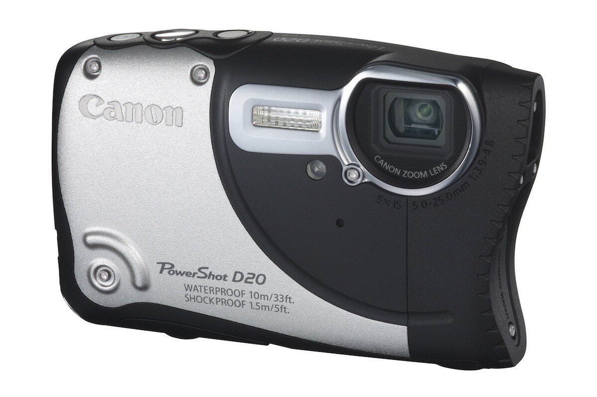
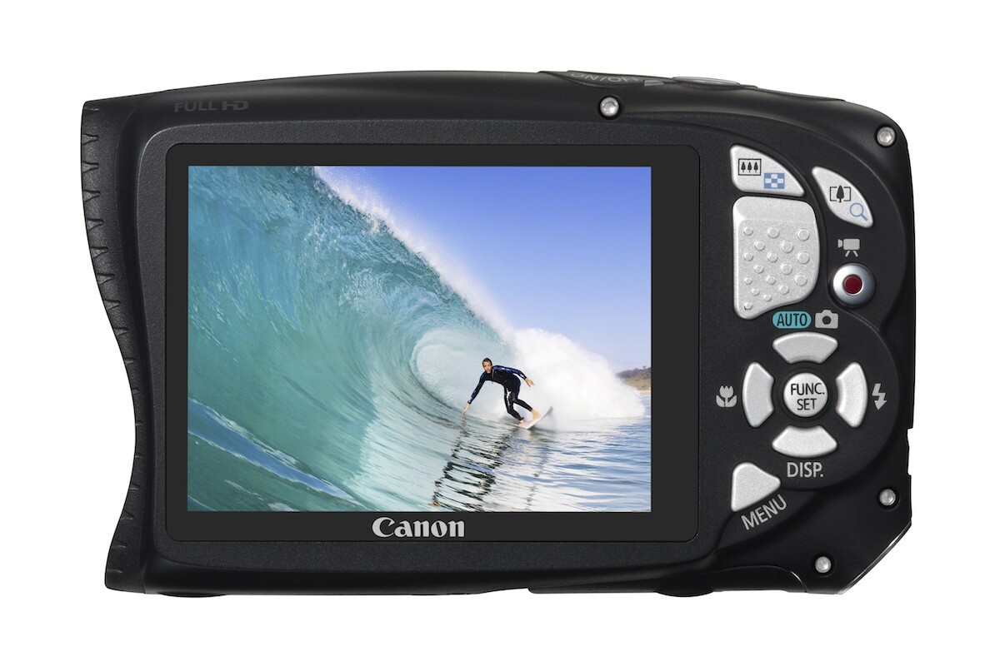
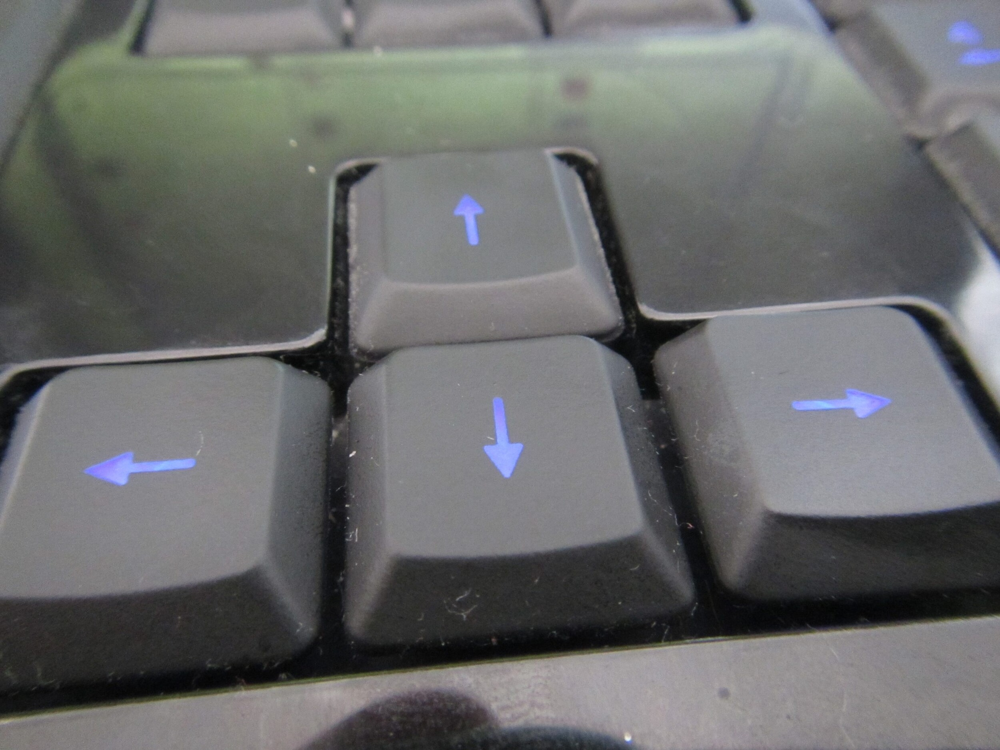
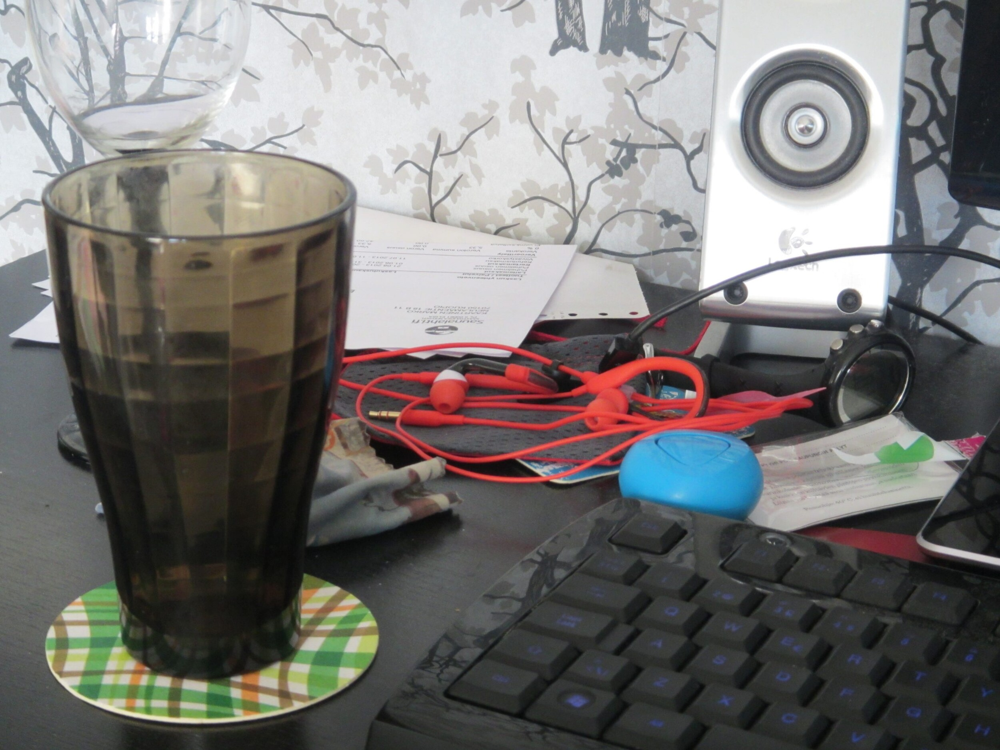
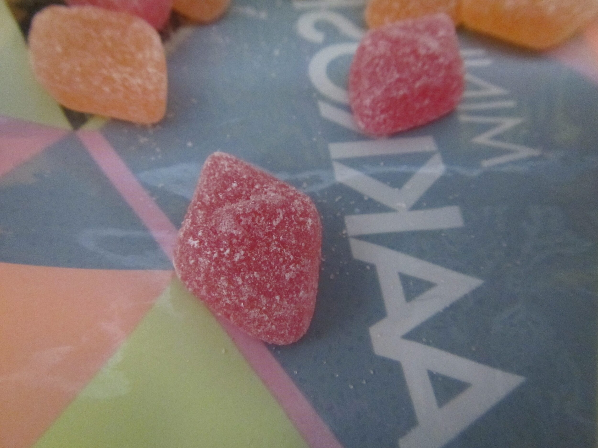

Sain postissa Canon PowerShot D20 kompaktikameran eli tuttavallisemmin pokkarin. Ihmettelen tässä artikkelissa hieman tämän kameran spesifikaatioita ja sitä mihin tämä nyt on lähdössä ja miksi. Artikkelissa, joka ilmestyy kuukauden sisään käsitellään tätä kameraa taas tarkemmin siitä miten se pärjäsi minun matkassani.

Tulen siis ottamaan tämän kameran mukaan Kreikan matkalleni ja siellä se pääseekin mereen uimaan, snorkkeli onkin sitä varten hankittu.

## D20 tekniset tiedot

Ensimmäisenä on mainittava se, että tämä kamera on rakennettu kestämään hieman rankempaakin käyttöä. Tämä on nimittäin vesi- ja pölytiivis, iskun- ja jäätymisenkestävä pokkari. Tiedot lupaavat jopa 10 metriin asti vedenkestävyyttä eli ajattelin kopata tämän mereen mukaan ja katsoa millaisia kuvia sieltä tulee. Kestää pudotuksen 1.5 metristä ja pitäisi toimia hyvin -10 asteessa – tätä en tosin tiedä miten tämä sitten käytännössä sillä kamerathan toimii pakkasessa, mutta hidastuvat. Sekä tässä vaikuttaisi olevan kunnollinen GPS sillä asetuksissa oli GPS merkkauksen valintoja.

D20 pokkarissa on 12,1 megapikselin HS System -järjestelmä, 3 tuuman näyttö, 28 mm:n objektiivi, 5x optinen zoom, älykäs kuvanvakain ja se kykenee kuvaamaan FullHD laatuista videotakin. Erikseen täytyy mainita vielä se, että tällä pitäisi saada selkeitä lähikuvia myös vedenpinnan alapuolella.

## Ensikosketus

Itselleni testikappaleeksi sattui hopean värinen D20, mutta tätä on myös saatavana keltaisena ja sinisenä. Paketissahan on perinteisesti kamera, akku, laturi, ohjeläpyskä ja cd-levy – mitään eriskummallista sieltä ei itse kameran lisäksi ole.

Kamerassa ensimmäisenä pistää merkille sen rakenteen. Se on nimittäin rakennettu suhteellisen jämäkäksi ja eroaa aika paljon tuosta [S110](/2013/canon-powershot-s110-ensikosketus "Canon PowerShot S110 ensikosketus") pokkarista mikä minulla viimeksi oli lainassa. Akun luukusta huomaakin, että vedenpitävyyttä on ajateltu sillä se on jämäkkä ja sieltä löytyy tiivisteet, samaten usb yms. piuhojen luukku on jämäkkä ja tiivisteellä suojattu. Muutenkin kameran rakenne tuntuu kestävältä. Tietenkin ensimmäisenä epäilytti se, että uskallanko mennä mereen tämän kanssa ja tämä ajatus on takaraivossa vielä siihen asti kunnes oikeasti menen mereen sen kanssa.

Yleensä Canonin pokkareissa on ollut zoomaus siinä laukaisunapin lähellä semmoisella ”sormikytkimellä”, mutta tässä mallissa on ajateltu varmasti kestävyyttä joten ne on toteutettu napeilla – tämä onkin ihan hyvä ja toimiva ratkaisu. Hieman noottia antaisin kuitenkin tuon laukaisunapin tuntumasta sillä puoleen väliin kun painan ja se tarkentaa niin jokusen kerran on lipsahtanut suoraan laukaisuun ilman tarkennusta – tottumiskysymys varmaankin.

Kuten ylläolevista kuvista näkyykin niin kaikki painikkeet ovat oikealla puolen ja vasemmalla on lähinnä optiikka ja näyttö. Optiikkakin on suojattu lasin taakse joten tuo on hyvä pitää puhtaana, jotta kuvissa ei ole sormenjälkiä ja muita tahroja.

Lähden tämänkin kameran kanssa sille linjalle, että automatiikka saa hoitaa hommansa. Alla onkin pari testikuvaa ja näimä ovatkin siirretty suoraan kamerasta tänne ja mitään muokkauksia en ole tehnyt (kuvakokoa pienentänyt).





## Mitä on tulossa?

Kamera lähtee siis minulla reissuun mukaan ja pääasiallinen kiinnostus onkin vedenalaisessa kuvauksessa. Pokkari tulee olemaan myös kokonsa vuoksi helppo ottaa mukaan kun järkkäri on vain liian iso kannettavaksi.

Blogi oletettavasti hiljenee siis lomani ajaksi ja kirjoitus kamerasta tulee loman jälkeen, joten sitä kannattaa odottaa. Odottaessasi voit kuitenkin suunnistaa [matkablogini](http://auringonalla.fi) puolelle sillä sinne tulen julkaisemaan D20 kameralla otettuja kuvia. Voi olla, että tännekkin eksyy muutama kuva!

*Kiitokset jälleen Canonille kameran toimittamisesta!*
