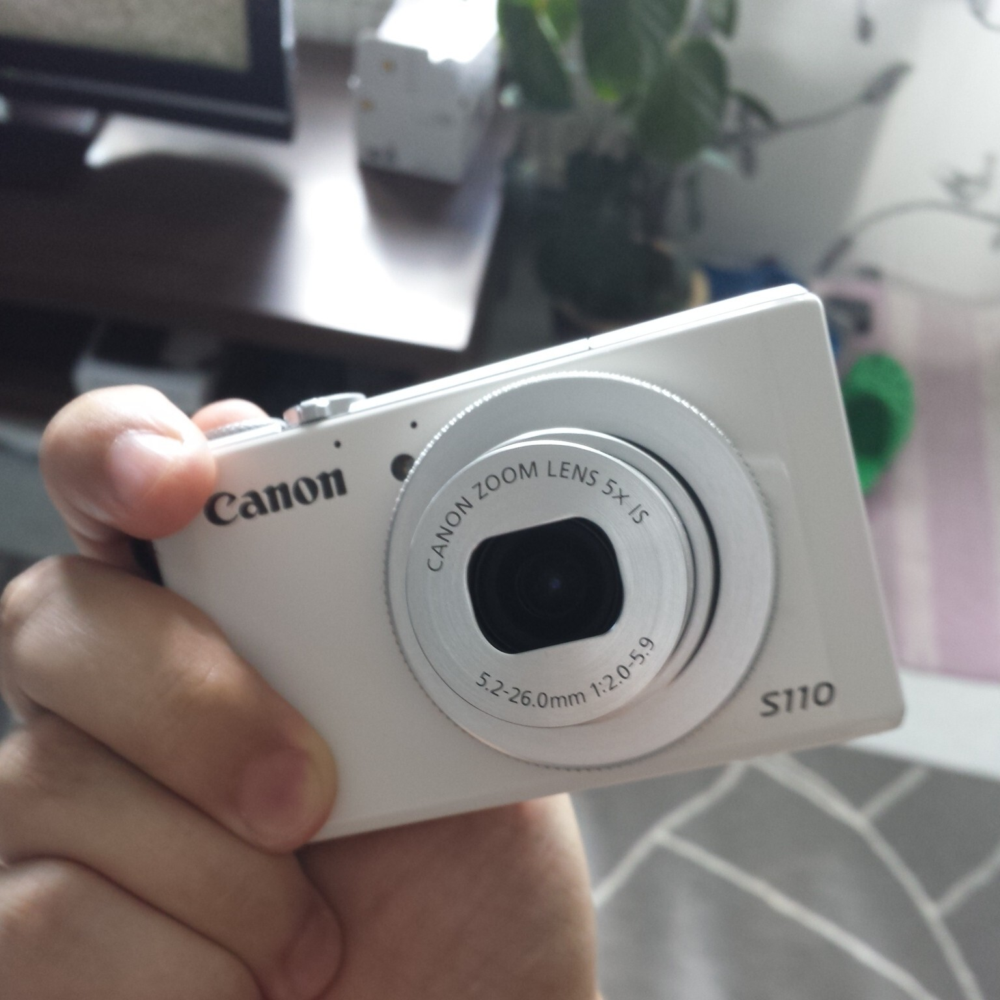
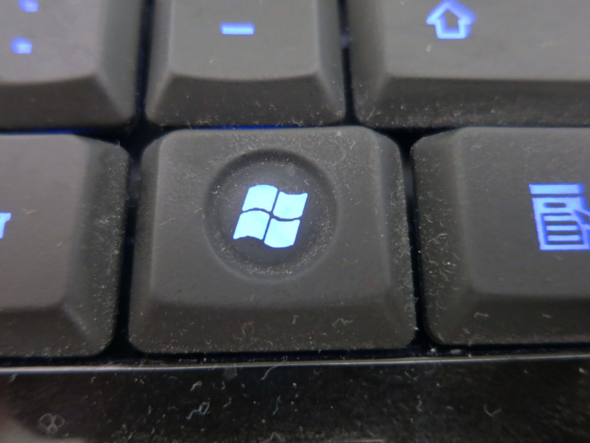
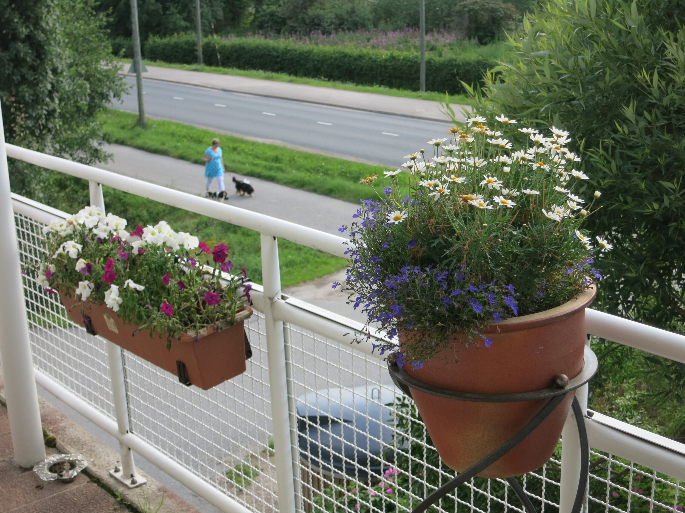

Olen saanut käsiini Canonin PowerShot S110 kompaktikameran eli tuttavallisemmin pokkarin. Tässä artikkelissa käväisen pikaisesti läpi kameran ominaisuuksia ihan paperilla ja hypistelen kameraa enemmän toisessa artikkelissa, jossa tulen tekemään tarkempaa tutustumista tähän kameraan ja pääasia onkin siinä miten tuommoinen kamera soveltuisi kaupunkilomalle. Tulen myös testaamaan sen verkko-ominaisuuksia hieman livejulkaisun kannaltakin.

## S110 tekniset tiedot

Itselleni laitteen spekseistä hyppää silmille se, että tässä on Wifi ja GPS. Nämä mahdollistavat sen, että saan kuviin gps tagin ja tätä kautta tiedän tarkalleen missä kuva on otettu (tietysti jonkun metrin heitto on mahdollinen). GPS tagaus pitääkin tehdä kännykän avustuksella, sillä ilmeisesti S110:ssa ei ihan täysiversitä tagausta ole (testaan tätä tarkemmin). Wifi taas mahdollistaa sen, että voin julkaista kuvan joko suoraan tai sitten liittää sen kännykkään, täppäriin tai jopa tulostaa sen suoraan. Tulen tuohon julkaisupuoleen perehtymään hieman lisää sillä kameran käyttö livejulkaisun kantilta kiinnostaa.

Itse olen pokkarin omistanut viimeksi jokunen vuosi sitten ja täytyy sanoa, että jo paperilta katsottaessa kehitystä on tapahtunut. S110 pokkarissa on nimittäin 12,1 megapikselin CMOS-kenno, HS System -järjestelmä ja DIGIC 5 -prosessori. Objektiivista vielä sen verran, että siinä on 24mm objektiivi 5x zoomilla ja valovoimaksi ilmoitetaan f2/0. Vertaan tietysti kokemuksiani entiseen peruspokkariin ja siinä ei ollut ollenkaan mahdollista RAW-kuvien otto. S110:ssa on objektiivin säätörengas, täydet käsisäädöt ja RAW-tallennus – eli jos tiedät mitä teet niin saat tästäkin kamerasta paljon enemmän irti.

Pokkareiden näytötkin on kehittyneet huimasti sillä tässä on kolmen tuuman kosketusnäyttö, en olekaan ennen koittanut kameraa missä olisi kosketusnäyttö. Mielenkiintoista kokeilla mitenkä tämä reagoi kosketukseen ja miten käytännöllinen tuommoinen onkaan.

S110 kykenee kuvaamaan myös videota ja sillä pystytkin kuvaamaan Full HD-laatuista videota enintään puolisen tuntia tai kun 4 gigatavua tulee täyteen. Vielä tarkemmat tiedot kamerasta ja sen ominaisuuksista löydät Canonin omilta [sivuilta](http://www.canon.fi/For_Home/Product_Finder/Cameras/Digital_Camera/PowerShot/PowerShot_S110/).

## Ensikosketus

Paketissa oli perinteisesti pikainen ohjeläpyskä usealla kielellä, jokunen dvd levy, kamera, akku, laturi ja usb-piuha. Kamera on väriltään valkoinen ja tätä on myös saatavana mustana. Kun kameran koppasin käteen niin tuttu pokkarimainen koko ei yllättänyt. Kamera vaikuttaa kuitenkin kädessä erittäin laadukkaalta ja kestävältä.

Muistikortti ja akku kiinni kameraan ja kamera päälle. Tuttu Canonin valikko kahlataan läpi ja katsellaan asetuksia, kaikki näyttää olevan kunnossa ja Wifiin päätetään tutustua myöhemmin. Tuo kosketusnäyttö tuntuu kiinnostavan eniten joten leikitään sillä hieman. Valikkoja on helppo käyttää myös koskettamalla ja liu’uttamalla sormea ruudulla. Koskettamalla näyttöä kuvatessa voit päättää mihin kamera alkaa kohdistamaan, näppärä asia tämäkin. Vaikuttaa ihan hyvältä peliltä ja näytön koko on oikein mainio.

Testailin kameraa tässä hieman ja käpistelin sitä. Automatiikka tuntuu hoitavan hommaansa mainiosti ja makrokuvaankin se siirtyi mallikkaasti ja sai ihan näppärän kuvan koppastua. Tuo näppäimistökuva onkin otettu S110 kameralla ja sitä ei ole mitenkään käsitelty (kuten ei näppistäkään putsattu). Kohdistin tuohon windows painikkeeseen ja aika hyvin näkyy pölyä tuossa kuvassa. Alla vielä yksi testikuva, jossa on kohdistettu kukkiin.

## Mitä on tulossa?

Kuten alussa jo hieman sanoinkin miten tulen tätä testaamaan niin tässä pieni kuvaus siitä mitä on tulossa.

Kamera lähtee minun mukaani kaupunkilomalle Tallinnaan ja tulen siinä katsomaan miten tuo kamera pärjää lomailijan mukana kaupungissa. Tallinnassa on hyvät Wifi verkot ja tulenkin siellä kokeilemaan kuvien julkaisua julkisten verkkojen kautta ja katson miten tuo GPS-toiminto loppuunsa toimii. Tavoitteenani on antaa kameran tehdä mahdollisimman paljon töitä sillä HS Systemin pitäisi osata mainosvideoiden mukaan toimia kaikenlaisissa tilanteissa – annan siis automatiikan hoitaa säätämisen. Toisena tavoitteenani olisi saada tuosta reissusta kiva kartta tehtyä jossa olisi sitten kuvat sijainnin mukaan. Tätä varten tulen varmaan tapani mukaan kirjoittelemaan muutaman rivin koodia!

Toinen näkökulma jota lähden tutkimaan on se, että miten tämä kamera voisi soveltua livejulkaisuun. Tällä tarkoitan sitä, että miten jonkun tapahtuman kuvat saisi välitettyä joko kännykän tai suoraan langattoman verkon yli verkkoon muiden nähtäviksi. Testaan siis miten tämä kamera soveltuisi livebloggaamiseen.

Mikäli teillä on jotain mielessä mitä haluaisit minun testaavan tällä kameralla niin kerro heti! Kamera on minulla vain sen tietyn aikaa ja sen jälkeen se lähtee takaisin Canonille!

Kiitos Canonille kameran toimittamisesta!
