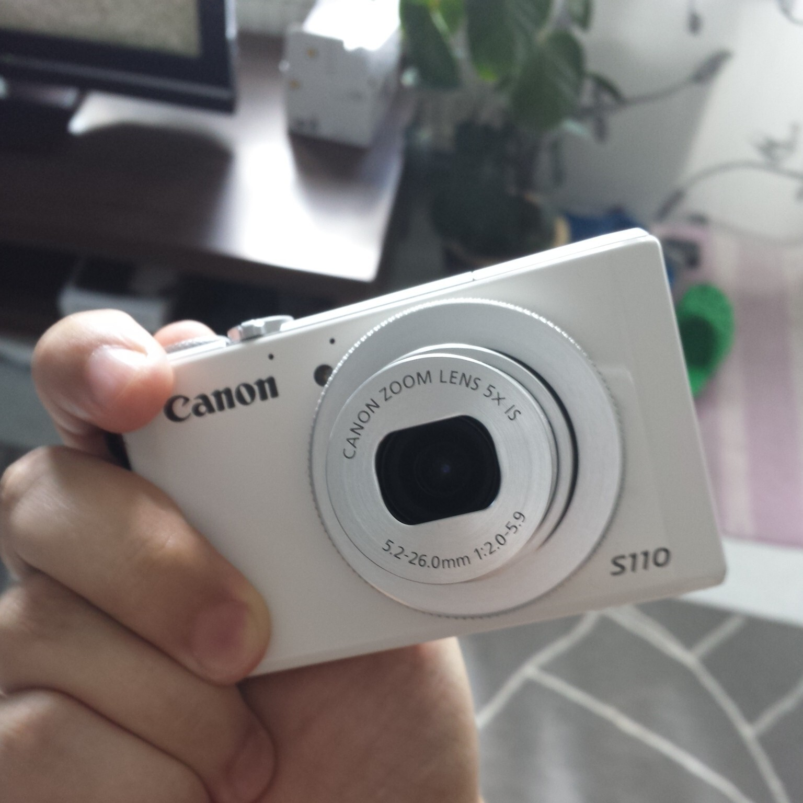
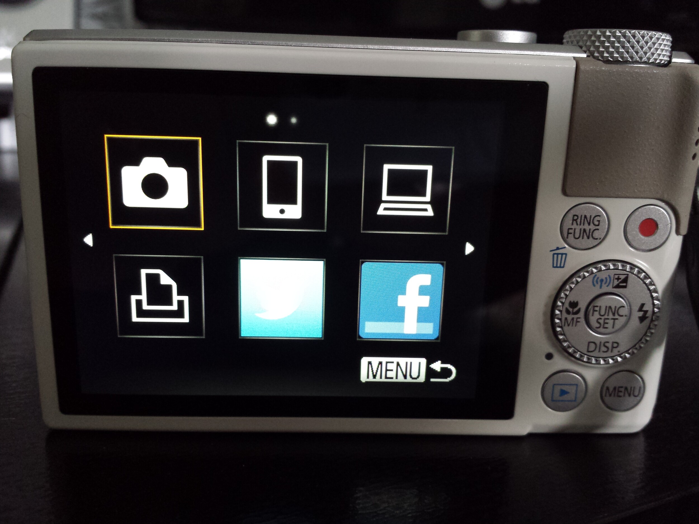

Kuten uhkasinkin aikaisemmassa [artikkelissa](/2013/canon-powershot-s110-ensikosketus "Canon PowerShot S110 ensikosketus") niin yhtenä näkökulmana on livejulkaisu. Tämän PowerShot S110 kameranhan sain vasta eilen käsiini ja sainkin tehtyä pieniä testauksia. Testirupeaman pääosana on kuitenkin Tallinnan reissu, jossa katsotaan miten Tallinnan langattomat verkot toimii. Tämä livejulkaisu testi onkin lähinnä eri tekniikoiden kokeilua sillä mitään tapahtumaa ei sattunut sopivasti kohdalle.

Livejulkaisulla tarkoitan tässä tapauksessa sitä, että kuvia julkaistaan lähes reaaliaikaisesti tapahtumasta, tuotteen julkistuksesta, reissusta tai muusta vastaavasta. Voidaan kuvitella vaikkapa seuraavanlainen skenaario:

> *Olen menossa tuotteen X julkistukseen ja otan mukaan kameran ja täppärin. Täppärillä julkaisen tekstipohjaisia twiittejä ja kameralla julkaisen kuvia. Twiitit ja kuvat näytetään sitten blogissa olevalla sivulla johon sisältö päivitetään automaattisesti. Minun tarvitsee siis tuottaa twiittejä tietyllä hashtagille, esimerkiksi \#mknet.*

Twiittien kirjoittaminen iPadillä ei ole kummoinen homma ja siihen en paneudukkaan sen enempää. S110 pitää ensin konfiguroida lähettämään twiittejä ja samassa konfiguroinnissa voidaan määrittää automaattinen teksti johon sisältyy \#mknet hashtagi. Alla oleva twiitti ja kuva onkin tullut suoraan S110 kamerasta.

> Näppäsin kuvan ja jaan sen teille [\#livekuva](https://twitter.com/hashtag/livekuva?src=hash&ref_src=twsrc%5Etfw) [\#mknet](https://twitter.com/hashtag/mknet?src=hash&ref_src=twsrc%5Etfw) <http://t.co/rRiX9L1Cdi>
>
> — Marko (@MarkoK) [July 15, 2013](https://twitter.com/MarkoK/status/356795043752845315?ref_src=twsrc%5Etfw)

Ainut vaatimus mikä S110 kameralla on julkaisemiseen on langaton verkko. Sen saat tehtyä omalla kännykällä tai jos tuuri käy niin tapahtumapaikalla on langaton verkko johon pääset käsiksi kameralla. Ei siis ole kovin kummoiset vaatimukset.

Oletetaan vielä, että saisin kaverin mukaan joka hoitaisi twiittien kirjoittamisen iPadillä ja tällöin olisi kuvien ottaminen ja lähettäminen minun vastuullani. Kuvien lähetyshän toimisi seuraavalla tavalla:

1.  Ota kuva
2.  Mene kuvien esikatseluun
3.  Valitse minne siirretään
4.  Valitse verkko
5.  Valitse kuva
6.  Siirrä

Kuva on tuon jälkeen verkossa muiden töllisteltävänä. Tämänlainen työnkulku sopisi myös jonkin tapahtuman tai vaikkapa reissun taltiointiin. Videossa työnkulkuhan on samanlainen, paitsi palveluna toimii Twitter. Testasin lyhyellä videopätkällä tätäkin ominaisuutta ja alla on tulos. Video on lähtenyt suoraan kamerasta Youtubeen Wifi yhteyttä käyttäen. Noin minuutinmittainen FullHD video vei noin 230 megatavua.



Canon PowerShot S110 soveltuu suhteellisen hyvin tämänkaltaiseen toimintaan. Pitää kuitenkin ottaa huomioon se, että kyseessä on pokkari ja tällöin ihan takariviin ei kannata lähteä sillä vaikka S110 zoom toimii oikein mainiosti ja HS System hoitaa hommansa hyvin niin silti kannattaa olla hyvällä paikalla!

Tietysti pokkarin etuna on sitten luonnollisesti koko ja se tukee erittäin hyvin livejulkaisun kaltaista toimintaa ja sitä, että sinulla ei tarvitse olla kauheasti tavaraa mukana – vain täppäri tai puhelin ja kamera.

Olin ehkä hieman yllättynyt miten mukavasti Wifi yhteys loppuunsa toimi. Yhdistit vain langattomaan verkkoon ja lähetit kuvan/videon palveluun minne halusit sen lähettää. Kotiverkkoni on suhteellisen nopea joten videon siirrossakaan ei kohtuuttoman kauan mennyt. Pieni viive tosin oli sen näkymisessä Youtubeen sillä se ilmeisesti lähettää sen ensin Canonin iMAGE GATEWAY palveluun ja siitä sitten Youtubeen.

Mikäli tekisin yleensä livejulkaisuja tapahtumista tai tuotejulkistuksista niin Canon PowerShot S110 olisi erittäin hyvä kamera siihen tarkoitukseen.

*Jäikö jokin asia mietityttämään, unohdinko jotain vai onko sinulla jokin muu kommentti? Kommentoi rohkeasti alla olevalla kommenttilomakkeella!*
