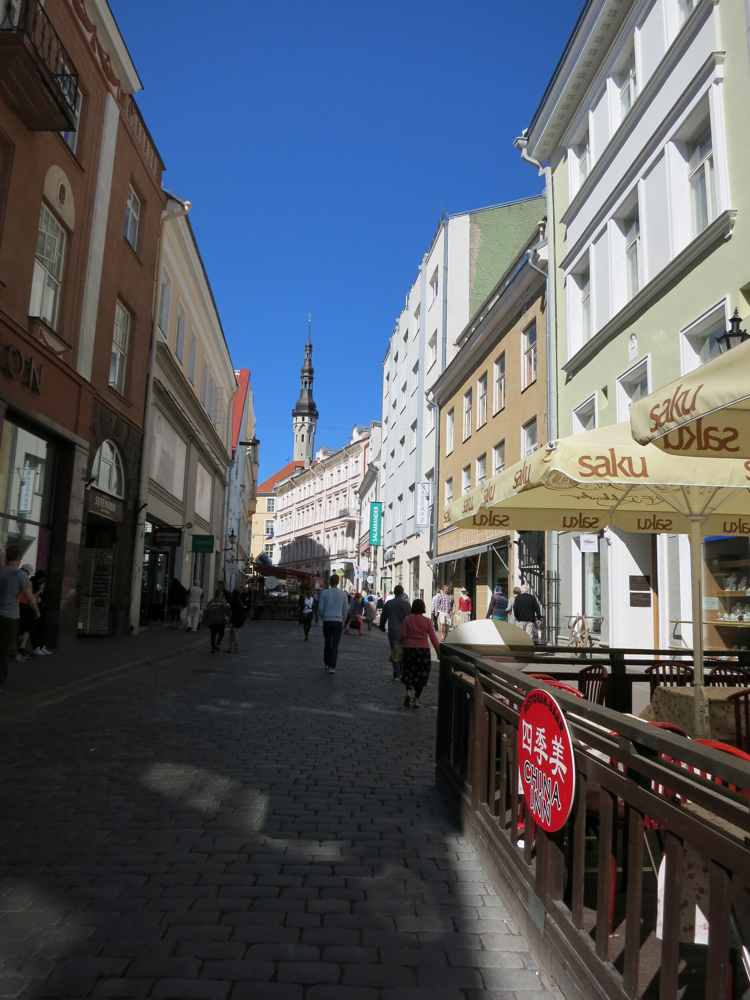
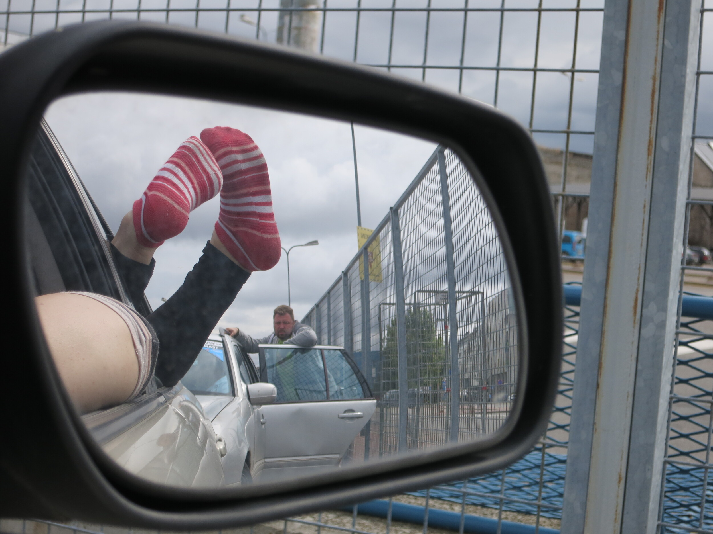

Kävin reilu viikko sitten Tallinnassa viettämässä pitkää viikonloppua ja kun matkassa oli mukana henkilö jolle Tallinna oli lähes kokonaan tuntematon kokemus niin tuli kierrettyä vanhaa kaupunkia ja lähiympäristöä suhteellisen kivasti. PowerShot S110 oli matkassa mukana ja se valikoitui matkaan mukaan sen GPS ja WiFi ominaisuuksien takia. Päätin myös jo etukäteen, että annan automatiikan hoitaa hommansa ja itse kuvaan vain kuvia – kuten normaali turisti tekisi.

Kuvanlaadusta ei ole oikeastaan mitään valittamista ja kuten oikealla olevasta kuvasta näkyy niin se näyttää oikein mainiolle. Kuvalle en ole tehnyt yhtään mitään vaan se on tullut suoraan kamerasta. Tietty blogia varten hieman pienensin tuota kuvaa, mutta alkuperäisen pitäisi olla linkin takana. Automatiikka hoiti hommansa paremmin kuin hyvin ja jos halusi sen tarkentavan johonkin tiettyyn niin tökkäisi kosketusnäyttöä ja sehän tarkensi sen siihen. Unohdin kosketusnäytön olemassa olon aluksi ja sitten jossain välissä muistin, että voin tökkiä näyttöäkin.

GPS oli pienimuotoinen pettymys sillä S110 GPS ei ole oikeastaan GPS vaan sinulla pitää olla kännykässä sovellus päällä joka tallentaa GPS logia ja sitten kun kamera ja puhelin on samassa verkossa niin voit tunkea sijainnit kuviin. Tämä toimi kyllä oikein hyvin ja Lightroom kun tajusi kuvien sisältävän GPS dataa niin se osasi näyttää ne kartalla. Tulen tekemään lähiaikoina kuvakartan näistä ja se tullaan julkaisemaan omana projektinaan tänne blogiin.

WiFi toimi kuten sen pitikin. Minä konffin ennen matkaa asetukset kuntoon ja matkalla piti vain yhdistää sopivaan langattomaan verkkoon ja kuvan sait verkkoon siitä. Ainut huono puoli tuossa WiFi:ssä oli se, että Tallinnassa moni langaton verkko vaati ylimääräisen vaiheen jota kamera ei osannut tehdä. Sinun piti nimittäin puhelimessakin avata selain ja painaa ”kirjaudu” -painiketta erikseen ja tästä se ohjasi sinut vielä joko WiFiä ylläpitävän ravintolan/paikan sivuille tai Facebookkiin. Moni kuva jäi siis siirtämättä sillä WiFi verkkoon en päässyt kun olisin halunnut.

PowerShot S110 on pienen kokonsa ansiosta mitä loistavin kamera matkalle mukaan. Itsellä tuo mahtui nimittäin taskuun ja siellä se matkustikin osan ajasta – omassa pienessä pussukassaan tietysti. Mikäli kamera ei ollut minun taskussa niin oli se avopuolisoni käsilaukussa. Kamera on kokonsa ansiosta mukana matkan joka vaiheessa ja näin saat ikuistettua hetket silloin kun ne tulee eteen – kuten vaikkapa autosta ulos sojottavat jalat ;) (ja niitä tuijottavan kanssamatkustajan)

Videon laatukin on tässä kamerassa mielestäni hyvä sillä sillä saat kuvattua 1080p laatuista videota ja halutessasi langattoman verkon yli suoraan YouTubeen. Itse kuvasin pari pientä pätkää tuolla reissulla ja niitä en käsitellyt itse mitenkään. Siirsin ne koneeltani suoraan YouTubeen äskettäin ja niissä kannattaa laittaa 1080p laatu YouTubesta päälle!





*Kiitokset vielä Canonille kameran toimittamisesta!*
