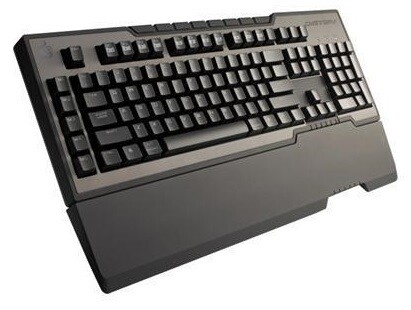
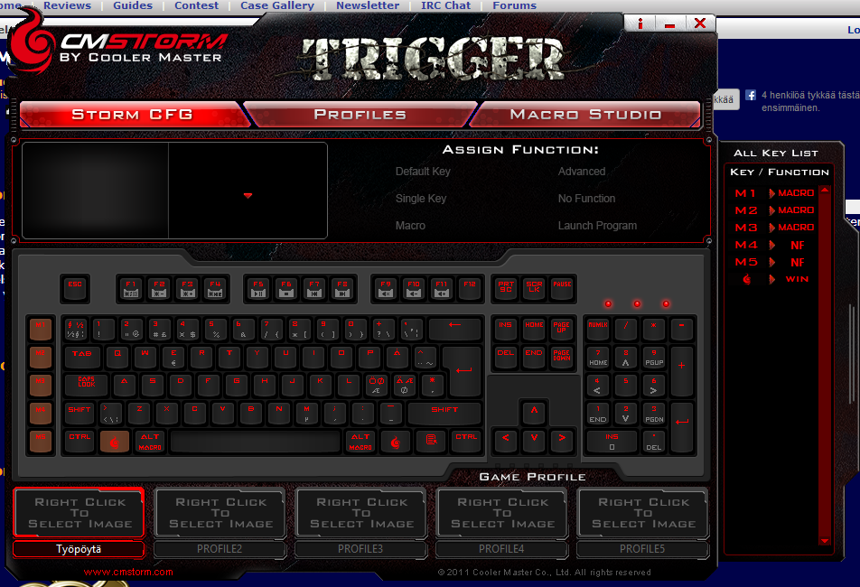
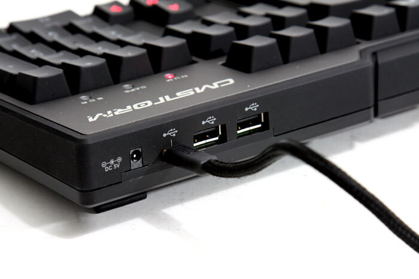
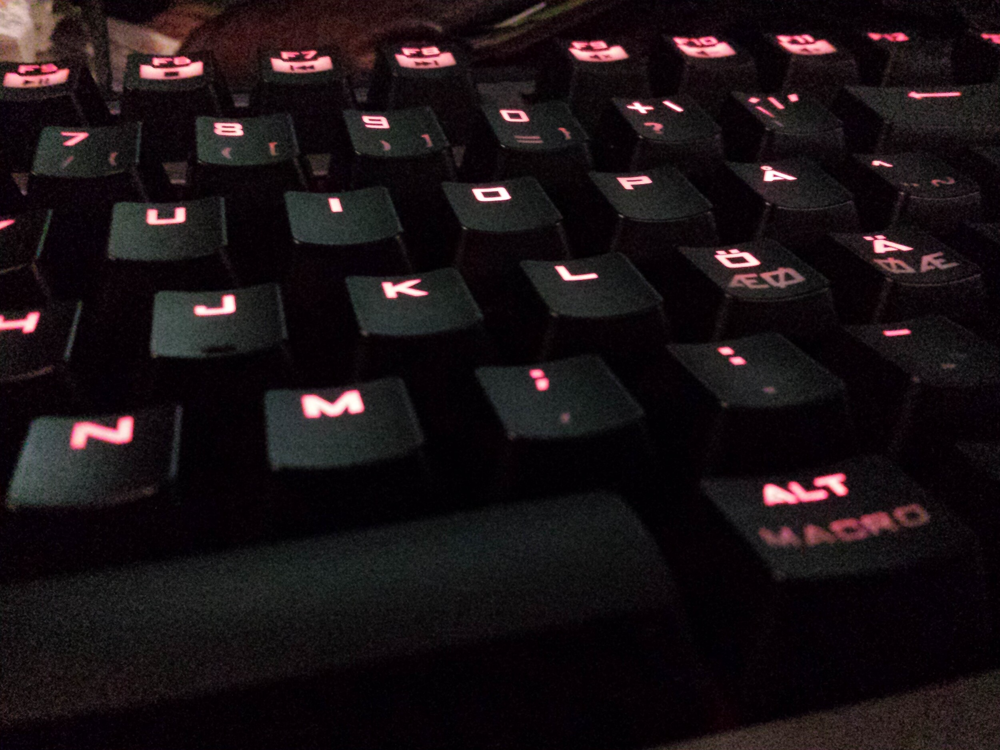

[Digiexpoilla](/2013/digiexpoilemassa-vuonna-2013 "Digiexpoilemassa vuonna 2013") käydessäni löysin itselleni hieman tuliaisia ja samanlainen tuliainen lähti mukaan myös veljelleni. Kyseessä on CM Storm Trigger mekaaninen näppäimistö. Olenkin halunnut mekaanista näppäimistöä ja kauan ja nyt kun tämän sai hyvällä hintaa Jimm’sin Digiexpo tarjouksena niin pitihän se kopata.

Mekaanisissa näppäimistöissähän on omat kytkimet joka näppäimen alla. Tässä mallissa on Cherry MX Black-kytkimet, jotka sattuvat olemaan Cherry MX kytkimien raskaimmat. Nyt hetken kirjoittaneena ja käyttäneenä olisin ehkä halunnut hieman kevyemmät brown tai blue kytkimet. Näissä on tosin aika kiva vaste minulle ja kiva ”klikse” eli ääni. Olen siis enemmän kuin tyytyväinen 60 euron sijoitukseeni.

Itse näppäimistössä on 64 bitin muisti profiilien tallentamiseen ja CM Stormin ohjelmalla saatkin tehtyä näppärästi eri profiileja ja saat vaihdettua niitä näppäimistön kautta. 1000Hz polling / 1ms vasteaika takaa myös nopean reagoinnin tietokoneelle päin. Tästähän löytyy lisäksi viisi makropainiketa, jotka sekottavat vielä minua sillä sormet vaeltaa M5 näppäimelle kun se pitäisi mennä controllin päälle – tähänkin tottuu tosin ja olenkin päässyt jo sinuiksi noidenkin kanssa. Ainut ongelma on se, että en ole vielä keksinyt fiksua käyttöä makroille. Näppäimistössä on myös mediapainikkeita kuten play/pause, stop, next, back, mute, vol+ ja vol-.

Kuten ensimmäisestä kuvasta näkee niin näppäimistössä on myös rannetuki ja tämä on irroitettava. Näppäimistö tulee kiinni tietokoneeseen USB piuhalla ja taakse se kiinnittyy Mini USB liittimellä. Takana on myös pari kappaletta USB 2.0 portteja. Mukana ei tule kuitenkaan 5V virtalähdettä, jolla saisit USB portteihin lisävirtaa sekä saisit vielä pari valojen kirkkausastetta lisää.

Niin tässä näppäimistössä on valot. Ovatpa ne vielä punaiset ja varsin mukavan näköiset. Kuten sanoin niin pari kirkkausastetta saa lisää jos pistää 5V virtalähteen ja normaalisti on siis kolme astetta. Valot saa myös pois päältä kokonaan sekä niin, että päällä on nuolinapit, makronapit sekä WSAD napit. Harmillisesti et voi omia valoprofiileja tehdä eli et voi säätää mitkä valot on milloinkin päällä.

Olen kaiken kaikkiaan varsin tyytyväinen tähän näppäimistöön ja voin varauksetta suositella tätä muillekkin.

### Plussat

- Näppäinten ääni
- Näppäimistön valot
- Jykevä rakenne
- USB 2.0 portit takana

### Miinukset

- Valoprofiilien puute
- Virtalähteen puute paketissa
