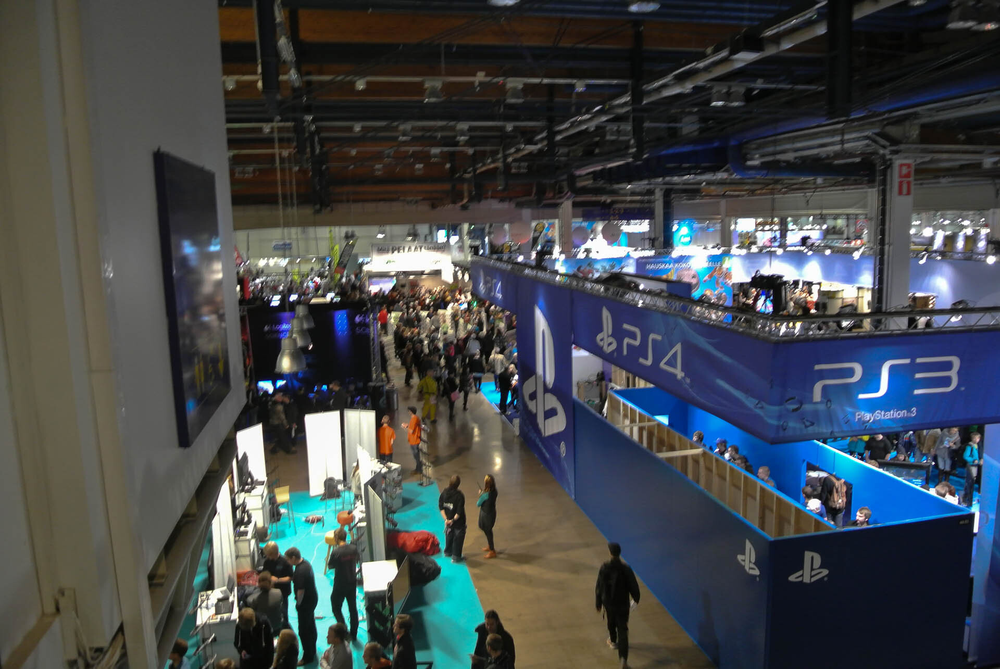

Tänä vuonna oli taas VR:llä 10 euron lauantai kampanja ja tuolla hinnalla kannatti jo lähteä Helsingin Messukeskuksen suuntaan Digiexpoille. Samaan aikaa siellä oli myös Hifi-, Ski- ja Boardexpot – samalla lipetillä pääsi siis neljään eri messuun sisälle. Tällä kertaa sainkin liput DNA:lta, joten iso kiitos heille vielä siitä!

Voitte muuten tutkailla Digiexpojen twiittivirtaani tuosta aiemmasta [postauksestani](/2013/digiexpo-2013). Siinä on jokunen kuva Instagrammistani ja tähän artikkeliin tuleekin kasa Nikon 1 mikrojärkkärillä otettuja kuvia.

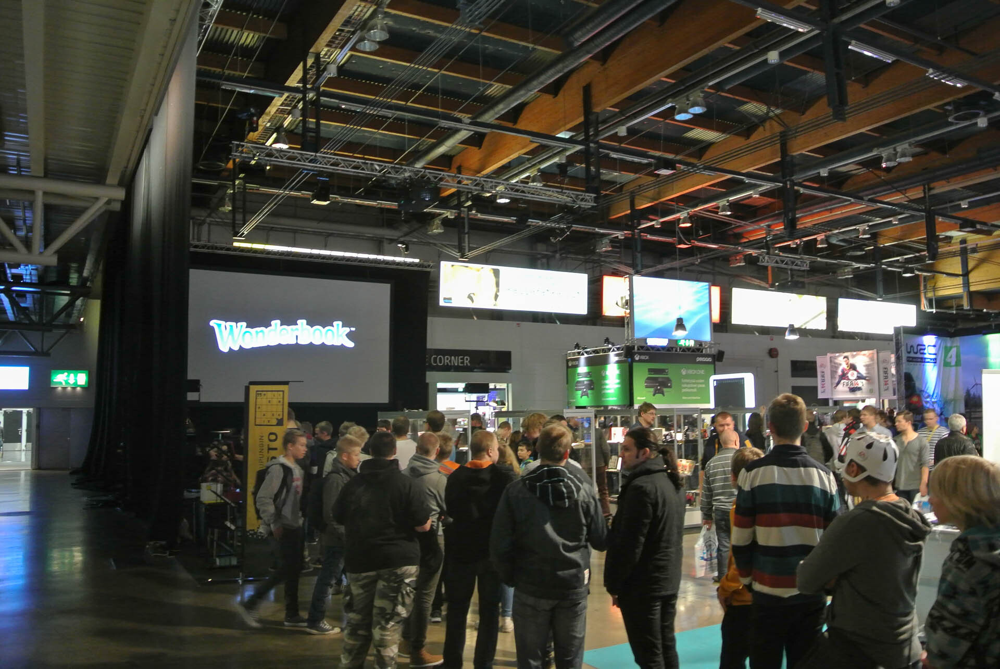

Aloitetaan Xbox Onesta ja PS4:stä sekä Oculus Riftistä. Näitä en ikävä kyllä päässyt kokeilemaan – tai olisin päässyt jos olisin jonottanut puoli tuntia per laite (oma arvio) ja siinäpä sitä aikaa sitten olisi mennytkin. Väkeä oli siis lauantaina runsaasti ja 12 jälkeen alkoikin jo tulla lämmin tuolla.

Toisaalta en ole itse vielä kumpaakaan laitetta hankkimassa niin kerkeän lukea vuoden alussa kokemuksia ja nähdä videoita ko. laitteista ihan tarpeeksi.

Oculus Rift olisi tosin ollut mielenkiintoinen vekotin, mutta jäipä sekin tällä kertaa kokeilematta. Ehkä seuraavassa tapahtumassa sitten.

Digiexpojen puolella oli lasikaapeissa esillä myös hieman vanhempaa tekniikkaa. Näytteillä oli nimittäin Commodorea, Amigaa, Game Boytä ja Nintendoa – eli näitä hieman vanhemman sukupolven laitteita. Löytyipä sieltä myös kasa korppuja joilla asenneltiin aikoinaan Civilization.


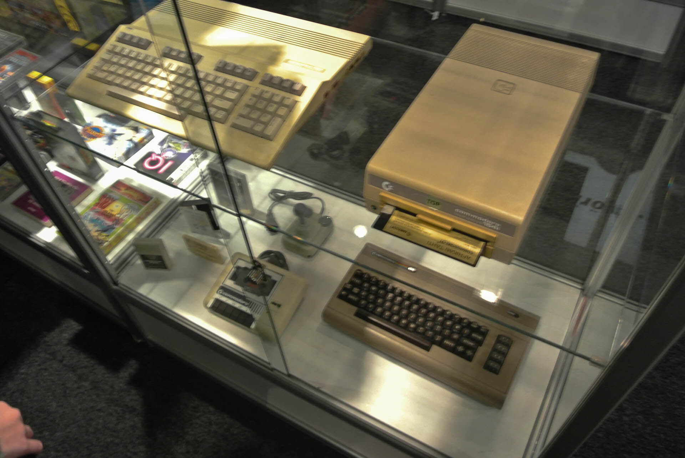
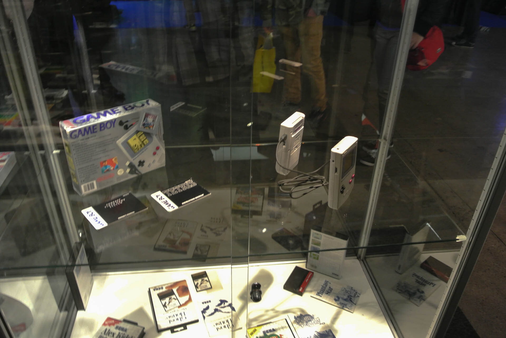
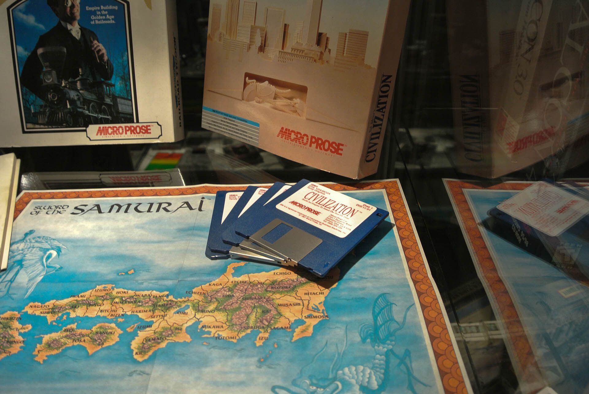
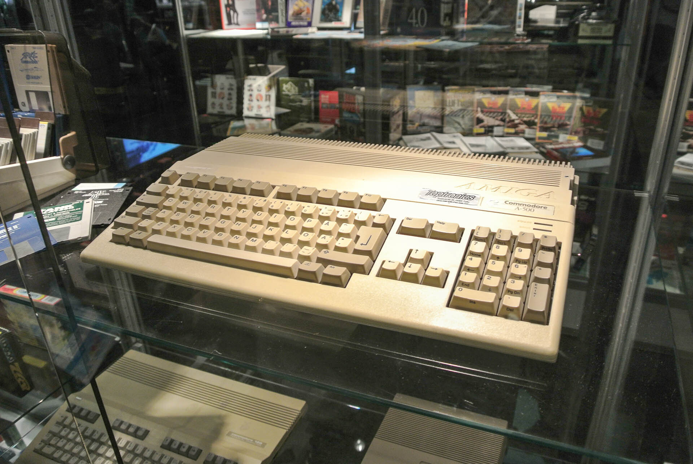
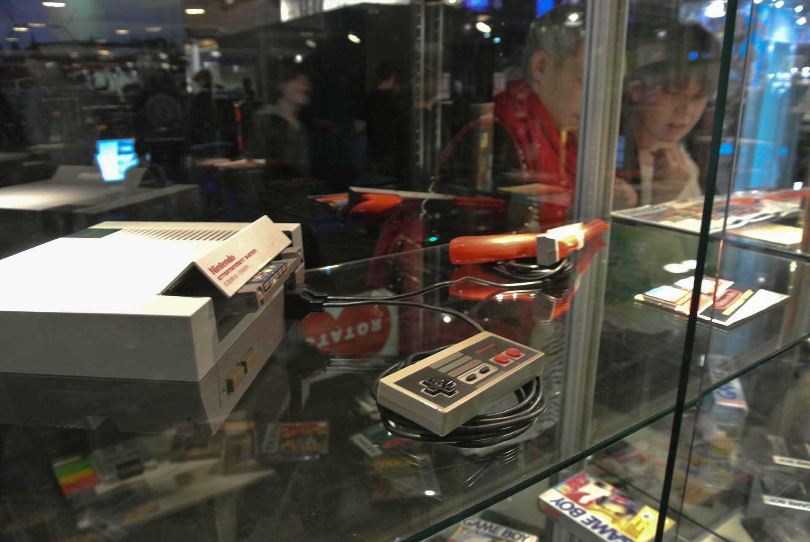


Näytteillä oli tietysti myös erilaisia (sekä eri hintaisia) televisioita, kaiuttimia, kuulokkeita sekä muuta sälää. Hifiexpojen puolella oli varsinkin suhteellisen mielenkiintoisia (sekä hintaisia) laitteita. Niihin ei ilman isompaa kukkaroa pääsekään tutustumaan kotioloissa.


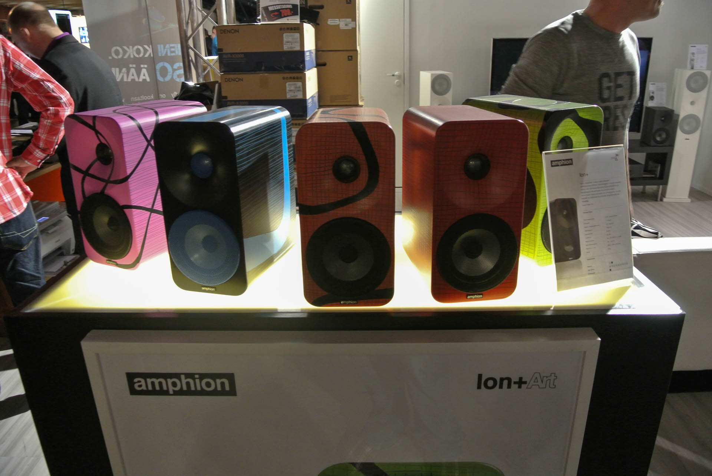
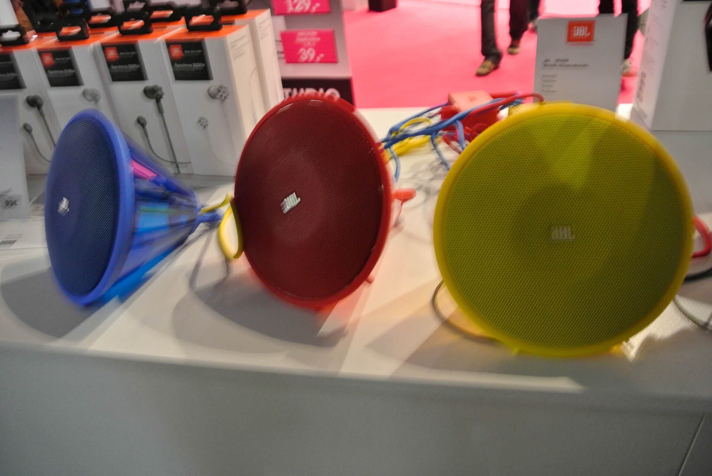
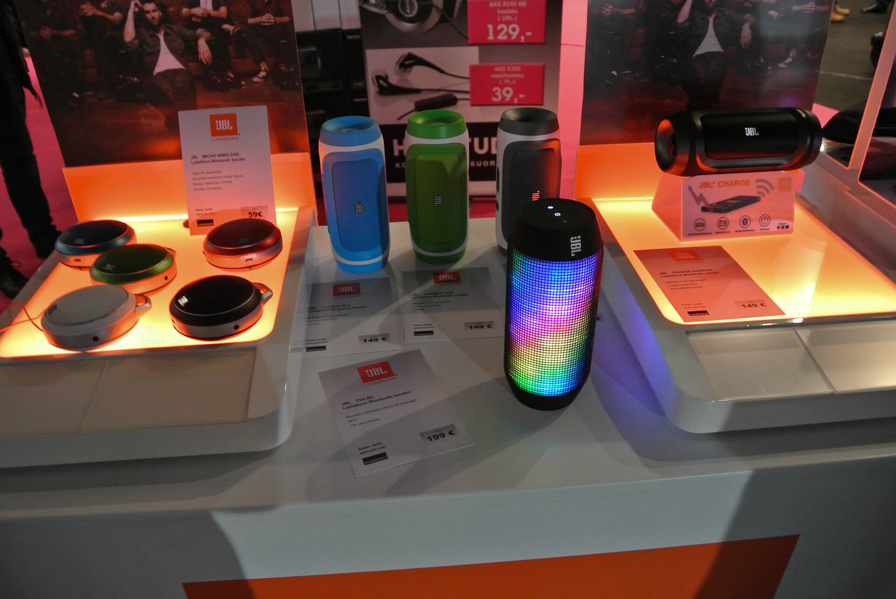
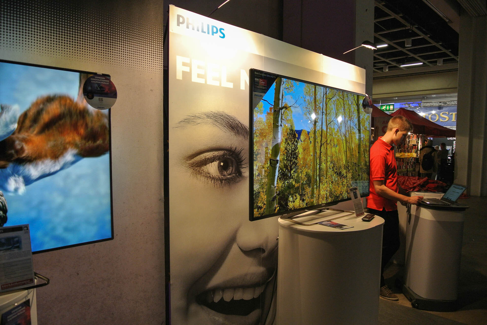


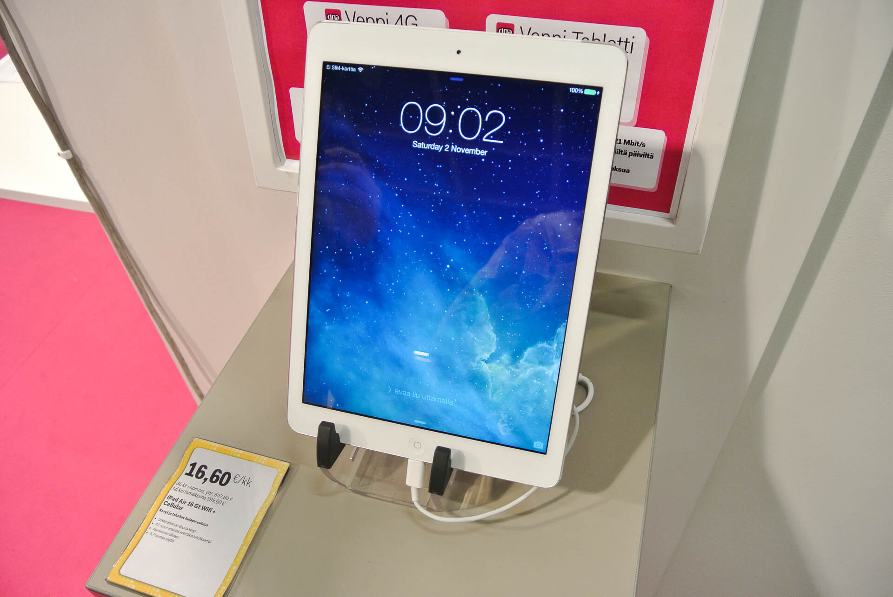

Itseäni kiinnosti ehkä eniten uusi iPad Air, joka saattaa tähän talouteen jossain välissä ilmestyä. DNA:n osastolla olikin [iPad Air](http://tappari.fi/apple/apple-julkaisi-ipad-minin-retina-naytolla-ja-ipad-airin) kokeiltavana ja olihan se suhteellisen mielekäs tuote. Sen keveyttä ei ihan päässyt kokeilemaan ”turvamollukan” takia sillä se toi oman painonsa laitteeseen – estipähän tuo mollukka sen katoamisen messuosastolta.

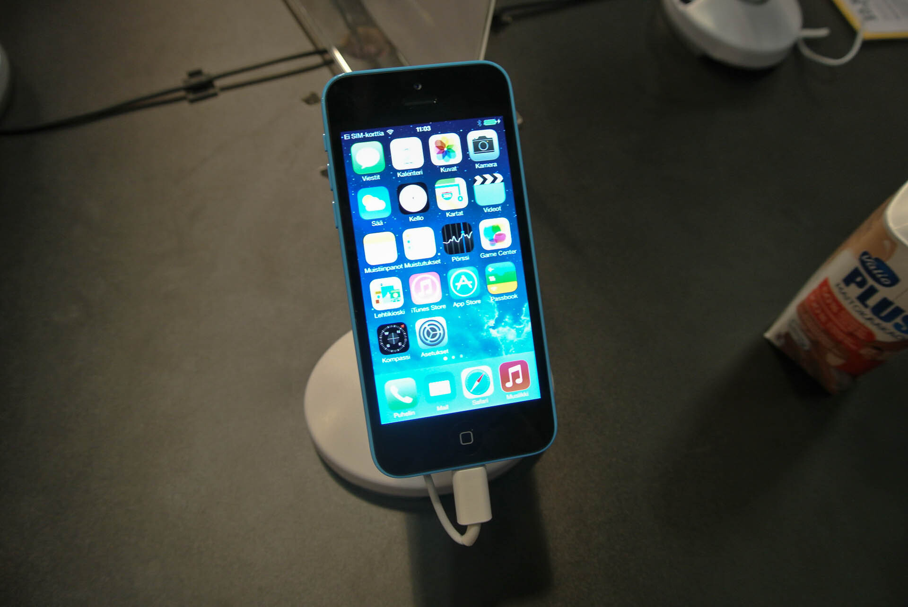

DNA:lla oli myös uusia iPhoneja kokeiltavana ja itseä kiinnosti 5C hieman enemmän kuin 5S – lähinnä värien takia. Kumpaakaan en ole nyt hankkimassa joten tarkempi tutustuminen jäi. Ensimmäinen mielikuva kuitenkin oli se, että aika kaponen laite kyseessä sillä leveys on pysynyt suhteellisen samana kuin iPhone 4:ssä, mutta pituutta on tullut lisää. Itsehän valkkaisin ehdottomasti sinisen 5C luurin, jos siis tämmöisen ottaisin. 5S olisi ehkä kuitenkin valinta, jos olisin iPhone hommaamassa.

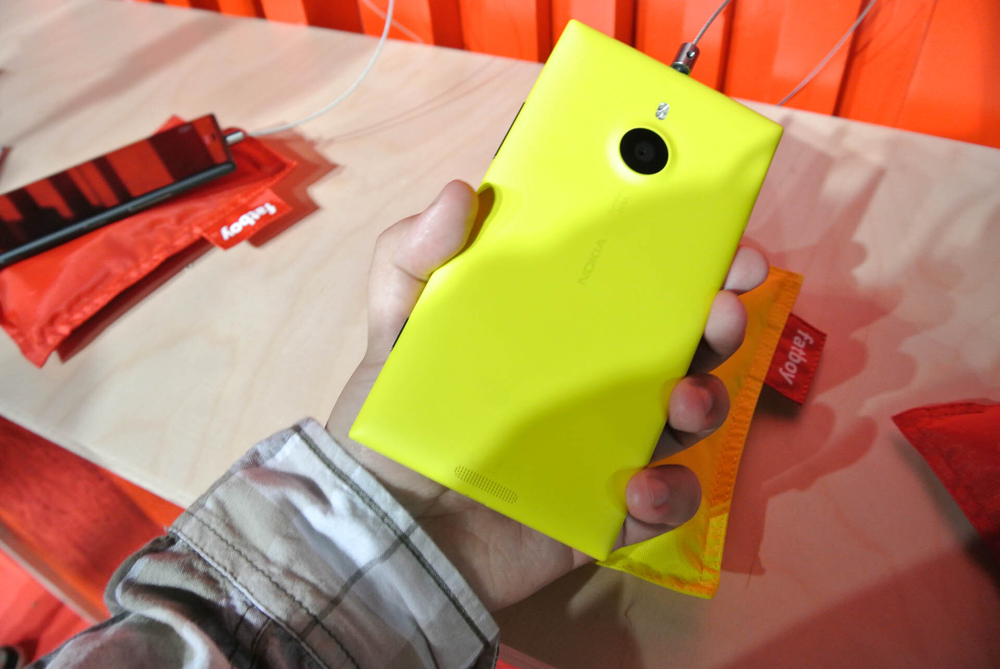

Messuilla oli myös Nokialta (köh Microsoftilta köh) näytteillä uusia laitteita. Uusi Nokia Lumia 1520 puhletti, joka on kokoluokassa ”helkutin iso”. Itse en enää voisi tuon kokoista puhelinta ottaa käyttöön, on se vaan liian iso – siinä kun on 6 tuuman kokoinen näyttö.

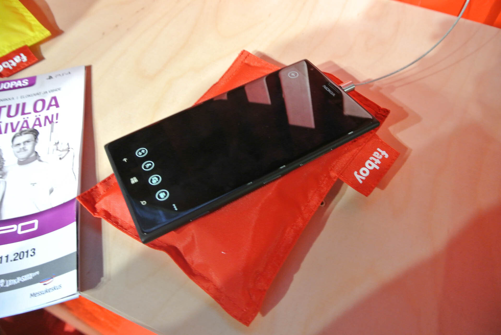

En siis usko tuon mallin kovin kauheta menestystä nauttivan, vaikka spekseiltään tuo ihan passeli onkin. Koko ajaa kyllä minut kauas pois tuosta puhelimesta. Eihän tuo taskuunkaan mahdu kunnolla.

Sen myönnän, että tuo fatboy tyynyt on kivoja ja haluaisin omaan Galaxy S4 puhelimeen langattoman latausmahdollisuuden ja tuommoisen tyynyn. Kyllä kelpaisi siinä puhelinta lepuuttaa.

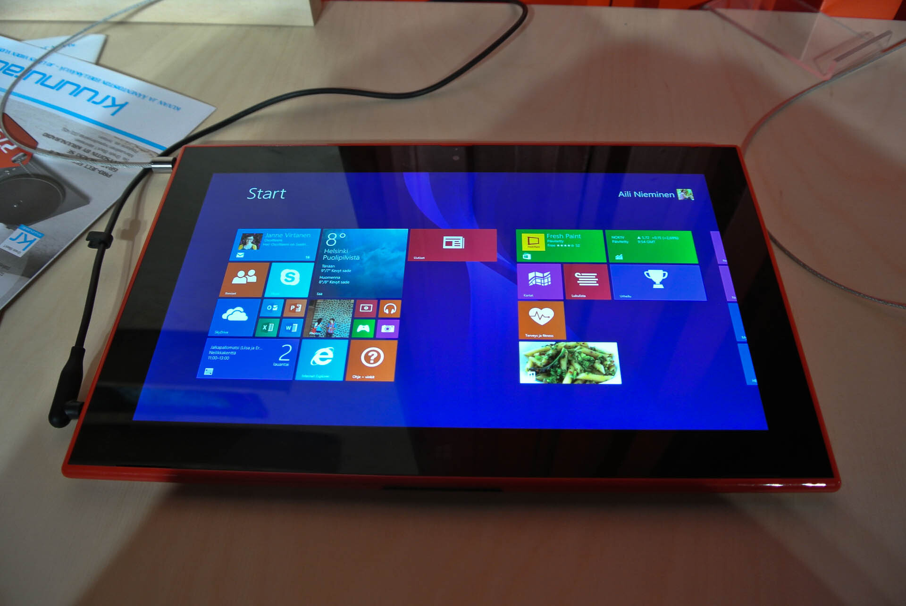

Toinen uutuus Nokialta oli [Lumia 2520](http://tappari.fi/nokia/nokia-julkaisi-lumia-2520-tapparin) täppäri, jota pääsinkin kokeilemaan. Tuo tuntui hieman muoviselle takaa. Tosin pikaisella kokeilulla tuo Windows 8.1 RT vaikutti ihan passelille käyttikselle, mutta olisi voinut panostaa Wordeihin yms. sovelluksiin niin ettei ne käynnistyisi työpöytämoodissa.

Käsittääkseni tämä on tarkoitettu käytettäväksi vaakatasossa, en muuten kokeillut käyttää tuota pystyssä – osaisikohan joku sanoa tähän jotain kommenttia?

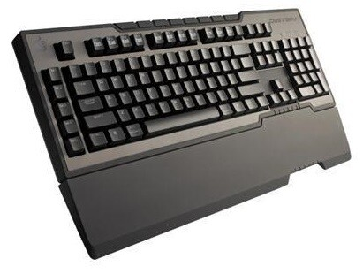

Tuliaisena Digiexpoilta tuli kopattua Jimmsiltä pari kappaletta CM Storm Trigger mekaanisia näppiksiä. Toinen itselle ja toinen veljelle. Olen tässä kohta viikon käyttänyt tätä ja tämä onkin ollut ihan hyvä vekotin. Näppäimistön ääni on varsin mainio ja pieni ”melu” näppäimiä painettaessa onkin todella mielekästä – omasta mielestäni. Vaste tässä näppäimistössä on hyvä ja itse olen tykännyt tästä todella paljon.

Ainut ongelma on ollut se, että en ole vielä keksinyt järkevää käyttöä makronäppäimille sillä en noita MMO pelejä pelailekaan. Näille voi ehdotella jotain käyttötapoja!

Harmikseni tänä vuonna Canon ei messuilla ollut, heidän kameroitaan olisi ollut mukava päästä käpistelemään tarkemmin.  Onneksi oli muita kameroita käpisteltävänä kuten Nikonia ja Sonyä. Sonyn DSC QX -sarjasta onkin ollut juttua [podcastin](/2013/005-lumia-1020-sony-dsc-qx-sarja-chromecast) puolella.

Omalta osaltani Digiexpot olivat siinä ja tulihan sitä kierreltyä myös muita expoja ja ihmeteltyä niiden tuotteita ja tapahtumia. Ihan kiva reissu vaikka hieman pitkä päivä oli loppujen lopuksi. Lähtö kotoa viiden jälkeen ja paluu kotiin joskus yhdeksän jälkeen.
