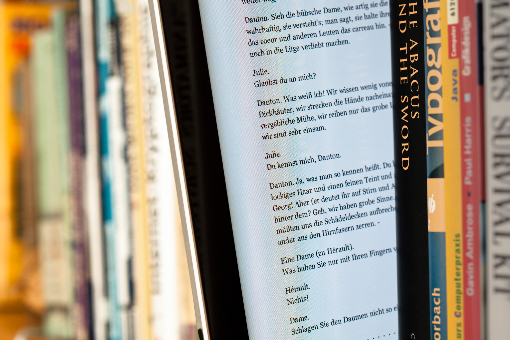

Niin, mutta ongelmana on se, että suomeksi ei e-kirjoja ole juurikaan. Oikeastaan onhan niitä, mutta esimerkiksi suosittua Tulen ja jään laulu (Game of Thrones) -kirjasarjaa et saa suomeksi e-kirjana ollenkaan. Nämä ovatkin vielä varsinaisia tiiliskiviä. Kirjoittelin muuten tästä aiheesta jo [viime vuonna](/2012/e-kirja-vai-oikea-kirja "E-kirja vai oikea kirja").

Olin lomalla pari viikkoa [Kreikassa](http://auringonalla.fi) ja matkalaukkuuni eksyi jokunen kirja ja mm. siellä oli tuon mainitun kirjasarjan eka osa – Valtaistuinpeli. Tämähän opus on 700 sivuinen ja ihan kevyimmästä päästä se ei ole ja rannalle sitä tuli rahdattua. Rannalla tulikin huomattua usea Kindle, ei täppäreitä juurikaan rannalle kannettu saati puhelimiakin kourallinen – Kindle oli suosittu varsinkin brittien keskuudessa. Tietty rannalla näki perinteisiä kirjoja, mutta Kindle oli lukulaitteiden ykkönen – näin oman hyvin silmämääräisen tutkimuksen mukaan. Tällöin teinkin päätöksen tutkia Kindleä kunhan palaudun kotiin.

Nyt sitten aloin tutkimaan ja huomasin sen surullisen seikan, minkä huomasin jo viime vuonnakin. Kindlelle ei ole kuin kasa suomalaisia kirjoja ja ne suosituimmat on vieläkin perinteisenä paperisena saatavilla. Englanniksihan saat sisältöä Kindleen vaikka kuinka paljon ja parhaillaan jopa ilmaiseksikin. Jäi siis ainakin vielä Kindle hankkimatta juurikin tuon sisällön puutteen vuoksi – harmi. Kindle olisi omiaan lukemiseen.

Tietty täppäreillekkin on omia appseja suomalaisten e-kirjojen lukemiseen, mutta edelleen valikoima on suppea. Sekä hinta on paperisen veroinen eli ennemmin hankkii vielä sen paperisen kuin sitten e-kirjan. Elisa tarjoaa omaa [Elisa Kirja](https://kirja.elisa.fi/) sovellustaan, jota kautta voi ostaa kirjoja sekä lukea – tämä toimii Androidilla ja iVempeleillä. Huomasin, että Suomalaisella on myös oma E-kirja [palvelunsa](http://ekirja.suomalainen.com/) ja toivoin löytäväni Valtaistuinpelin sieltä – en löytänyt. Suomalaistakin riivaa suppea valikoima ja se hinta.

Matkallehan tuo Kindle olisi omiaan jo sen kokonsa takia sekä akkukeston takia. Täppäri voi kuitenkin olla aika arvokas laite rannalla kuletettavaksi, tästä syystä en omaa iPadiä kuljettanut rannalla ollenkaan.

Ehkäpä vuoden päästä alkaisi e-kirja olla suomessakin paremmin esille. Toivoisin voivani ostaa Kindlen ja lukevani suomenkielistä sisältöä. Se joka alkaa Kindlelle suoltaa näitä e-kirjoja suomessa voi saada aika hyvin kävijöitä ja siihen jos alat Kindleä jälleenmyymään niin eikun vaan – täällä olisi yksi asiakas.

Pitää pohtia vielä tuota Kindlen hankintaa ja seurata tuota tilannetta. Tulen myös kirjoittelemaan Kindlestä oman artikkelin. Kertokaahan te omia kokemuksia ja näkemyksiä!
