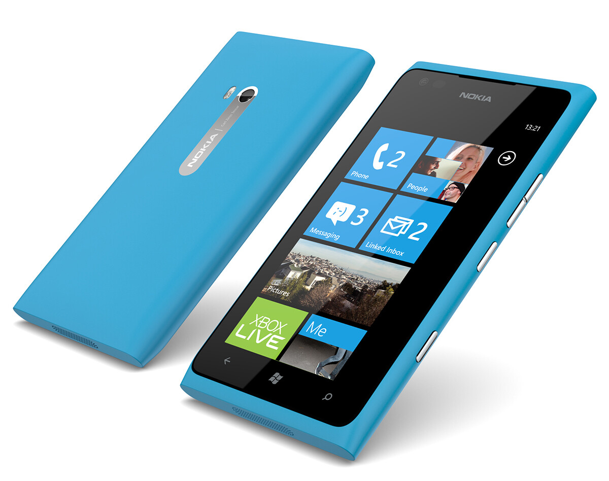
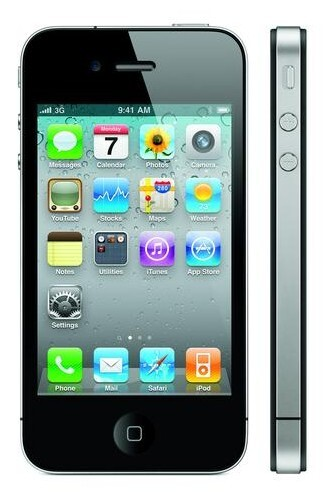

Viime vuonna ostamani Lumia 900 oli passeli puhelin kunnes oikeastaan tulin siihen tulokseen, että Lumian ja minun yhteistyö ei sujukaan niin hyvin kuin olisin ehkä tahtonut.

Aloitin aikoinaan matkapuhelinten käytön Nokialaisella, mutta tänä päivänä ei Nokia enää vakuuta minua. Tämä Lumia 900 puhelin olikin pieni kokeilu siitä voisinko palata takaisin Nokian kelkkaan. Vastaus on siis tällä haavaa se, että en palaa Nokian kelkkaan ainakaan silloin kun sillä on taustalla Windows Phone käyttöjärjestelmä. 7.8 versio kun tuli niin olin taas hieman innoissani, kun sai tiiliä tuunattua paremmin – sekään ei auttanut pitkäksi aikaa.

Lumiassahan on hyviäkin puolia, itse nimittäin tykkäsin tuosta puhelimesta värin ja muotoilun kannalta. Tietty joitain typeryyksiä oli siinäkin kuten reunukset. Itse käyttöjärjestelmä toimi sinällään hyvin ja oikeastaan tykkäsin tiilikäyttöliittymästä 7.8 päivityksen jälkeen vielä enemmän.

Huonoja puoliakin löytyi tästä puhelimesta. Itse en nimittäin ikinä tullut sinuiksi Lumian näppäimistön kanssa. Suomalaisesta Marketplacesta eli sovelluskaupasta ei tuntunut löytyvän passelia ohjelmia samalla tavalla kuin iPhonelle. Onneksi kuitenkin Whatsapp, Dropbox, Evernote yms. oli sielläkin, mutta sovellusten tarjonta ei ollut samalla tasolla kuin iPhonella. Androidillakin on parempi sovellustarjonta…

**Mutta miksi siirryin takaisin iPhone 4 puhelimeen takaisin?** Yksi syy on se, että tuli yksinkertaisesti ikävä Applen infraa ja niitä loistavia appseja mitä on tullut iPhonellekkin.

iPhonen käyttäminen onkin ollut hyvin sujuvaa ja vanha ystävä tuntuu vielä toimivan ihan passelisti. Tietysti iPhone 4 on hieman hidas joissain tilanteissa ja omassani on outo keltainen läikkä ja koti-painike ei toimi täysin aina.

On se kuitenkin aivan erilainen tuntu kuin tuossa Lumiassa, eipä oikeastaan ole ikävä sitä. Sovellukset toimii kuten pitääkin ja tätä on ilo käyttää ja sanotaanko näin, että kännykän ”räplääminen” on lisääntynty sen jälkeen kun Lumia meni laatikkoon.

**Aionko uusia puhelimen piakkoin?** Tämä onkin sitten se mielenkiintoisin kysymys. iPhone 4 tuntuu toimivan vielä aivan passelisti ja sinällään iPhone 5 ei ole tällä hetkellä vaihtoehto, mutta ehkäpä 5S olisi passeli – sen näkee vasta syksyllä. Samaten iPhonen hinta tuntuu vitosessa olevan suht kova, 4S olisi taas vain pieni päivitys nykyiseen.

Nexus 4 voisi olla mielenkiintoinen luuri, mutta sen hinta onkin älytön verrattuna muuhun maahan. Toisaalta Android ei ehkä puhelimen puolelta houkuttele niin paljoa. iOS tuntuu kaikkein mukavimmalle ympäristölle kuitenkin, varsinkin kun Windows Phone ei iskenyt.

Näitä sanoja kun luen niin taidan olla ikuisesti iPhonen käyttäjä sillä 3G oli täysin jotain erilaista matkapuhelinmarkkinoilla. Nykyään toivoisin, että Apple tekisi sen uusiksi ja uudistaisi markkinoita ja ravistelisi asioita kuten edesmennyt Steve teki.

Tällä hetkellä jos puhelimen koppaisin niin varmaan se olisi iPhone 5. Tosin 5S kun on tulossa joskus niin paha sanoa… Pitäisi tietää julkaisu ajankohta ja tiedot niin näkisi olisiko se odottamisen arvoinen puhelin.

Kommentit ovat muuten tervetulleita!

*ps. Kiinnostaisiko Lumia 900 puhelin, semmonen voisi olla myynnissä ;)*
