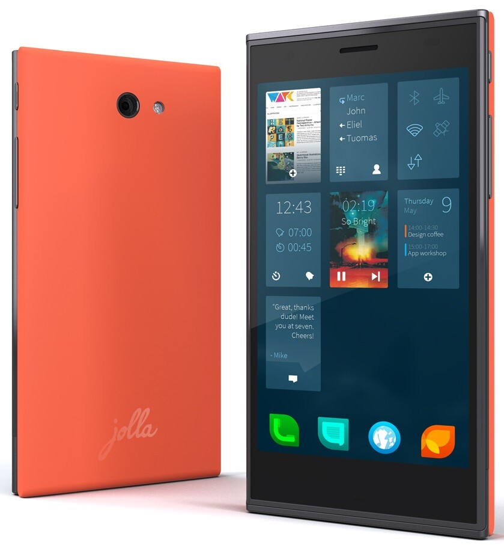

Näin kävi, kävin Kuopiossa Päivärannan Citymarketissa ja huomasin siellä DNA:n liikkeessä Jollan. Pitihän sitä hieman hypistellä ja sanoisinko näin, että vaatisi hieman totuttelua sen käyttäminen – näin tosin on lähes joka puhelimen kanssa.

Lyhyellä hypistelyllä puhelin vaikutti sinällään mielenkiintoiselta, mutta ei herättänyt ehkä niin suuria tuntemuksia kuin olin luullut (ja toivonut). Tietty Sailfish on vielä betassa ja sitä kehitetään, mutta vielä en ehkä ostaisi sitä – enkä ostanutkaan. Tällä hypistelyllä en voi sanoa tuomiota puhelimesta vaan pitää saada se omaan käyttöön pitemmäksi aikaa, jolloin näkee parhaiten sopiiko puhelin minulle.

Olisin halunnut ennakkotilata Jollan jo ekoilla kiekoilla, mutta en tehnyt sitä silloin, toisellakin kierroksella se jäi välistä ja harmitti niin vietävästi. Viime viikonloppuna sormi oli jo DNA:n verkkokaupan tilausnapilla, jäi silloinkin tilaamatta.

> Jolla on puhelin, jota kukaan ei osta järjellä, mutta sitäkin useampi tunteella. Niin minäkin tein, kun laitoin ennakkotilaukseni vetämään jo toukokuussa, edes näkemättä puhelinta. Viime viikolla se sitten saapui.
>
> – Petteri Järvinen @ [HS.fi](http://www.hs.fi/tekniikka/Kolumni+Kukaan+ei+osta+Jolla-puhelinta+j%C3%A4rjell%C3%A4/a1387248207459)

Juurikin näin, Petteri sen sanoikin. Itselläkin oli enemmän tunnesyitä kuin järkeä siinä, että olisin halunnut puhelimen. Järki veikin voiton sillä en ottanut puhelinta kainaloon tänäänkään. Olin aikoinaan ensimmäinen tutuistanu joka hankki iPhonen, siis silloin kun sitä ei ollut kaikilla kuten nyt. Silloin iPhone oli jotain uutta, erilaista ja hienoa – tänään senkin tarina on oikeastaan toinen kun junnataan paikallaan.

Palatakseni Jollaan ja tunnesyihin, halusin osaksi tuntea sitä, että olin niiden ensimmäisten joukossa joilla oli Jolla ja toivon vieläkin, että Jollan seuraava malli tulee ja on parannus tähän – raudaltaan kun tämä puhelin ei sinänsä ole ihmeellinen. Rauta ei kuitenkaan ole se pääasia, käyttöjärjestelmä vaikuttaa paljonkin.

Jollassa on Sailfish (beta) ja tuo beta teksti löytyykin DNA:n mainoksista ja Jollan spekseistä. Yksi syy miksi olin tilaamassa Jollaa useita kertoja oli juurikin Sailfish ja sen erilaisuus – se yrittää tehdä jotain uutta ja erilaista – aivan kuten iPhone teki aikanaan.

Sailfish itsessään on vielä kesken ja siitä puuttuu paljon natiiveja sovelluksia ja paljon ominaisuuksia – tietty näitä asioita tulee lisää kunhan kehittäjät kerkeävät tehdä niitä. Tietysti osa kehittäjistä ei lähde tukemaan taas uutta käyttöjärjestelmää ellei ole tarpeellista kysyntää.

Itse päätin, että odottelen puolisen vuotta eteenpäin ja katsastan tilanteen sen jälkeen uusiksi. Tietty mieli voi muuttua mikäli mullistuksia tulee vastaan, mutta tänään en Jollaa ostanut enkä osta huomennakaan. Mikäli Jolla pukinkontista löytyy (epäilen tätä) niin sitten se tulee käyttöön – ehdottomasti.

Ostitko sinä Jollan? Kerro kokemuksesi!
