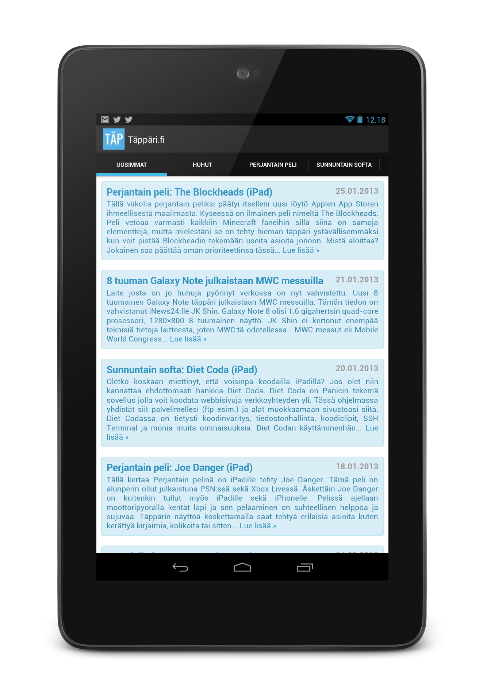

Näin pääsi tosiaan käymään ja tein ensimmäisen mobiilipuolen sovelluksen ikinä. Valitsin ympäristöksi Androidin sillä siellä ei ole järjettömiä kehittämiskustannuksia siitä, että voit julkaista sovelluksen. Googlen Play kauppaan piti pistää 25 dollaria, mutta katsotaan josko sen saisi tienattua takaisin joskus. Androidin valitsin myös siksi, koska halusin tehdä jotain Nexus 7 täppärille ja olen Eclipseä käyttänyt kouluaikoina Javan koodaukseen.

Kokeilin Android Development Toolseja (ADT) jo aiemmin ja leikin hieman niillä. En kuitenkaan päässyt kunnolla sisälle tuohon. Annoin ADT:n olla rauhassa koneen sopukoissa jonkun viikon ajan ja sitten viime perjantaina aloin taas katselemaan sitä. Silloin aloin oikeastaan kehittämään sovellusta kunnolla ja silloin päämääräksi tuli tehdä Täppäri.fi sivustolle oma sovellus.

Halusin, että sovellus näyttäisi Täppärin uusimmat ja sitten parista muustakin kategoriasta kirjoituksia. Päädyin siihen ratkaisuun, että käytän WebViewiä joka mahdollistaa verkkosivun aukaisemisen sovelluksessa. Tällöin saan yhdistettyä oman osaamisen (PHP+HTML+CSS) tähän Android sovellukseen ja saan myös tällöin helposti tehtyä muutoksia ilman, että tarvitsee sovellusta päivittää Google Playhin.

Ensimmäisen sovelluksen kohdalla lähdin suhteellisen valmiista pohjasta liikenteeseen kun projektia luotaessa pystyi jo suoraan valkkaamaan, että käytetään tabeja sekä niiden välillä voi vaihdella pyyhkäisemällä oikealle tai vasemmalle. Sain siis perusrungon kasaan ilman sisältöä jo varsin helposti. Tämän jälkeen hypätään sinne koodin maailmaan ja tutkitaan miten tuo generoitu koodi oikein toimii. Onneksi omaan ohjelmointitaustan niin ymmärrys rakenteeseen ja toimintaan saatiin aika pian ja päästiin soveltamaan Internetistä löytyviä vinkkejä sekä neuvoja.

Kun tahdoin WebViewiin sisältöä sen perusteella mikä tabi sattuu olemaan auki niin tajuttuani logiikan sen saavuttaminen oli suhteellisen helppoa. Generoitu koodi nimittäin palautti TextViewin eteenpäin ja pystyin helposti muokkaamaan funktiota palauttamaan WebViewin ja pistämään siihen sisällöksi haluamani verkkosivun. Tässä tapauksessa verkkosivu on koodinpätkä joka saa aukiolevan tabin ja hakee sen perusteella sisällön Täppärin verkkosivusta ja muotoilee sen.

Kun sain nämä elementit toimimaan ja olin muotoillut verkkosivun passeliksi olin tyytyväinen ja versio 1.0 oli valmis. Julkaisin sen eilen lauantaina Google Playhin ja maksoin 25 dollarin summan siitä lystistä, että sain tilin sinne ja pystyin yleensä lisäilemään appseja. Homma onnistui suhteellisen simppelisti ja parin tunnin päästä klikattuani publish -painiketta oli sovellus kaikkien saatavilla. En ole vielä saanut Google Playstä tilastoja asennuksista, mutta eiköhän nekin tule tässä lähiaikoina.

Aloin seuraavaksi pohtimaan mainoksia, niitä nimittäin näkee ilmaisissa sovelluksisa ja voisinpa semmoisen pistää näkyviin. AdMob oli tähän vastaus ja versio 1.1 tulisi saamaan mainoksen ja vieläpä samana iltana tulisin tekemään päivityksen. Mainioksen laittaminen tähän sovellukseen olikin helpommin sanottu kuin tehty. Päänvaivaa tuotti nimittäin sen asemointi, olisin halunnut mainoksen alareunaan, mutta jonkun tunnin kiroilun jälkeen en onnistunut siinä. Tätä pitää koittaa vielä myöhemmin uudestaan, mutta nyt mainos yläreunassa kelvatkoon. Lähetin samalla myös koodinpätkälleni tiedon siitä minkä korkuinen mainos on sillä se vaihtelee sen mukaan onko puhelin vai täppäri.

Päivityksen julkaiseminen on suhteellisen helppoa. Tarvitsee muokata vain AndroidManifest.xml filuun versionCodea sekä versionNamea ja tämän jälkeen voikin tehdä uuden apk paketin ja pistää sen Google Playhin. Tunti pari apk paketin lataamisen jälkeen päivitys oli saatavilla kaikille ja mainos toimi vallan mainiosti. Ei ihan niinkuin olisin halunnut, mutta tarpeeksi hyvin ensimmäiseen sovellukseeni.

Sovellus on ollut nyt alle 24 tuntia julkaistuna ja nyt on jo pari kehitysideaa tullut, jotka aion toteuttaa tänään. Ensimmäinen on se, että artikkelit olisi hyvä näyttää sovelluksessa eikä aukaista Chromea sitä varten. Tämän fiksasin jo osittain eilen, mutta vaatii tuunausta vielä jonkun verran. Toinen on se, että jos laite ei ole verkossa niin saat hieman huonon ilmoituksen siitä joten pitää tämä korjata tekemällä oma ilmoitus. Sovellushan vaatii toimiakseen verkkoyhteyden sillä muutan ei sisältöä saada haettua.

Tämä kirjoitus oli suhteellisen ympäripyöreä selitys siitä mitä tuli tehtyä. Täppärin puolelle tein [sivun](http://tappari.fi/tappari-fi-android-sovellus), jonne olisi tarkoitus saada keskitettyä tuota sovelluksen kehitystä. Onhan se kuitenkin Täppärin sovellus, pitää katsoa josko tekisi omalle blogillekkin sovelluksen, nyt kun kerta sen tekeminen onnistuisi suhteellisen helposti.
