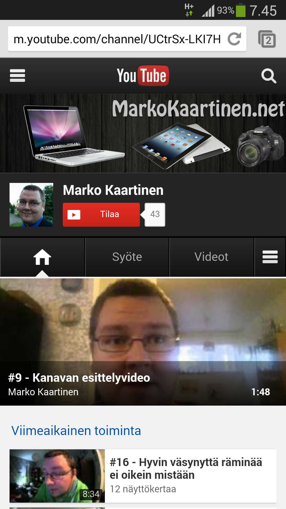
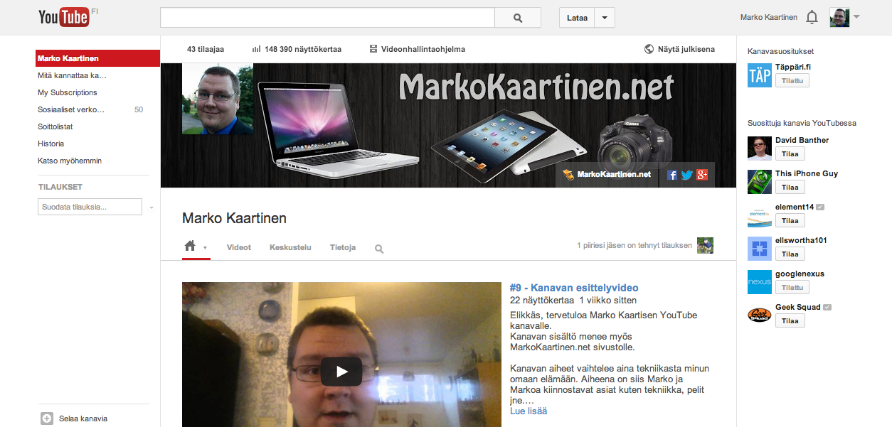
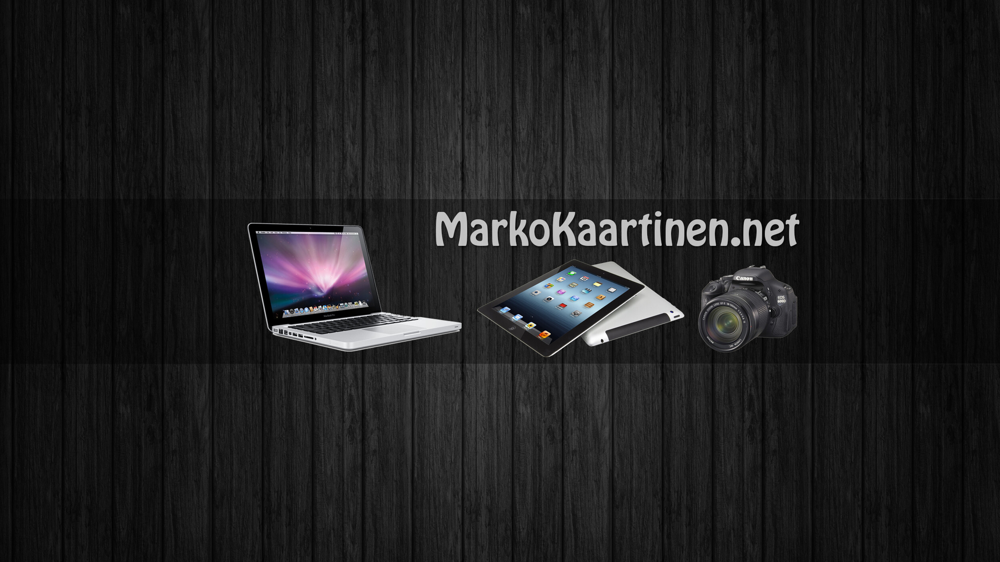

YouTuben kanavia voi nykyään oikeastaan tuunata vain kanavakuvan avulla. Tietty oma avatarkin siinä näkyy, mutta kanavakuva taitaa olla se isoin asia mitä pystyt tekemään.

Kuten tuosta oikealla olevasta kuvasta näkee niin matkapuhelimellakin tuo kanavakuva näkyy ja se näkyy erikokoisilla laitteilla hieman eritavalla.

Kanavakuvan koko kannattaa pistää suosiolla 2560×1440 pikselin kokoiseksi, sillä näin saat parhaiten tuunattua sitä. Löysinkin YouTuben omasta Ohje-osiosta ohjeen [kanavakuvaa](https://support.google.com/youtube/answer/2972003) koskien. Sieltä voit käydä lukemassa tarkemmat määreet tuolle kuvalle.

Itse toteutin kanavakuvan hyvinkin simppelisti. Ensin kaivoin sopivan taustan tuohon 2560×1440 kokoon ja tämän jälkeen katsoin mikä se turvallinen alue nyt olikaan. Turvallinen alue on se alue mikä näkyy kaikilla laitteilla, joten tähän alueeseen kannattaa laittaa tärkein informaatio kuten kanavan nimi yms.

Itse tein ensin mustan erillisen taustaosan tuohon keskelle joka oli 2560×423 pikselin kokoinen ja pistin siihen hieman läpinäkyvyyttä. Näin tuo keskiosa erottuu kivasti televisionäkymässäkin, jolloin siis koko kuva on näkyvillä. Muilla laitteilla pääasiassa on näkyvillä tuo musta ”palkki” läpinäkyvyyden kanssa jolloin taustaakin näkyy. Laitteesta riippuen YouTube kasvattaa kuvan leveyttä ja kunnes päästään televisioon niin läntätään koko kuva näkyville.

Itsehän pistin hyvinkin simppelin kanavakuvan ja en lähtenyt hienostelemaan sen kanssa. Siitä tuli mielestäni oikein passeli ja siitä saa hieman kuvaa mitä tällä kanavalla on ja mikä sivu nyt onkaan kyseessä.

Oikealla vielä nähtävissä lopullinen taustakuva kokonaisuudessaan. Tämän voisi laittaa FullHD näytön taustaksikin sillä 2560×1440 px kuva skaalautuu sopivasti myös 1920×1080 px kokoiselle näytölle.
