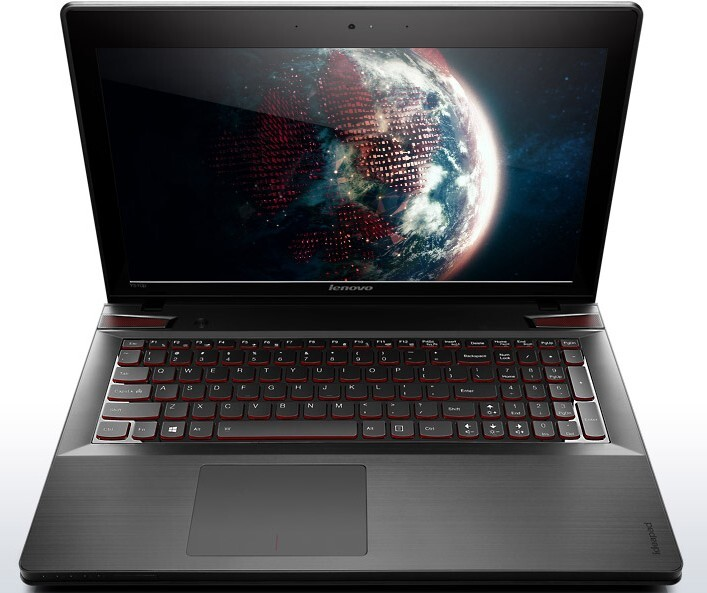
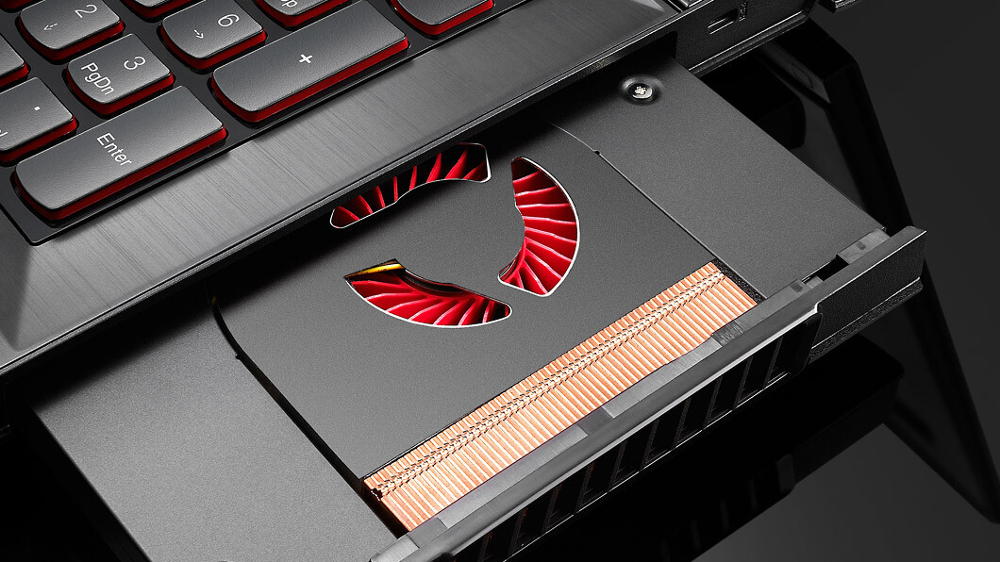
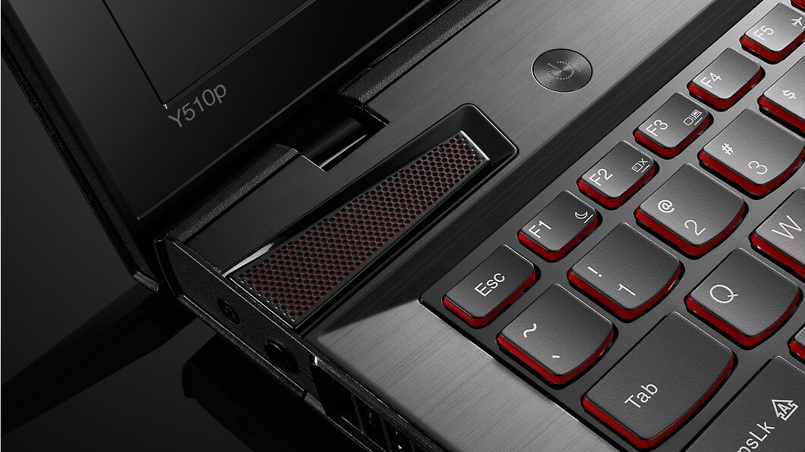
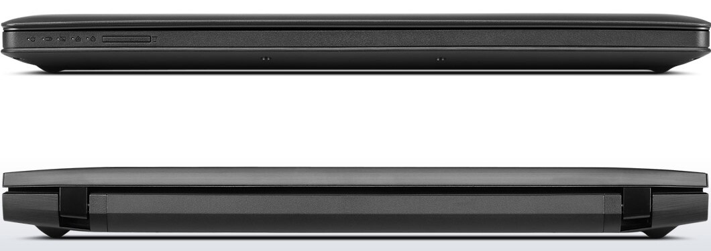
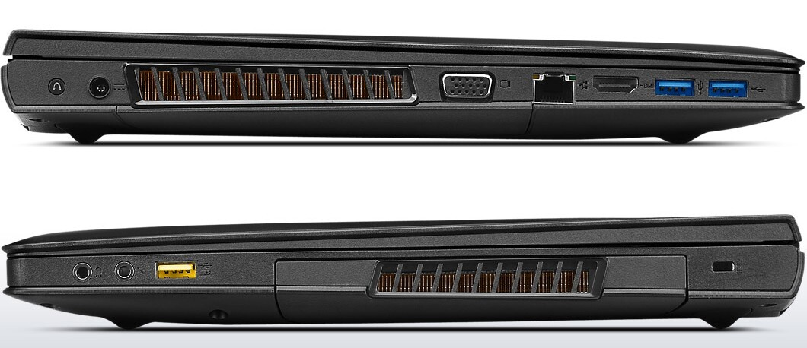
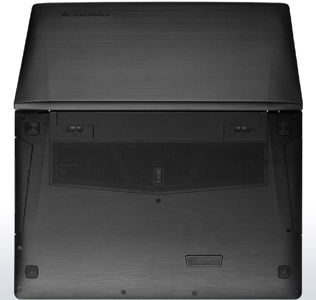
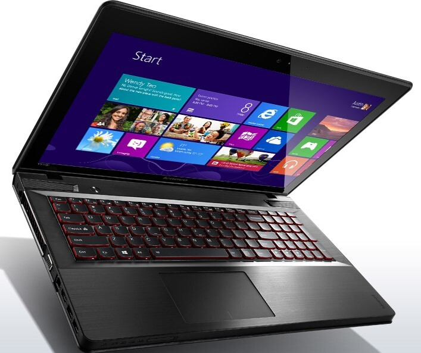

Aikaisemmin tässä blogissa katsastettiin [Asuksen](/2013/katsaus-asus-g750-pelilappariin "Katsaus ASUS G750 peliläppäriin") pelikannettavaa ja tällä kertaa otetaan sille erittäin varteenotettava kilpailija katsastukseen. Itse jos konetta hankkisin niin tämä Lenovon IdeaPad Y510p veisi voiton. Katsotaan tosin ensin hieman mitä se pitää sisällään ja miltä se oikein näyttää sekä mitä ratkaisuja tässä koneessa on tehty.

Harmikseni tätäkään konetta en omista sillä pankkitilin saldo ei tykkää hyvää jos jokaisen mielenkiintoisen laitteen hankkisin. Lenovon IdeaPad Y510p on 15.4 tuuman FullHD näytöllä varustettu täysiverinen pelikannettava. Suorittimen virkaa ajaa Intel Core i7-4700MQ (2.4GHz), muistia koneessa on kahdeksan gigatavun verran (1 slotti vapaana ja maksimi määrä on 16 gigatavua). Kiintolevynä on yhden teratavun kiintolevy ja 24 gigatavun ssd cache levy.

Näytönohjain tai oikeastaan näytönohjaimet ovat tämän koneen yksi valttikortti. Niitä on nimittäin kaksi ja molemmat ovat NVIDIAN GeForce GT750M 2 GB GDDR5 näytönohjaimia ja toimivat rinnakkain ([SLI](http://fi.wikipedia.org/wiki/Scalable_Link_Interface)). Tässä onkin mielenkiintoinen ratkaisu tehty tällä saralla sillä toinen näytönohjain on optisen aseman tilalla Ultrabay paikassa (kuvassa näkyy), joten perinteistä DVD-asemaa tässä koneessa ei ole vaan tilalle on läntätty aimo annos tehoa. Itse pidän tätä positiivisena asiana sillä en käytä nykyisessäkään pöytäkoneessa DVD-asemaa ollenkaan. Tässä ratkaisussa on myös etuna se, että voit putsata tuon näyttiksen suhteellisen helposti.

Äänipuolikin on ollut arvosteluissa kehuttu sillä ääntä hoitaa JBL:n kaiuttimet ja Dolby Home Theater v4 äänentoisto. Kaiuttimet onkin sijoitettu näkyvälle paikalle, suoraan näppäimistön yläpuolelle joten jotain jytää näistäkin saa irti. IdeaPadissä on tietysti perus mikrofoni ja kuuloke -liitännät joten halutessasi voit kuunnella musiikkia/peliääniä omien kuulokkeittesi kautta. Tämä onkin se suositeltava tapa jos koneen rahtaat LANeille!

Mainitsin kuuloke/mikrofoni liitännän joten katsotaan hieman tämän muita portteja ja miten ne on oikein laitettu. Ensimmäisessä kuvassa onkin katsottu mitä koneen takaa ja edestä löytyy. Takana nyt ei kummoisia ole, mutta edessä on kuitenkin muistikortinlukija sekä tarpeelliset merkkivalot eri toiminnoille.

Seuraavassa kuvassa onkin kone vasemmalta ja oikealta sivulta. Vasemmalta puolen löytiikin virtajohdon paikka, tuuletin, VGA, HDMI, RJ45 verkkopiuha ja kaksi USB3.0 porttia. Oikealta puolen löytyykin mikrofoniliitäntä, kuulokeliitäntä, USB2.0 portti, Ultrabay paikka jossa em. näytönohjain sekä Kensington lukolle paikka. IdeaPadissä on tietysti myös WLAN ja Bluetooth mahdollisuudet.

Kuten äskeisessä kuvassa näkyi niin vasemmalla puolen on koneen tuulettimen aukko ja oikealla on sitten yhden näytönohjaimen paikka. Pohjasta löytyykin loput tuuletusaukot, joten sylissä pitäessä voi ilmanotto estyä joten kannattaa olla tarkkana ettei kone ylikuumene sen takia. Pohjakuvaa katsoessani voisin veikata, että tuo vasemman puolen tuulettimen slotti lähtisi myös jotenkin irti tai ainakin sen alusta lähtisi auki jotta sen voisi putsata, mitään varmaa tietoa minulla ei tästä kuitenkaan ole sillä konetta en ole päässyt livenä kokeilemaan enkä omista ko. konetta.

Kone on kaiken kaikkiaan erittäin tyylikäs ja näppäimistökin on taustavalaistu punaisilla valoilla ja se vaikuttaa muutenkin erittäin hyvältä näppäimistöltä ainakin kuvien perusteella. Asuksen läppäriin verrattuna IdeaPadillä on painoa vain 2.7 kiloa joten tämä on todellinen pelikannettava – tätä kehtaisi kanniskella päivittäin tuon painonsa ansiosta. Akku on 6-kennoinen Lithium-Ion akku ja sille uhkaillaan jopa 5 tunnin kestoa – pelikäytössä en tosin usko, että saadaan niin paljo irti.

Hintaa tällä tehopakkauksella on noin 1200 euroa eli hieman halvempi tapaus kyseessä kuin Asus G750. Tässä koneessa selkeänä etuna on sen koko ja se seikka, että tässä on kaksi näytönohjainta. Nämä seikat ovat yksi syy miksi hankkisin tällä hetkellä tämän koneen ennemmin kuin Asuksen. Näytön koon ”pienuus” ei sinällään haittaa sillä sen resoluutio on kuitenkin 1920×1080 ja kotona ollessani käyttäisin konetta kuitenkin omalla 24 tuuman näytöllä – tällöin IdeaPad Y510p näyttö toimisi ikäänkuin kakkosnäyttönä.

Mikäli sinulla tai tutullasi on IdeaPad Y510p pelikannettava niin kerro ihmeessä kokemuksesi!

**Päivitys:**\
[Käy myös lukemassa henkilökohtaisia kokemuksiani tästä kannettavasta!](/2013/lenovo-ideapad-y510p "Lenovo IdeaPad Y510p")
