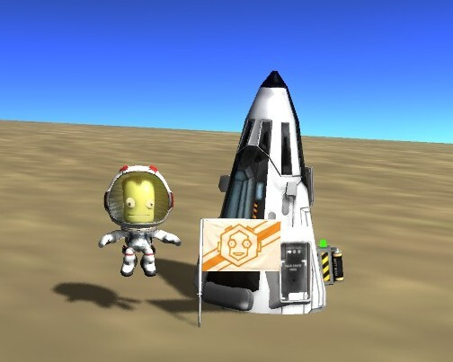

KSP eli Kerbal Space Program on erittäin koukuttava peli, jossa voit rakentaa oman raketin ja lentää sillä avaruuteen – siis mikäli se kestää ja ei räjähdä laukaisussa. Pelihän on Alpha-vaiheessa vielä joten se kehittyy vielä ja siihen on tulossa varmaan paljon lisää vaikka nytkin tuntuu, että siinä on aivan hillittömästi tavaraa. Pelissä ei ole vielä tavoitetta, eli voit itse asettaa itsellesi tavoitteita ja tehdä mitä lystäät – voit vaikka lähteä kuuhun perustamaan omaa tukikohtaa.

Pelin pääosassa on Kerbin planeetta ja sen hahmot Kerbinit. Yhteisön suosikki ja oma henkilökohtainen suosikkini on Jebediah ”Jeb” Kerbin, sillä nimittäin on hauskaa vaikka maa lähenee uhkaavasti ja vauhtia on liikaa. Peli simuloi kolmiuloitteisesti planeettojen vetovoiman, avaruusaluksen liikkeet, rakettimoottoreiden voiman ja polttoaineiden määrät. Peli myös tallentaa kaikki alukset esimerkiksi kiertoradalla. Eli jos vaikka lennät kuuhun ja poistut pelistä, seuraavan kerran kun lennät kuuhun, saatat nähdä aluksesi siellä. Voit myös palata sen ohjaimiin Tracking Station-keskuksen kautta.

Pelin ensimmäinen haaste on se, että saat yleensä avaruusaluksen kiertoradalle ja siitä sitten minne haluatkaan. Itse en ole vielä onnistuneesti päässyt kuuhun ja Jeb jäi kerran pyörimään auringon ympäri omalle kiertoradalleen bensan loputtua.

Itse olen rakennellut vaikka minkälaista viritelmää ja osa räjähti jo laukaisussa. Alla on jokunen kuva noista omista viritelmistä sekä jokunen kuva itse pelistä. Peli on loppujen lopuksi aika komea ja sen pelimekaniikka on vieläpä toimiva. Suosittelen erittäin lämpimästi tätä peliä.


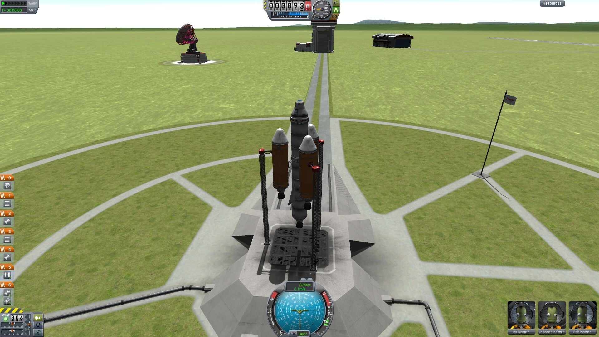
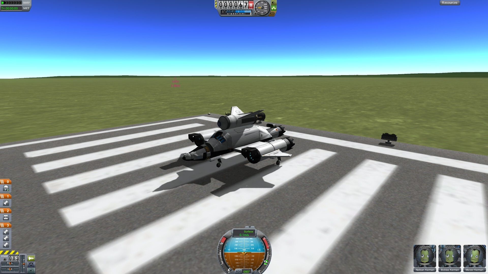
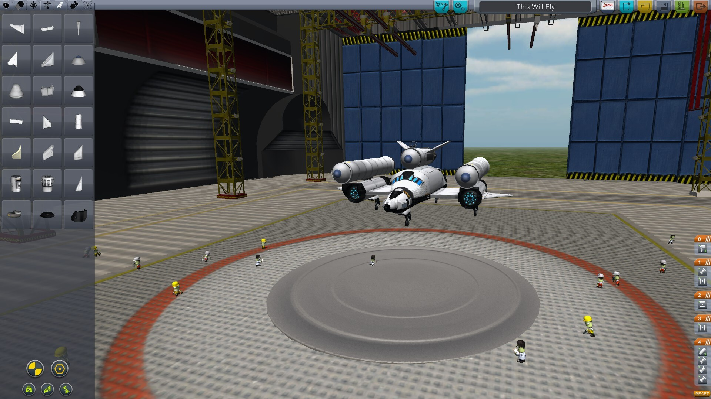
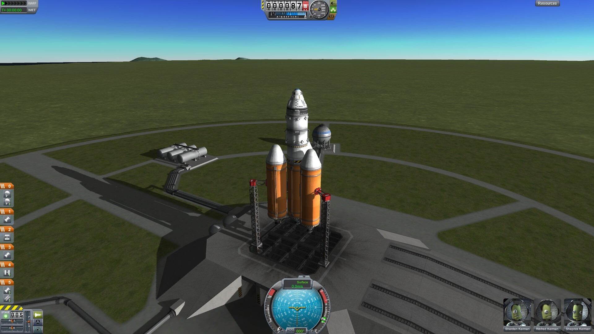
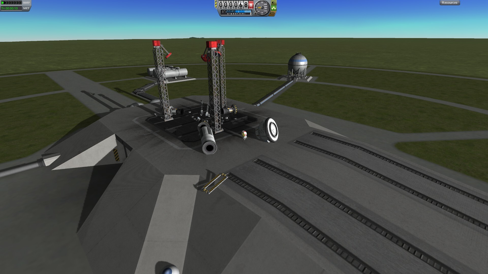
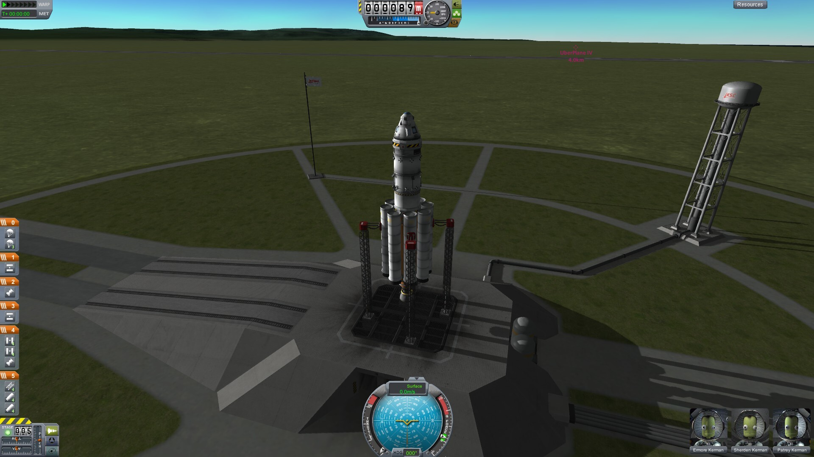
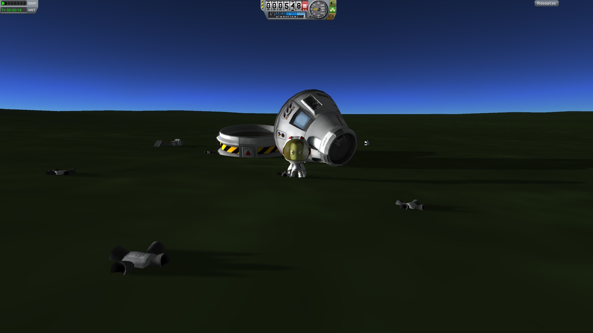
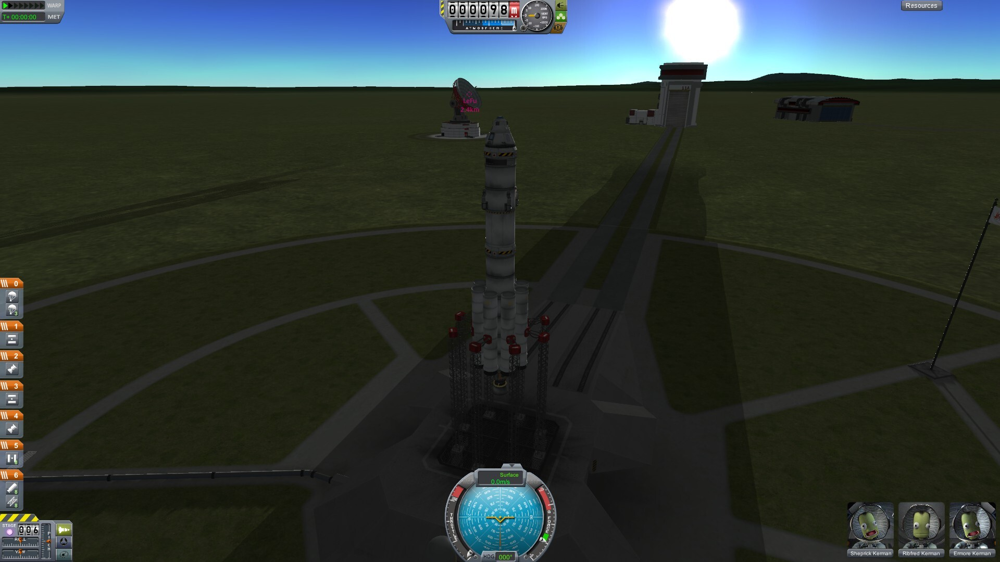
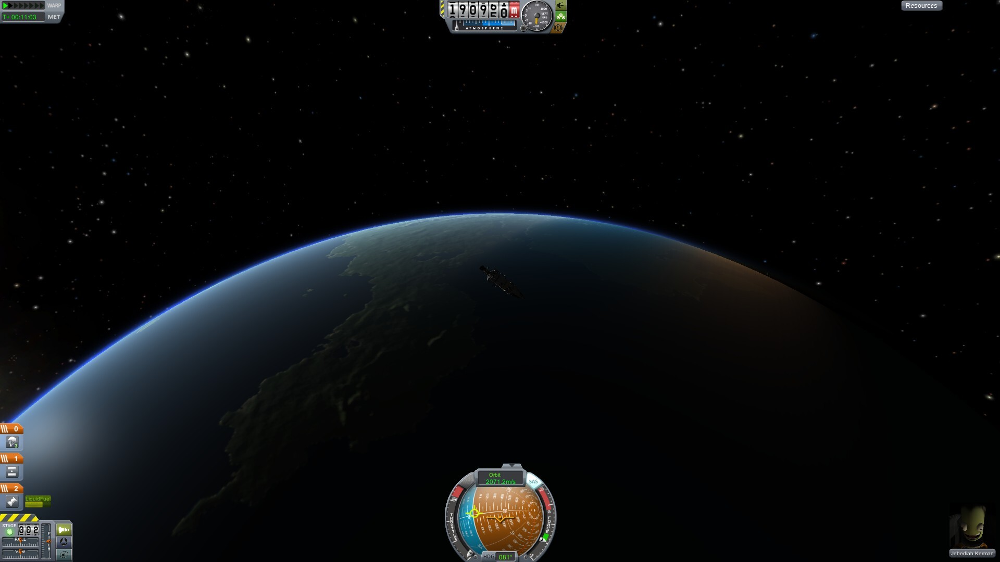
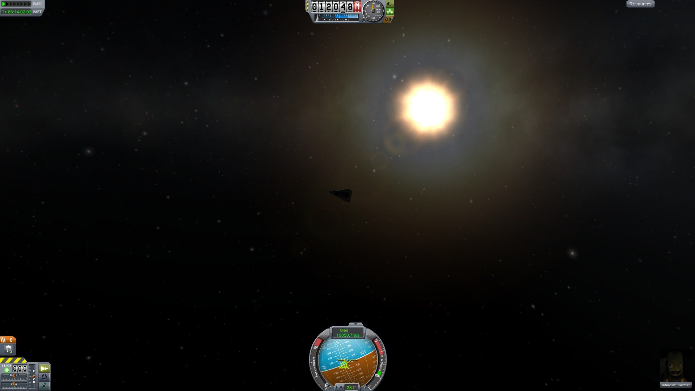
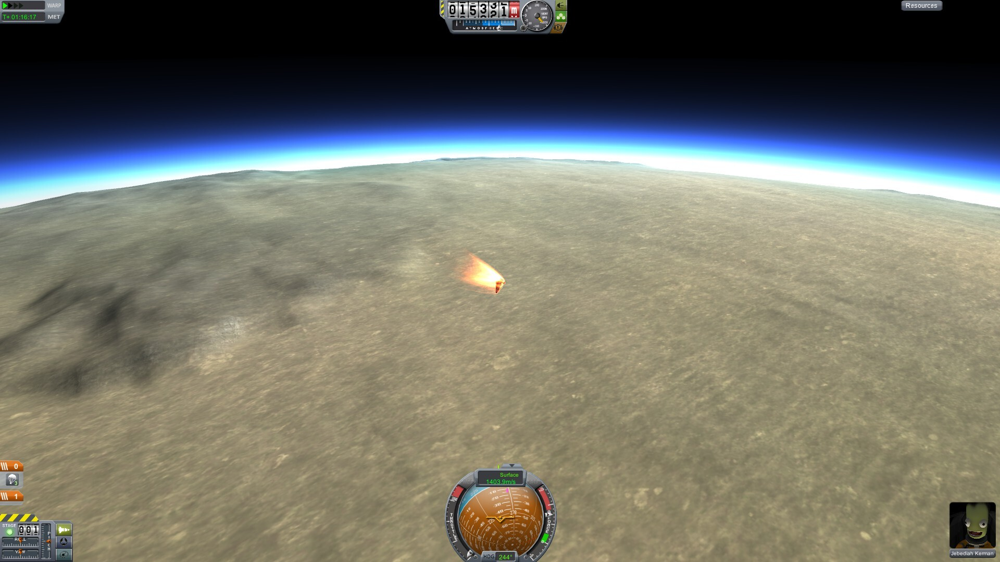
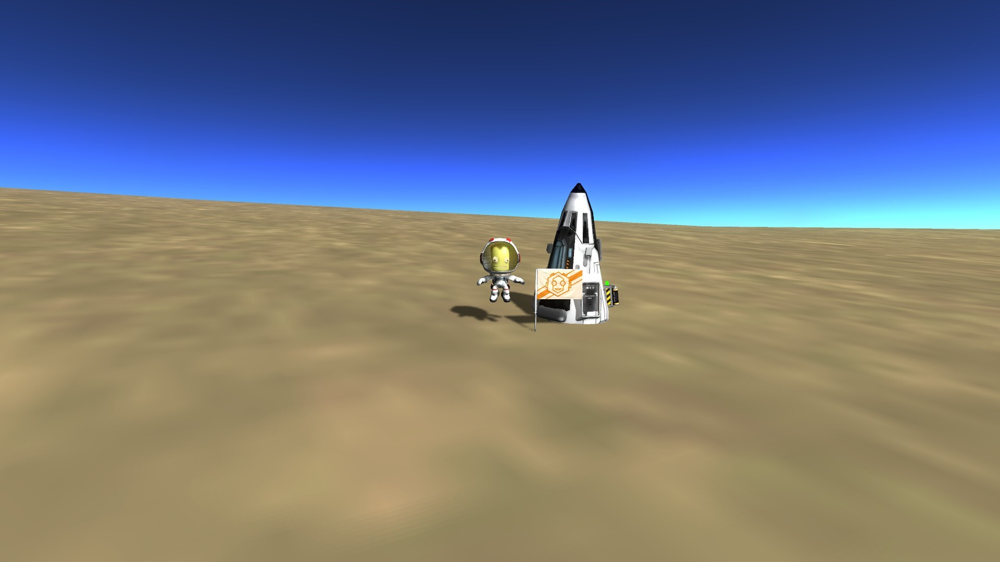


Lähteenä käytetty: [Wikipediaa](http://fi.wikipedia.org/wiki/Kerbal_Space_Program), KSP:n omaa [wikiä](http://wiki.kerbalspaceprogram.com/wiki/Main_Page) ja sen [kotisivuja](https://kerbalspaceprogram.com/).
