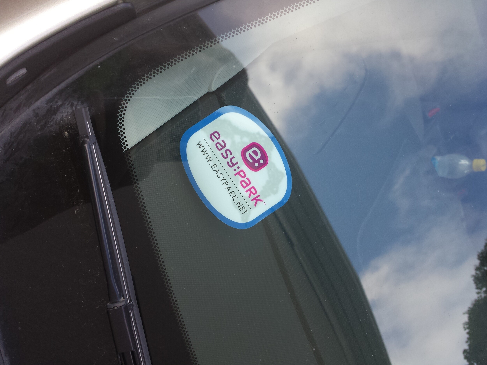
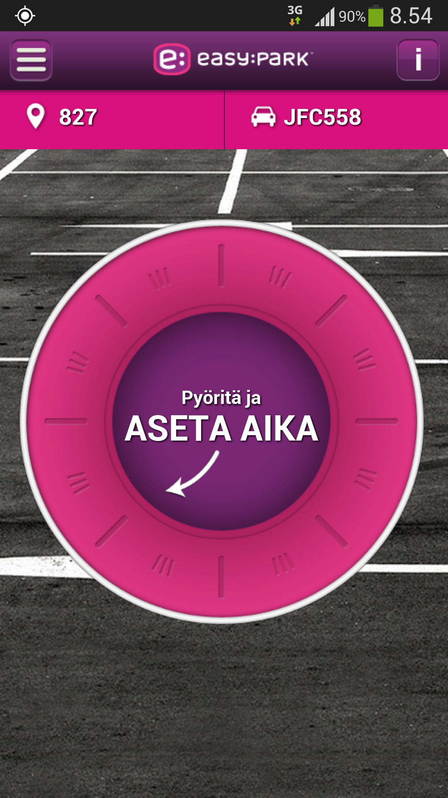
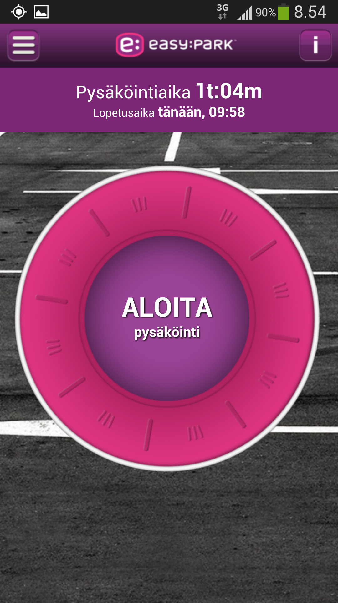
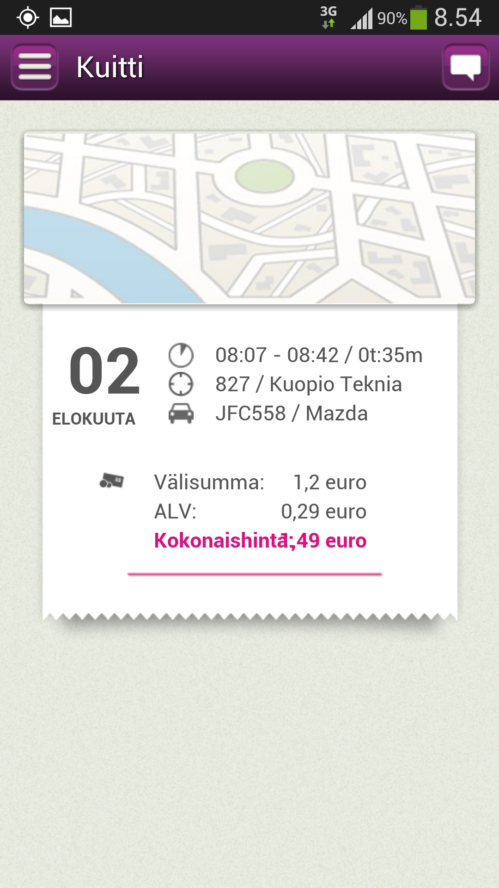

Tulin joku aika sitten jo tilanneeksi EasyParkin tarrat ja rekisteröidyin jäseneksi. Tulin huomanneeksi, että Kuopiossa on juurikin asiakkaan parkkipaikka EasyPark parkkipaikka ja näin ollen saan käytettyä tuota EasyParkkia aina kun pysäköin siellä. Tämän ko. asiakkaan luona tuleekin käytyä suhteellisen usein, joten tämä on loistava apuväline siihen.

Käyttäminenhän on suhteellisen simppeliä. Länttäät ensin tuon EasyParkin tarran tuulilasiisi ja pysäköit auton parkkipaikalle, jossa on EasyPark käytössä. Näet alueen koodin joko näppärästi hakemalla GPS:n kautta sovelluksella, mutta kannattaa varmistaa se vielä maksuautomaatin kyljestä. Itse pysäköin Kuopiossa alueelle 827 eli TietoTeknialle.

Ajan valintakin on simppeliä kuin mikä. Pyörität vain kiekkoa sopivaan kohtaan ja sen jälkeen oikeastaan ainut homma on painaa aloita pysäköinti painiketta.

Itsehän valkkasin reilun tunnin sillä epäilin siellä menevän vähintäänkin sen verran. Normaalisti olisin pistänyt 1.5-2 tunnin edestä kolikoita tai höylännyt korttia automaattiin tuosta edestä. Nyt voin pistää tunnin ja jatkaa sitä näppärästi jos on tarvis. Tällä kertaa kuitenkin meni vain 35 minuuttia joten lopetin pysäköinnin kun saavuin autolle ja maksoin vain siitä ajasta minkä pysäköin – tuossakin säästi pari euroa sillä normaalisti olisi jäänyt ylimääräistä aikaa.

Pysäköinnin lopettamisen jälkeen näet vielä yhteenvedon siitä ja näet paljonko se tuli maksamaan. Ainut parannus tähän sovellukseen olisi tässä näytössä. Omalla Samsung Galaxy S4 puhelimella kokonaishinta teksti menee hinnan päälle.

Tätä voit myös käyttää netissä ja hallita pysäköintejäsi myös sieltä. Voit myös aloittaa pysäköinnin sitä kautta ja jopa soittamalla EasyParkin palvelunumeroon. Kaiken kaikkiaan näppärä sovellus ja erittäin näppärä palvelu. Voisin kuvitella tästä olevan enemmänkin hyötyä yrityksille sillä tuolta saa näppärästi myös kuitit PDF muodossa.

Kuopiossa näitä parkkipaikkoja on muutama, mutta esimerkiksi pääkaupunkiseudulla noita on paljon. Yhtenä esimerkkinä voisikin ottaa länsisataman pitkäaikaisen ja lyhytaikaisen parkkipaikan. Siellä nimittäin on käytössä EasyPark ja uskoisin siitä olevan hyötyä laivamatkustajille – itse en vielä hyödyntänyt viime Tallinnan reissullani vaikka Länsisataman kautta menimmekin.

Alla vielä video EasyParkin toiminnasta.


