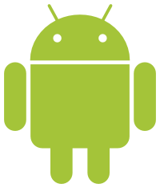

Saadakseen Google Playhin kehittäjäpuolen auki ja pystyäkseen julkaisemaan sovelluksia pitää maksaa 25 dollarin suuruinen liittymismaksu. Tämä on käsittääkseni kertaluontoinen maksu kun taas Applella iOS kehittäjäohjelma maksaa 99 dollaria per vuosi.

Androidin puolella sovelluksen voit heittää lähes suoraan Play kauppaan ja se on parin tunnin päästä siellä. Niin simppeliä se on. Päivityksen heittäminen on yhtä helppoa, lataat vain uuden APK tiedoston ja homma on sillä selvä.

Tilastoissa olisi kuitenkin hieman parantamisen varaa. Ne laahaa päivän jälessä eli näet tänään johonkin aikaan eilisen tilastot. Olisi kiva saada suhteellisen reaaliaikaista tilastoa latauksista ja muusta vastaavasta. Tilastoissa on kuitenkin tarvittava tieto aina versiosta, Androidista, laitteesta, maasta, kielestä, palveluntarjoajasta sekä voi vielä katsoa kaikki aktiiviset asennukset sekä miten paljon on asennuksia yhteensä yms.

Itse Google Play kauppahan ei muuttunut oikein mitenkään, pystyn softia asentelemaan ihan niinkuin ennenkin ja mitään etuja ei sinällään tullut. Näen vain tuon kehittäjäpuolen jossa voin lisäillä omia sovelluksia ja hallita niitä. Tietenkin se etu on, että omasta ohjelmasta saan kehityksessä olevan version asenneltua omaan laitteeseen.  Tämä tietty onnistuu ilman tuota kehittäjäpuoltakin sillä voit ADT:n kautta asentaa sen ohjelman laitteeseesi.

Olen pohtinut toista sovellusta jota lähtisin kehittämään Android puolelle. Ehdotukset ovat tälläkin saralla tervetulleita! Olen myös pohtinut, että kun minulla on tämä olemassa oleva pohja Täppäri.fi sovelluksen myötä niin sitä voi hyvin soveltaa muihinkin verkkosivuihin. Varsinkin kun Täppäri.fi sovellusta kehitän ja korjailen monia virheitä ja eteentulevia asioita.

Kaiken kaikkiaan erittäin toimiva systeemi on tarjolla kehittäjillekkin. Mikäli tekisin monikielisen version niin käännösten lisääminen kaupan puolelle olisi helppoa. Kysymykset ja kommentit ovat tervetulleita, kuten aina!
