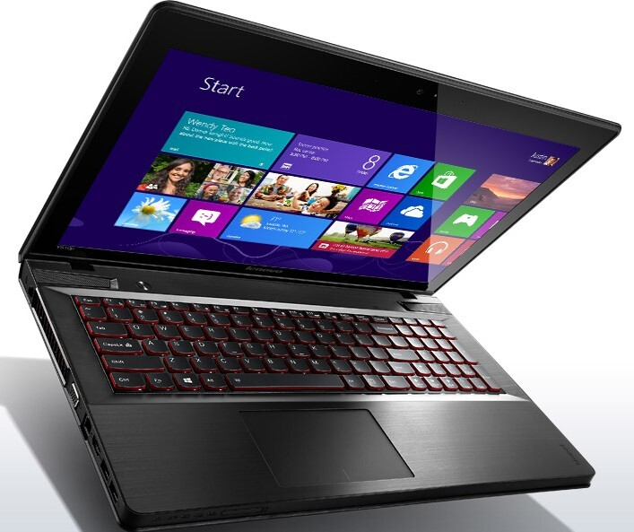
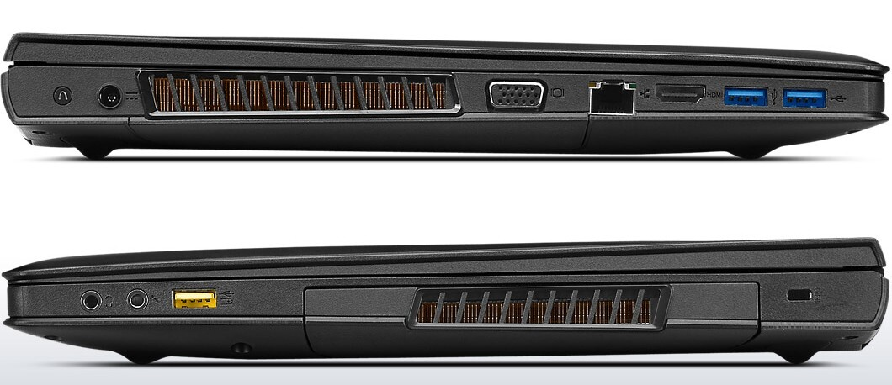
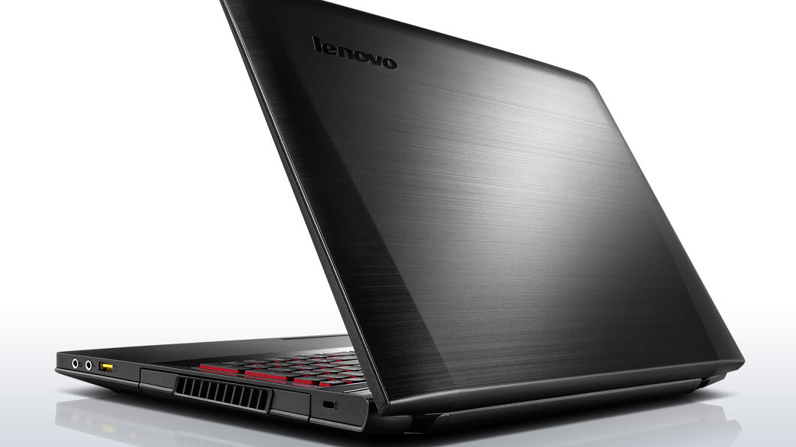
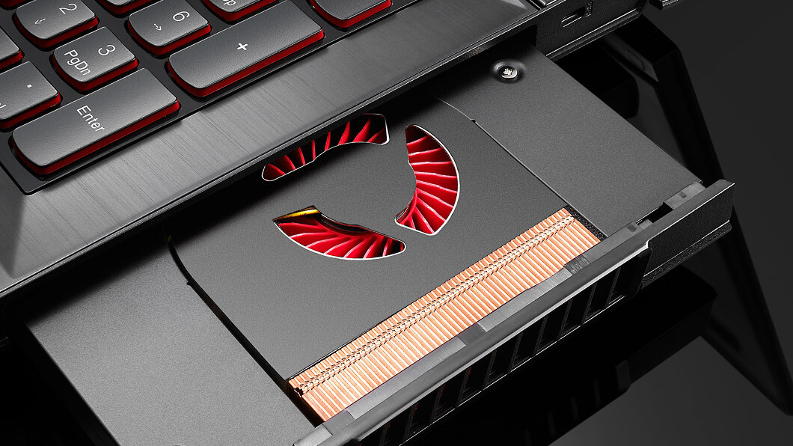
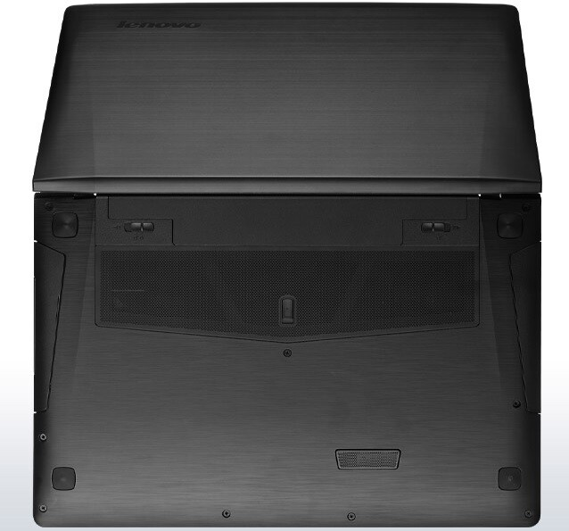
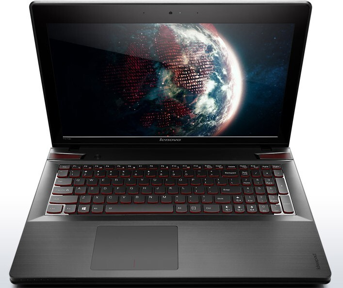
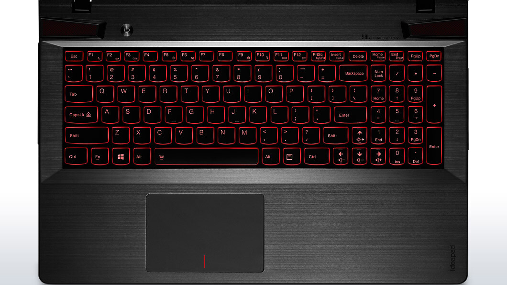
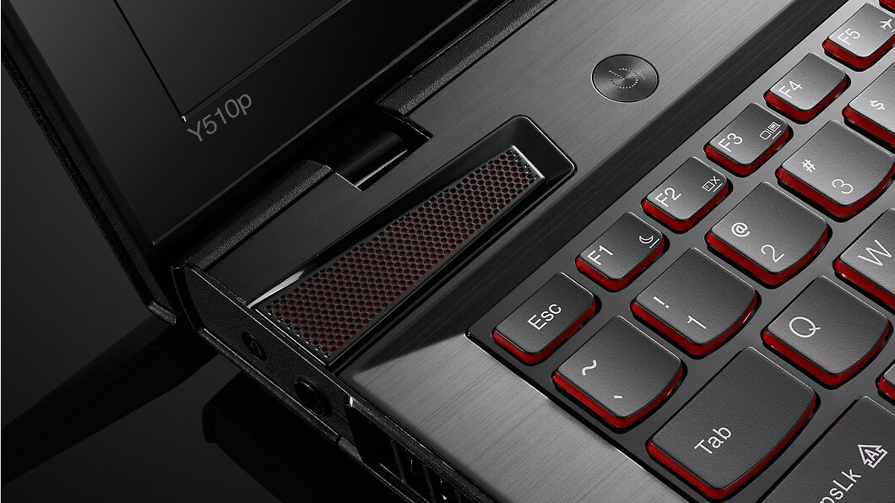

Kirjoittelin aikaisemmin [katsauksen](/2013/katsaus-lenovo-ideapad-y510p-pelilappariin) tästä Lenovon IdeaPad Y510p pelikannettavasta sekä pääsipä se podcast [jaksoonkin](/2013/007-pelilapparit). Huushollissa tuli sitten tarve tai tarve luotiin toiselle pelikoneelle kun yksi pelaamiseen tarkoitettu pöytäkone ei enää riittänytkään. Olinkin tehnyt osittain tämmöistä tilannetta varten katsausta tarjontaan sillä toisen pöytäkoneen kokoaminen ei olisi tullut kyseeseen. Reilu kuukausi sitten huusholliin rantautuikin uuden karhea Lenovo IdeaPad Y510p, aiemman katsauksen takia ajattelinkin kirjoittaa artikkelin vasta sitten, kun olin päässyt käyttämään tätä konetta kunnolla.\

### Tekniset tiedot

Aloitetaan kuitenkin siitä millaisilla teknisillä tiedoilla tämä kone saapui omaan huusholliini.

- Prosessori: Intel Core I7-4700MQ @ 2.4 GHz (Haswell)
- Näytönohjain: 2x NVIDIA GeForce GT 750M (sli)
- Muisti: 8 Gt (laajennettavissa 16 Gt)
- 24 Gt SSD sekä 1TB
- 15.6″ mattanäyttö
- 2x USB 3.0 ja 1x USB 2.0
- HDMI ja VGA
- Verkkoportti
- Kuuloke ja mikrofoni portit
- Muistikortinlukija
- JBL kaiuttimet

### Yleistä

Ulkonäöltäänhän IdeaPad Y510p on todella miellyttävä ja punaisilla ledeillä varustettu näppäimistö tuo sitä jotain tähän muuten mustaan kokonaisuuteen. Kooltaankaan kone ei ole tavallista läppäriä kummoisempi ilmestys vaikka tehoa löytyy paljon enemmän kuin perus ”markettiläppäristä”.

DVD asemaahan tässä koneessa ei ole sillä sen paikalla on juurikin tuo toinen näytönohjain, jonka saat halutessasi irti ja laitettua DVD aseman tilalle mikäli tämmöisen hankit. Itsehän en juurikaan tarvitse DVD asemaa, mutta mikäli tarve tulee niin minulla on olemassa USB porttiin menevä DVD asema jolloin saan sitä kautta luettua levyjä menettämättä toista näytönohjainta.

En missään vaiheessa odottanutkaan kovin kummoista akun kestoa tämänkaltaiselta koneelta ja en lähtisi pelisessioita vetämään pelkällä akulla. Olenkin itse käyttänyt tätä konetta juurikin verkkovirrassa ja Lenovon omassa Energy Management ohjelmassa onkin ”Optimoitu akun kunto” -tila jolloin akun kuntoa pyritään säästämään kuluttamalla sitä vaikka se olisikin verkkovirrassa. Samaisessa ohjelmassa on pölynpoisto nappi jolloin IdeaPad Y510p huudattaa tuulettimiaan.

Omaan malliini saisin vielä 8 gigatavua muistia lisää, mutta vielä ei ole ainakaan tarvetta tälle tullut. En ole itseasiassa vilkaissutkaan koneen sisuksiin sillä ei ole tullut vielä tarvetta tehdä minkäänlaista tutkimusta takakannen alle. Jossain vaiheessa tulen kuitenkin ainakin koittamaan tuulettimien putsausta sekä katson samalla mitenkä tuo muistin päivitys onnistuisi.

USB porteista mainitsen sen verran, että tässähän on yksi USB portti sellainen (teknisten tietojen kuvassa, keltainen portti) joka on ns. always on eli aina päällä ja siinä voit puhelinta esimerkiksi ladata hyvinkin simppelisti. Samaan syssyyn kehun vielä kuuloke ja mikkiportin paikkaa sillä ne ovat oikealla ja näin ne ei ole häiriöksi kun konetta pitää sylissä ja plugit ei pääse vääntymään/katkeamaan.

Merkkivalojen sijaintia voisin sen sijaan hieman moittia sillä ne ovat juurikin edessä ja ne on hieman piilossa siinäkin. Ikonitkin ovat huomaamattomia joten jos et muista ulkoa niin pitää melkein katsoa lähempää mikä valo nyt mikäkin oli. Olisin toivonut ainakin Num Lock ja Caps Lock merkkivaloja tuonne näppäimistön yläpuolelle.

### Näytönohjain ja näyttö

Tein itse sen virheen, että menin päivittämään näytönohjaimen ajureita NVIDIAn omalla työkälulla ja sehän ei tukenut suoraan tätä IdeaPadin SLI setuppia. Reilun tunnin säätämisen jälkeen sainkin palautettua ajurit takaisin Lenovon tarjoamiin ajureihin. Aloinkin sen jälkeen seurailemaan Lenovon ajurisivuja ja he julkaisivatkin uudet näytönohjaimen ajurit tässä yksi päivä ja sainkin päivitettyä ne sitä kautta. Suosittelenkin tässä asiassa välttämään Windowsin ja NVIDIAn oman ohjelman päivityskehotuksia ja kannattaa odottaa sitä, että Lenovo julkaisee omat ajurinsa.

Itse en ole vielä omissa peleissäni törmännyt siihen, että en jotain peliä olisi voinut pelata. Oikeastaan näytönohjaimiin ja näyttöön liittyen näyttöhän on FullHD-näyttö ja sen natiiviresoluutio onkin 1920×1080. Itse suurensin Windowsin asetuksista fonttia hieman sillä muuten oli niin pirun pieni, taisi olla oletuksena jopa suurennettu fontti. Pelit kuitenkin menee näppärästi tuolla natiiviresolle ja tällä näytöllä onkin kelvannut pelata.

Näytöstä vielä sen verran, että katselukulma on kerrassaan loistava ja mattanäyttö kun on vielä niin aina parempi. Itsellä ei ole ollut mitään ongelmia näytön kanssa enkä omassa käytössä ole mitään kauheampia valovuotojakaan huomannut.

### Näppäimistö ja touchpad

Näppäimistön tuntumahan on vallan mainio ja tällä onkin mukava kirjoitella, esimerkiksi tämä artikkeli on kirjoitettu kokonaan tällä IdeaPadillä. Näppäimistöstä mainitsinkin jo punaiset ledit jotka sopii tähän koneeseen mainiosti. Ne eivät ole liian kirkkaat ja eivät näin häiritse millään tavalla. IdeaPadiin on myös perinteinen Numpad laitettu ja se mahtuukin oikein näppärästi sivuun eikä sen olemassa olo häiritse normaalia kirjoittamista, mukava lisä siis varsinkin Numpadiä paljon käyttävälle.

Touchpad on itselleni suhteellisen huono ilmestys sillä olen tottunut käyttämään MacBook Pro:n touchpadiä ja IdeaPadissä sen tuntuma voisi olla parempi. Olenkin laittanut laitteen kylkeen hiiren sillä touchpadiä tulee käytettyä oikeastaan vain jos kone on sylissä tai kun hiirtä ei ole käytettävissä. Pelikäytössähän erillinen hiiri on melkein välttämätön sillä itse en ainakaan osaa pelata yhtään touchpadin avulla – ainakaan FPS pelejä.

### Reilun kuukauden käytön jälkeen

Kone on ollut meillä käytössä jo hyvän aikaa ja tästä onkin saatu jo passeli mielipide aikaan. Meillähän tätä konetta on minun lisäksi käyttänyt Outi ja oikeastaan tämä kone on ollut enemmän Outin käytössä kuin minun sillä se vähän hankittiinkin hänelle pelikoneeksi ja sitä se on ollutkin. Itse olen ”varastanut” tämän itselleni kun olen lähtenyt kotoa toisaalle pitemmäksi aikaa ja näin olen saanut pelitkin mukaan.

Ainoat ongelmat ovat olleet nuo edellä mainitut SLI ongelmat, jotka olivat oikeastaan oma moka. Muuten kone on toiminut vallan mainiosti ja meidän pelaamat pelit ovat toimineet hyppien keikkuen tällä koneella. Ihan uusimpia pelejä kuten BF4 ja Call of Duty Ghosts ei ole päässyt testiin sillä en niitä omista ja BF4 on ainut noista mikä tulee jossain välissä hankittua (kunhan se hinta tipahtaa ensin siedettävälle tasolle).

Kone on ollut itselle matkassa pariinkin otteeseen ja se on kyllä ollut tähän tarkoitukseen varsin passeli. Xbox ohjaimen ja HDMI kaapelin kanssa koneesta on saatu varsin mukava pelikone local co-op peleihinkin. Kone kiinni telkkariin ja pari Xboxin ohjainta matkaan, niin hyvin on saatu pyöriteltyä Spelunkyä ja muita laatupelejä.

Lyhyesti sanottuna, tässä siis todella loistava kone pelaamiseen ja varsinkin jos haetaan kannettavaa tietokonetta ja tämänkaltaista tehoa koneelta. Itse voinkin tällä kokeilulla suositella lämpimästi Lenovo IdeaPad Y510p pelikannettavaa!

### Plussat

- Kaksi näytönohjainta!
- Näyttö
- Tehot
- Näppäimistö
- Ulkonäkö ja koko

### Miinukset

- Touchpadin tuntuma
- Akunkesto

Tästä varsin mainio kannettava pelaamiseen ja viihdekäyttöön. Mikäli sinulla on kysymyksiä tai haluat, että testaan jotain niin heitä alla olevan lomakkeen kautta kommenttia! Voin tietty testata tarvittaessa jotain peliä mikäli sen omistan – ellen omista niin lahjoituksia voi aina tehdä ;)
