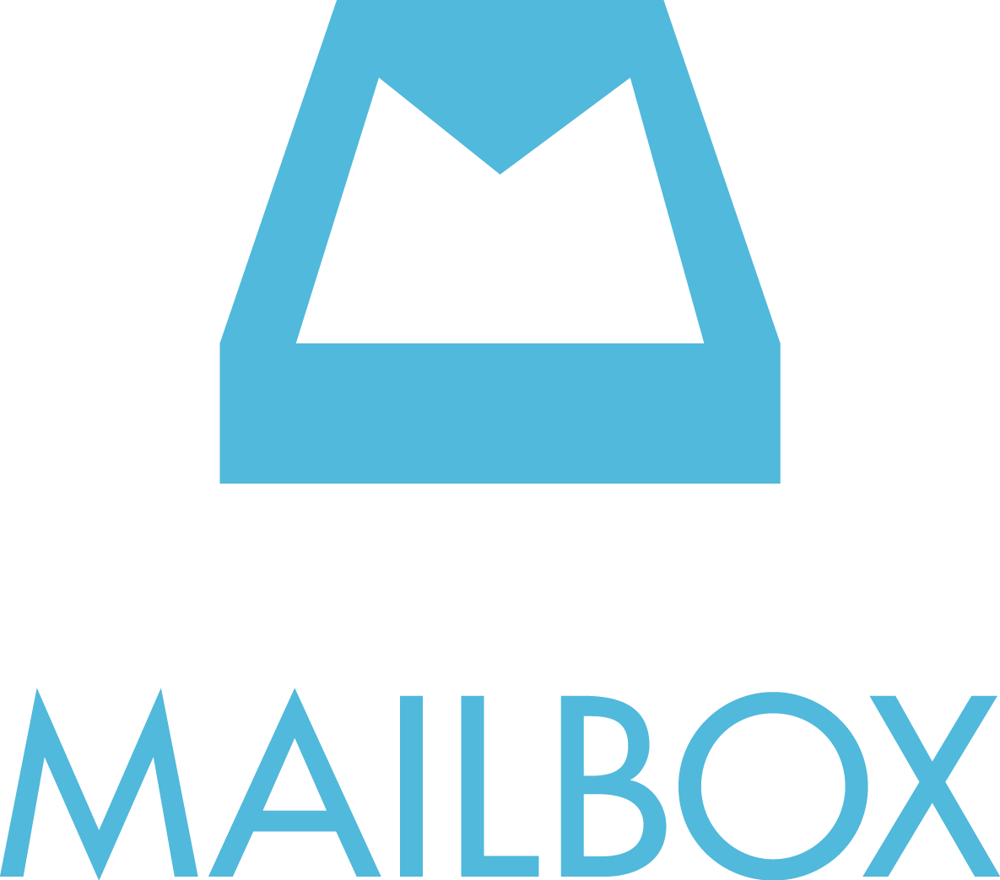
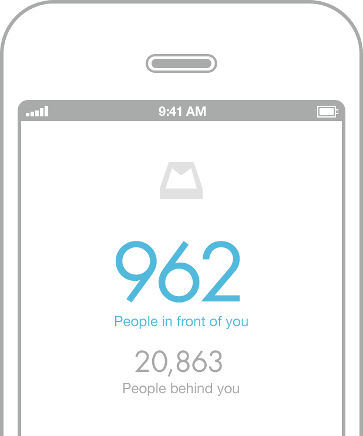
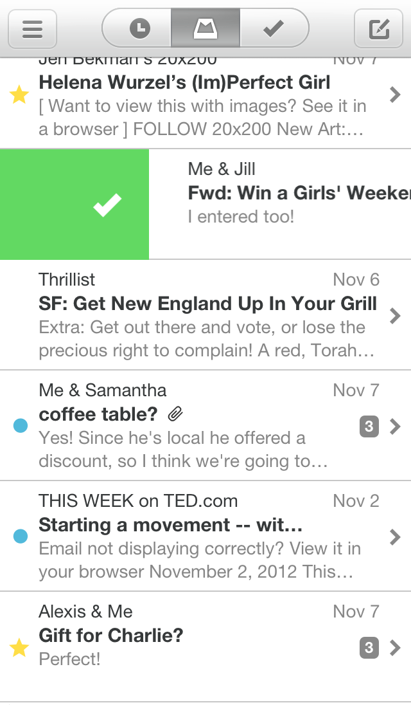
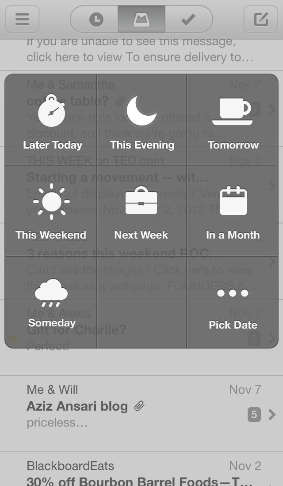

**Hei! Kiva, että eksyit sivuille, mutta tämä Mailbox iPhone sovellukseen liittyvä artikkeli on vuodelta 2013. Tämä artikkeli EI liity Suomi24 palvelun loppumiseen eikä mailbox.org palveluun!**

Mailbox on suhteellisen tuore sähköpostiohjelma vain ja ainoastaan iPhonelle. Sitä en osaa sanoa milloin tuo on tulossa muille alustoille. Mailbox keskustelee myös vain Gmailin kanssa, joten jos sinulla on joku muu kuin Gmail niin ei sinun kannata paljoa pidemmälle lukea ellet ole sitten halukas vaihtamaan.

Mailbox on sinällään kuten muutkin sähköpostiohjelmat, mutta siinä on ominaisuuksia joita ei iPhonen perus mailissa ole. Siinä nimittäin sähköpostit näkyvät aktiivisena niin kauan kuin poistat, merkkaat tehdyksi tai siirrät postin käsittelyä. Käyttöönotto onkin hauska homma jos sinulla on useampi tuhat postia laatikossasi… Silloin sinulla on siivoustalkoo edessäsi kuten allekirjoittaneella.

Tätä ohjelmaa pitää tosin jonottaa. Itse taisin olla jonossa tätä ohjelmaa varten noin viikon verran. Itse kun astuin jonoon niin tilanne oli suhteellisen hauska sillä minua ennen jonossa oli 300 tuhatta jonottajaa. Kaikille meille oli yhteistä se, että halusimme tämän sovelluksen.

Jonotus oli tosiaankin sen väärti sillä itselläni oma Gmail tili on ollut vuodesta 2005 asti ja se kaipasikin siivousta. 8 vuoden edestä sähköposteja odotti siis käsittelyä sillä oli ennemmin poikkeus jos poistin tuolta Gmailista jotain – saattaahan sitä joskus tarvita?

Suurimman osan siivouksesta hoisin tosin Gmailin webkäyttiksen kautta sillä tein siivouksen niin, että hain tiettyjä lähettäjiä kuten uutiskirjeet yms. ja poistin tällä tapaa useita viestejä kerralla. Sainkin siivottua Gmailin kautta sähköpostin hyvinkin siistiin kuntoon ja käsittelin Mailboxilla vain pari kolme sataa viestiä.

Viestien käsittely oli suhteellisen simppeliä tuolla. Jos halusit poistaa niin pitkä pyyhkäisy oikealle ja jos halusit säästää jotain niin nopea pyyhkäisy oikealle. Mikäli taas haluat johonkin ryhmään laittaa sähköpostin niin pitkä pyyhkäisy vasemmalle ja jos taas halusit käsitellä viestiä myöhemmin uudelleen niin lyhyt pyyhkäisy vasemmalle. Mailboxin toiminta on yksinkertaista ja nykyään oma Gmailin sähköpostilaatikko onkin hyvin siisti.

Mainitsinkin tuon, että viestin voi siirtää käsiteltäväksi myöhemmin. Tämä on erittäin hyvä ominaisuus sillä itsellä on tilanteita jolloin haluan katsoa esim. illalla sähköpostia tarkemmin – Mailbox mahdollistaa sen helposti. Pyyhjäisen sähköpostin vasemmalle ja valkkaan milloin haluan käsitellä sen. Sitten kun käsittelyn aika tulee niin Mailbox ilmoittaa siitä sinulle – helppoa kuin mikä.

Sovelluksen ulkoasukin on simppeli ja sitä kautta minusta erittäin hyvä ja toimiva. Toiminnallisuudet toimii hyvin ja oikeastaan mitään en lähtisi muuttamaan tältä saralta.

Kuten varmaan on käynyt selvästä tuon käyttäminenkin on helppoa kuin mikä ja itse ainakin pidän tuon logiikasta ja käyttäytymisestä. Ainut mistä voisi nillittää on se ettei tuo ole suomenkielisenä saatavilla – ainakaan vielä. Ehkä joku päivä käännetään tämäkin sovellus suomeksi.

Mainitsinko vielä sen, että Mailbox on täysin ilmainen sovellus. Mailboxin saa hankittua AppStoresta. Tietysti se tuntuu hyvältä katsella Mailboxista omaa Gmailin laatikkoa kun ei niitä turhia sähköpostejakaan ole enää. Itse säästin vajaat 2000 sähköpostia ja muut jouti roskakoriin.

Suosittelen lämpimästi, kerrankin oma sähköposti on minun hallinnassani eikä turhia posteja enää ole ja nyt tapanani on poistaa turhat postit heti kun olen ne lukenut – ei jää uutiskirjeet enää kuleksimaan!
