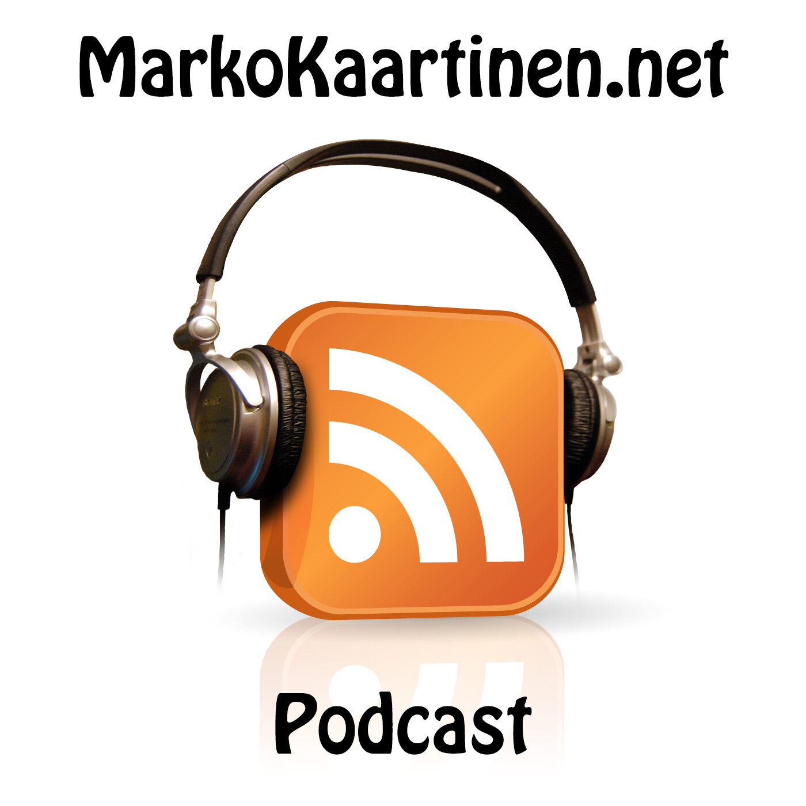
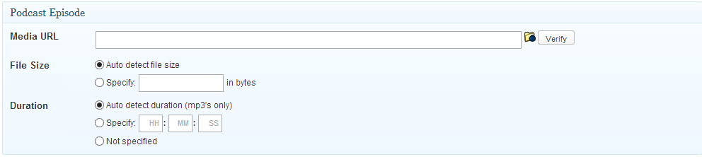
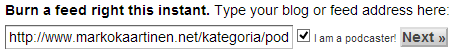

Tätä on parikin minulta kysellyt ja vastaankin tähän aika syvääluotaavasti tämän blogikirjoituksen avulla. Käynkin läpi ensin ohjelmia ja välineitä millä itse tätä olen tehnyt ja tämähän on vain miten minä tein tämän ja tapoja on monia – samoin ohjelmia.

Itsellä on tällä hetkellä nauhoittamista varten käytössä oma headsetti, jonka hankin tuossa keväällä pelaamista varten kun entinen oli tiensä päässä. Headsetti on **Steelseries Siberia V2** ja sen kaveriksi hankin vielä **DeLOCK Sound 7.1** -USB-äänikortin sillä USB-portin kautta saan vielä hitusen paremman äänen ulos tuosta kuin pelkästään 3.5mm plugin kautta. Tulevaisuudessa, jos homma pyörii kivasti ja sitä kautta innostus lisääntyy ja ehkä rahavaratkin niin ajattelin hankkia paremman mikrofonin, jotta saisin vielä parempaa ääntä ulos päin.

Päätin tehdä heti alusta tuon podcastin nauhoituksen MacBook Prollani sillä kannettava on kuitenkin kannettava ja sen voi kopata helposti matkaankin mukaan. Tutkiskelin jonkin verran sitä millä ohjelmilla porukka tekee näitä Macillä ja päädyin nauhoittelemaan maksullisella **Audio Hijack Pro:lla**, hinta ei ollut paha vain 32 dollaria ja kokeilin tuota useaan otteeseen Trial versiona. Toki jos haluat ilmaiseksi päästä niin Audacity toimii myöskin! Tuo pystyy nauhoittamaan myös Skypen keskusteluja ja oikeastaan mitä ohjelmaa vain, eli Chromen kautta voisin esim. hangouttia nauhoitella. Toinen suosittu sovellus oli **Levelator** joka tasoittaa nauhoituksen ”levelsit” ja tämä on tosiaan vielä täysin ilmainen sovellus! **iTunesilla** muutan tuon Audio Hijack Pro:n tuottaman .aiff filun mp3 filuksi. Tätä vaihetta tosin pohdiskelen vielä uudestaan sillä iTunesille etsin hieman parempaa vaihtoehtoa vielä. ID3 tagit pitää tietysti pistää kuntoon ja sen hoidan **Tagr** nimisellä ohjelmalla.

Työnkulkuhan on tähän mennessä seuraavanlainen:

1.  Teen valmistelut podcastin jaksoa varten Google Docsissa ja päätän aiheet jaksoa varten
2.  Nauhoitan podcastin Audio Hijack Pro:lla yhdellä otolla
3.  Nauhoituksen jälkeen heitän filun Levelator ohjelman kautta
4.  Levelatorista tulleen filun muutan mp3 muotoon iTunesin avulla
5.  Laitan vielä ID3 tagit kuntoon Tagrilla.

Tämän jälkeen minulla on julkaisukunnossa oleva mp3 tiedosto. Siitä siirrynkin WordPressin puolelle julkaisemaan podcast jaksoa ja kerronkin siitä mitä minä käytin siellä puolen.

Tällä hetkellä siirrän tuon mp3 tiedoston tähän samaan virtuaalipalvelimeen kuin missä tämä sivusto on, mutta jossain välissä siirryn todennäköisesti pelkästään podcasteille tarkoitettuun hostiin, näin filut on omassa paikassa ja ei vie kaistaa tästä sivutilasta. Mutta pääsääntöisesti kun mp3 on valmis niin se siirretään verkkoon.

Siirron jälkeen luon uuden postauksen WordPressissä ja asensin sen avuksi PowerPress lisäosan, mutta asetuksien puolelta en laitellut juurikaan muita kohtia kuntoon kuin audiosoittimen sillä en halua PowerPressin hoitavan tuota julkaisua syötteeksi asti vaan haluan sen vain laittavan tuon soittimen sivuilleni. PowerPress tuokin postauksen luontiin yhden kentän lisää, kuva alla:

Tuohon Media URL kenttään pistän siirtämäni mp3 tiedoston osoitteen ja painan verify – tämän jälkeen kun julkaisen niin PowerPress laittaa soittimen kuntoon ja RSS feedissä on tarvittavat infot podcastia varten.

Sen verran vielä ennen kuin julkaisen postauksen niin pistän artikkelille kategorian Podcast sillä WordPressissä saa mistä tahansa kategoriasta syötteen ulos kun pistää kategorian osoitteen perään /feed -sanan. Tämän jälkeen julkaisen Podcastini blogiin.

Kun minulla on podcastit tietyssä kategoriassa ja voinkin Feedburneriin pistää syötteen osoitteen ja pistää täpän I’m a podcaster! Alla on vielä kuva miltä se näyttää kun heitän osoitteen siihen ja miten teet sen Feedburnerin syötteen. Tuo täppähän antaa sinun syöttää kansikuvan yms. tiedot iTunesia varten.

Käytän Feedburneria sen takia tässä välissä sillä jos haluan joskus siirtää feedini erikseen tästä sivusta niin minun ei tarvitse kuin muuttaa Feedburnerin asetuksissa oleva syötteen osoite mistä Feedburner hakee sen. Tällöin ei tarvitse iTunesiin tai käyttäjille antaa uutta osoitetta.

iTunesiin saat lisättyä podcastin hyvinkin helposti, sinun täytyy vain käydä syöttämässä syötteen osoite eli Feedburnerin osoite iTunesiin. Itse sain lisättyä podcastini iTunesiin käyttämällä tätä [linkkiä](https://buy.itunes.apple.com/WebObjects/MZFinance.woa/wa/publishPodcast), sinun pitää asentaa iTunes ellet ole jo sitä asentanut!

Näin listattuna nämä asiat tarvitset itsellesi jos haluat minun tavalla tämän verkkoon:

- Paikan jonne siirtää mp3 tiedostot
- WordPress
- PowerPress lisäosa WordPressiin
- Feedburner
- iTunes

Tässä on kutakuinkiin se prosessi millä teen podcasteja ja mitä minulla on täällä WordPressin puolelta ja mitä tapoja käytän muutenkin tuon julkaisemiseen. Mikäli sinulla on jotain kysymyksiä tai kommentteja niin antaa tulla!
