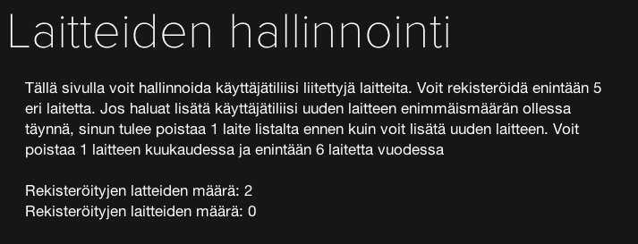

Olen käytellyt tässä jonkin aikaa HBO:n palvelua jossa voin katsella tietokoneella ja iPadillä sarjoja ja elokuvia. Olen kuitenkin harmissani sillä palveluun tahtoisin muutaman parannuksen. En nykyisellään ajatellut uusia tätä kokeilujakson jälkeen.

## Muistaisi mihin jäin

Tällä tarkoitan sitä, että palvelu näyttäisi minulle heti etusivulla seuraamani sarjan seuraavan jakson. Jos katsoin esim. Game of Thronesin ensimmäisen kauden toisen jakson – palvelu voisi näyttää minulle suoraan kolmannen jakson. Näin pääsisin suoraan katsomaan tätä jaksoa. Netflix muuten tekee tämän oivallisesti.

## Kevyempi etusivu

Nykyisellään etusivulla on isot kuvat ja jokunen sarjan/elokuvan kuva. Olisi kiva jos pääsisi heti sarjojen listaukseen. Taas vähän niin kuin Netflixin puolella. En halua, että palvelusta tehtäisiin täysin samanlainen, mutta tahtoisin joitain ominaisuuksia siihen.

## Kirjoitusvirhe?

Mielestäni omistan laitteita enkä latteita. Pieni hauska virhe jonka huomasin tässä.

## Laitteiden lisäys/poisto

> Voit poistaa 1 laitteen kuukaudessa ja enintään 6 laitetta vuodessa

Miksi?? Ei tässä ole mitään järkeä. Miksi näiden kanssa ei voi puljata niin paljon kuin lystää?

## Laitetuki

Konsolit, ne on kuulemma tulossa. Ne olisi hyvä olla mahdollisimman pian sillä ei kaikilla ole taitoa kytkeä tietokonetta kiinni televisioon. Konsoli on kuitenkin monessa taloudessa ja sen kautta on helppo katsoa tämänkaltaista palvelua.

https://twitter.com/HBO_fi/status/280583670694285312

## Katselurajoitus

Saan usein herjaa, että eihän joku toinen laite ole käytössä. Tästä pääsen eteenpäin sillä, että suljen ja avaan ohjelman. Miksi tätä et voi katsoa esim. kahdella laitteella yhtäaikaa?

## Akkusyöppö?

Tätä en varmaksi sano, mutta jotenkin tuntuu että iPadillä akkua kuluu tuhottomasti. Verrattuna Netflixiin mielestäni akunkulutus on korkeampi. Onko joku muu huomannut samaa?

## 12kk määräaikainen tilaus

Miksi, oi miksi tätä ei voi tilata kuukausi kerrallaan. Sarjoja ei välttämättä tule koko aikaa lisää ja joka kuukausi ei varmaan tulisi katsottuakaan. Vuoden tilaus tuntuisi siis turhalta. Jos hyvä HBO:n väki ei muuta tee niin tehkää tämä muutos!

## Loppusanat

Tässä jokuinen epäkohta mihinkä olen kiinnittänyt huomiota. Nämähän ovat siis omia mielipiteitä ja olen kyllä muuten pitänyt palvelusta. Sarjathan ovat loistavia, mutta en usko hyötyväni koko vuoden mittaisesta tilauksesta.

Toivotaan, että jotain tehdään ja kyllä he varmaan tekevät. Teidän mielipiteet ovat aina tervetulleita!
