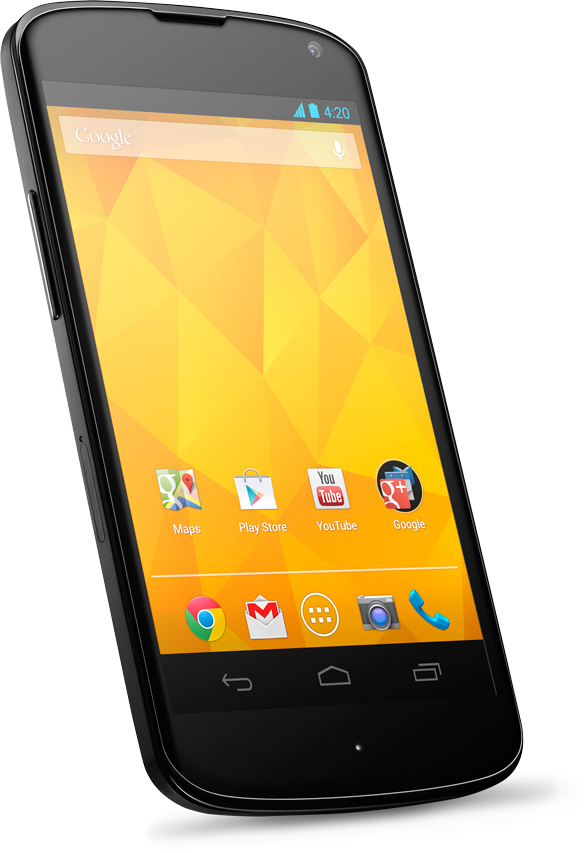

Google on alkanut puskemaan omia loistavia tuotteitaan ulos kuten Nexus 7 täppärin, joka tuli hankittua. Onneksi siinä sentään hinta oli täällä pohjolassakin kohdallaan. LG:n valmistama Googlen Nexus 4 kännykkä taas onkin aivan toinen tarina.

Otetaan kuitenkin ensin hieman teknistä tietoa tästä puhelimesta esiin. Puhelin on 4.7 tuuman näytöllä varustettu ja sen resoluutio on 1280×768 eli aika peruskauraa siltä osin. Takakamerana on 8 megapikselin kamera ja edessä on 1.3 megapikselin kamera. Puhelimessa on perus WiFi ja Bluetooth yhteydet sekä 3G yms. yhteydet.

Sisäistä muistia laitteessa on joko 8 tai 16 gigaa, mutta ainakin kahdessa kohta mainittavassa kaupassa oli vain 16 gigaisia malleja myynnissä. RAMmia Nexus 4 luurissa on 2 gigatavua ja suorittimena toimii Qualcomm Snapdragon™ S4 Pro CPU. Puhelimessa tulee uusin Android Jelly Bean käyttöjärjestelmä ja ominaisuuksina on tietysti GPS, kompassi, kiihdytysanturi ja muuta peruskamaa.

Käpistelin tätä luuria pari viikkoa sitten Gigantissa ja se tuntui oikein mukavalta ja voisipa se olla loppujen lopuksi seuraava puhelimenikin ellei Lumia 900 miellytä enää. Tässä on vain yksi älytön asia… nimittäin se hinta…

Nexus 7 täppärin hinta on UK:n Google Playssä 159 puntaa eli noin 189 euroa. Suomessa vastaava malli maksaa noin 269 euroa. Ero ei siis ole kova. Nexus 4 puhelimen 8 gigan malli on 239 puntaa (n. 285 €) ja 16 gigan malli on 279 puntaa (n. 333 €). Sitten kun katotaan paljonko hinta on suomalaisissa kaupoissa. Esimerkiksi Gigantissa hinta on hulppeat 579 euroa ja Verkkokauppa.comissa hinta on 599 euroa. Molemmat suomalaiset kaupat myyvät vain 16 gigan mallia. Hinnassa on siis eroa brittihintoihin noin 250 euroa, kun taas Nexus 7 täppärissä hinnan ero oli 80 euron luokkaa.

Puhelin kiinnostaisi, mutta ei missään nimessä tuolla hintaa. Harmi ettei tästä tullut järkevän hintaista puhelinta hyvillä ominaisuuksilla tänne pohjolaan… Britteihinkö pitää lähteä, jotta saa tämän kohtuullisella hinnalla?
