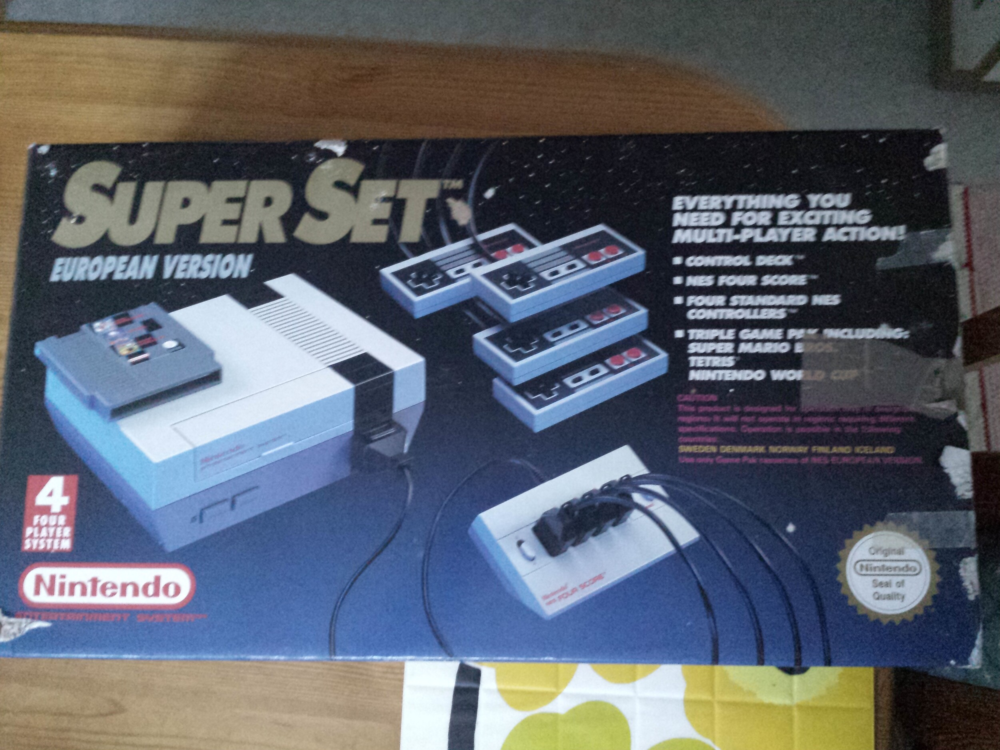
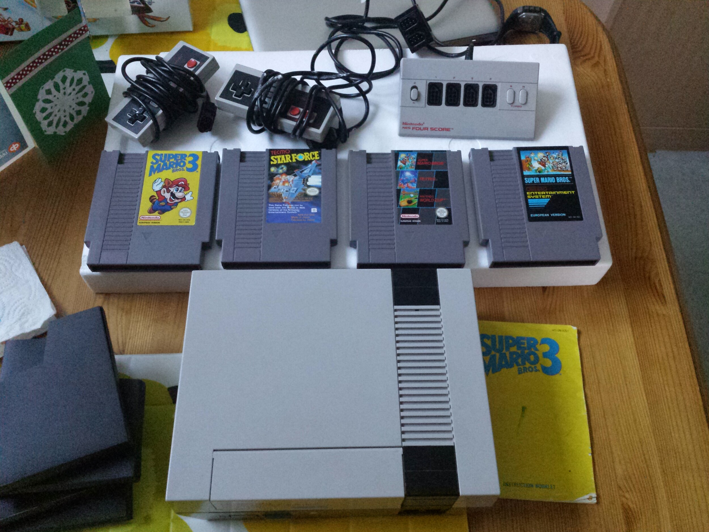
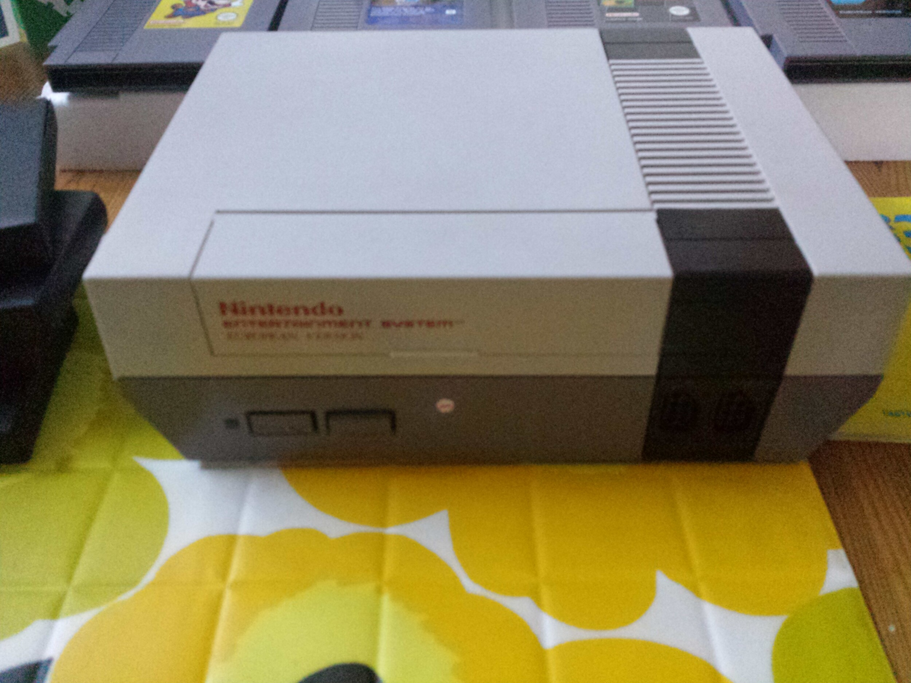
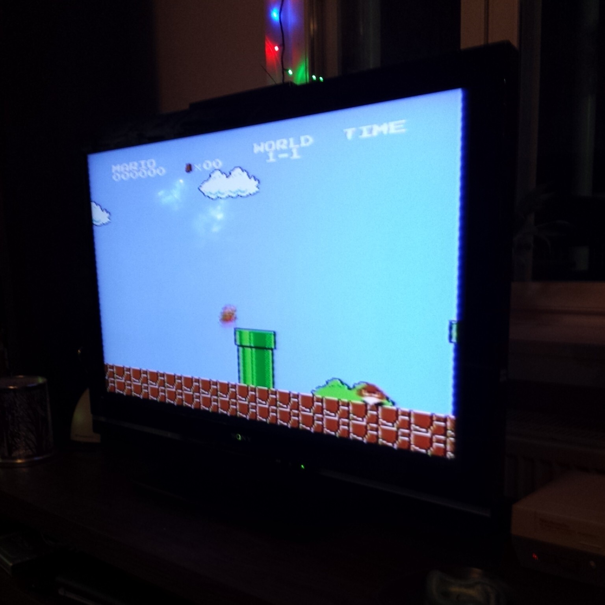
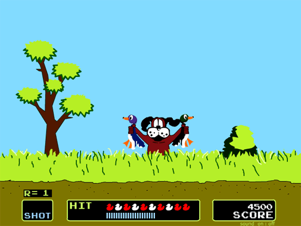
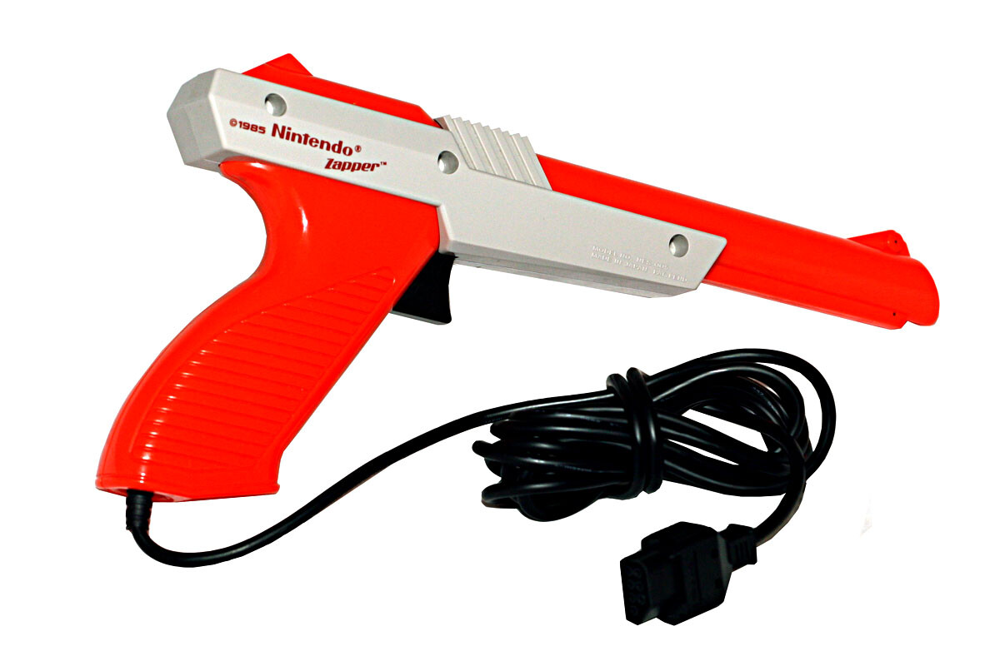

Minähän en omistanut nappulana Nintendoa, meillä oli Sega. Kävimme siis naapurissa pelailemassa Nintendon Duck Hunttia. Sega on muuten vieläkin tallella, mutta viimeisimpien tietojen mukaan se ei toimi. Viikonloppuna tuli viestiä kaveriltani, että hän löysi kirpputorilta Nintendon pilkkahintaan. Laittelin takaisin viestiä, että ostithan sen ja otan heti sen. Noh hän ei silloin ostanut ja maanantaina kävi sitten koppaamassa sen talteen.

Eilen sain sitten käsiini tämän Nintendon ja vaikka kaverini oli panostanut selvästi paketointiin (oli muuten joululahjapapereissa) niin olihan se aukaistava. Oli tämä sentään ensimmäinen Nintendoni. Paperit pääsivät parempiin suihin, nimittäin Paavo-kissa sai siitä joulun ensimmäiset paperit ja se olikin sitten koko illan paras lelu.

Tämä setti minkä kaveri löysi oli Nintendo Super Set, johon on alkuperäisesti kuulunut neljä ohjainta, Nintendo, ohjainten jakaja sekä pelikasetti missä on kolme peliä (Super Mario, Tetris ja Nintendo World Cup). Paketti oli kuitenkin lähes täydellinen, siitä puuttui kaksi ohjainta. Tosin siinä oli kolme peliä lisää tuohon alkuperäiseen ja ne olivat Super Mario (tämä olikin tuolla kolmen pelin kasetillakin), Super Mario 3 sekä Star Force. Matkassa oli tietysti virtapiuha sekä kaapeli millä tämän sai telkkariin kiinni perus antennin paikkaan.

Itse Nintendohan on suhteellisen simppeli laatikko joka ei paina oikeastaan mitään verrattuna nykykonsoleihin. Olin hieman yllättynyt miten tämä oli näin hyvässä kunnossa ja mitenkä oli alkuperäinen Super Set laatikko tallessa vielä.

Pitihän sitä tietysti alkaa kokeilemaan, hieman epäuskoisena lähdin kytkemään piuhoja kiinni 40 tuuman FullHD telkkariin ja mietin mitenkähän tämä tulee toimimaan. Nintendossa on myös s-video piuhalle mahdollisuus, mutta tätä minulla ei ollut saatavilla – pitänee se ostaa tässä kunhan eteen sattuu.

Nintendohan ei aluksi tuntunut lähtevän toimimaan tuossa. Ihmettelin miksi ei näy kanavapaikalla 3 vaikka näin sen olin laittanut tuolta Nintendon vivusta (vaihtoehtoina 3 ja 4). Hetken pähkäiltyäni ja Googlattuani tajusin, että minun telkkari on kaapeliverkossa ja antenniverkkoon pitänee kanavat hakea, jotta televisio tajuaa kanavalta 3 tulevan edes signaalia. No hain kanavat ja homma ei lähtenyt vieläkään pelittämään. Pistin sitten vivun asentoon 3 ja hain kanavat uusiksi vielä. Tämän jälkeen oli vastassa normaalista poikkeava lumisade ja tämän jälkeen hieman säädin Nintendon päässä olevaa johtoa ja tuli harmaa ruutu.

Itse kun en Nintendoa omistanut niin Outi tiesi heti, että puhalletaan kasettiin. No paineilmaa hieman kehiin niin kasettiin kuin koneen sisällekkin. Tämän jälkeen ilo oli ylimmillään kun FullHD telkkarissa pyöri se aito ja alkuperäinen Super Mario.

Yllätys oli itselle se, että Nintendo toimi koko ruudun leveydellä ja sururaitoja ei ollut. Liekö telkkari sitten venyttänyt kuvaa, en sitä älynnyt näprätä eilen vaan olin tyytyväinen siihen, että koko vekotin yleensä toimi. Kokeilimme tietysti nämä muutkin kasetit läpi ja yllätykseksi kaikki pelit toimivat moitteetta.

Tämän jälkeen googlailinkin vielä saisiko tuon Duck Hunt pelin toimimaan vielä ja mistä sen saisi yleensä hankittua vielä. Tämä haave kuitenkin murskaantui pikaisesti sillä ilmeisesti Duck Hunt pelin valopistooli vaatii vanhan kuvaputki telkkarin. En siis tule tätä hankkimaan sillä ei ole minkäänlaista halua siirtyä takaisin kuvaputki telkkareihin ja sille ei varsinkaan ole tilaa missään.

Pelissähän ammuttiin valopistoolilla ankkoja ja osuneet ankat sitten noukki metsästyskoira. Koirahan oli koko pelin ärsyttävin otus sillä se hihitteli sinulle kun et osunut näihin ankkoihin.

Tuohon valopistooliin palatakseni, sen toimintalogiikka on näin vanhemmalla iällä mielenkiintoinen. Alla lainaus [Wikipediasta](http://fi.wikipedia.org/wiki/NES_Zapper):

> Kun liipaisinta painetaan, peli väläyttää ruudun lyhyeksi ajaksi kokonaan mustaksi. Kun ruutu pimenee, piirretään myös yhden framen ajaksi valkoinen suorakulmio kohtaan, johon pelaaja voi osua ja saada pisteitä. Diodi aseen takaosassa saa tämän jälkeen tiedon valon intensiteetistä. Tieto valon intensiteetistä lähetään konsolille. Mikäli tulkitaan, että signaalissa oli lasku ja tämän jälkeen jyrkkä nousu, oli pelaajan ”ampuma” pikseli ruudulta suorakulmiossa. Tällöin pelaajalle merkitään osuma. Monen pikselin ”kohdealueita” tuettiin piirtämällä vilkkuva, valkoinen suorakulmio jokaisen potentiaalisen pikselin ympärille.

26 vuotta Nintendon Eurooppaan tulon jälkeen on minullekkin saatu Nintendo. Pitänee alkaa seuraavasti metsästämään pelejä tälle konsolille. Mikäli sinulla roikkuu nurkissa ylimääräisiä pelejä niin saa laittaa tulemaan tänne päin!
