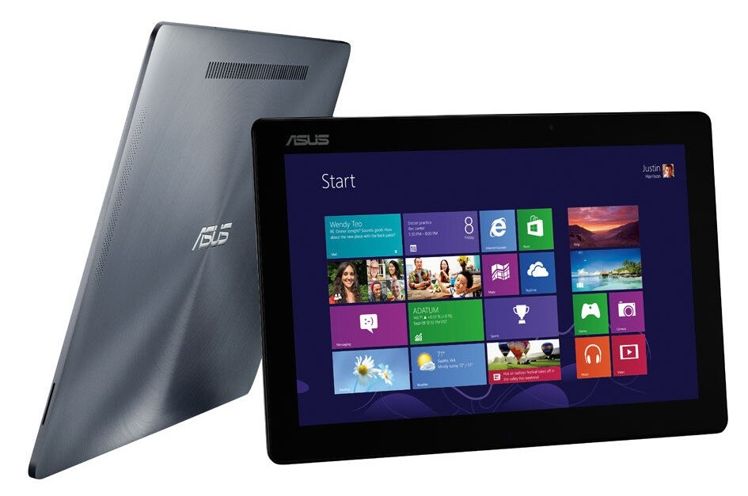
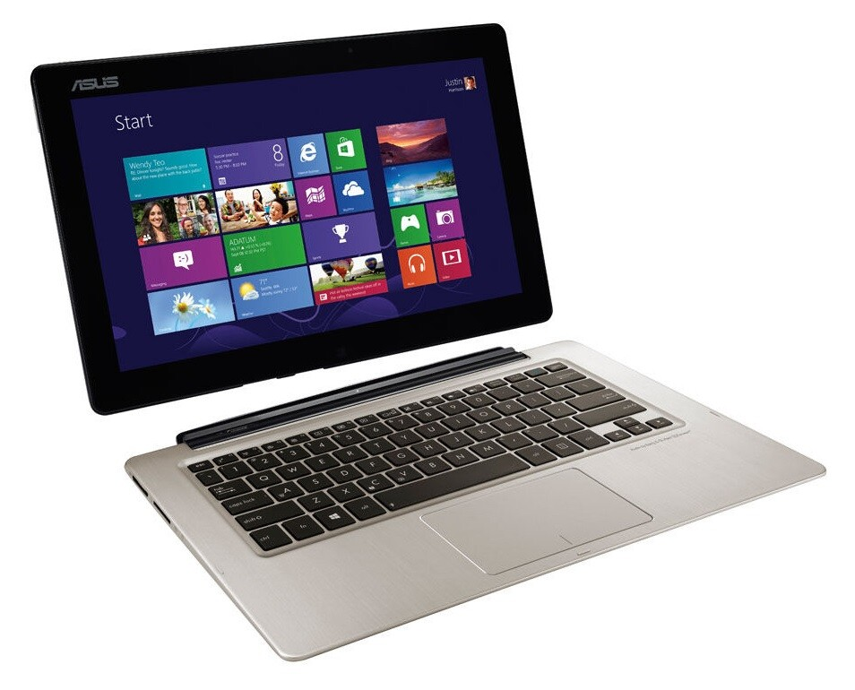
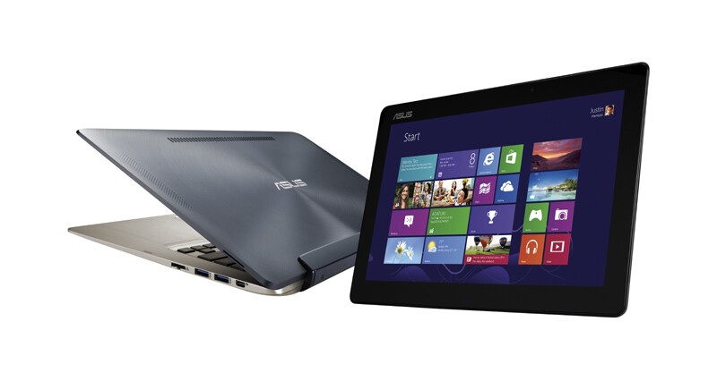
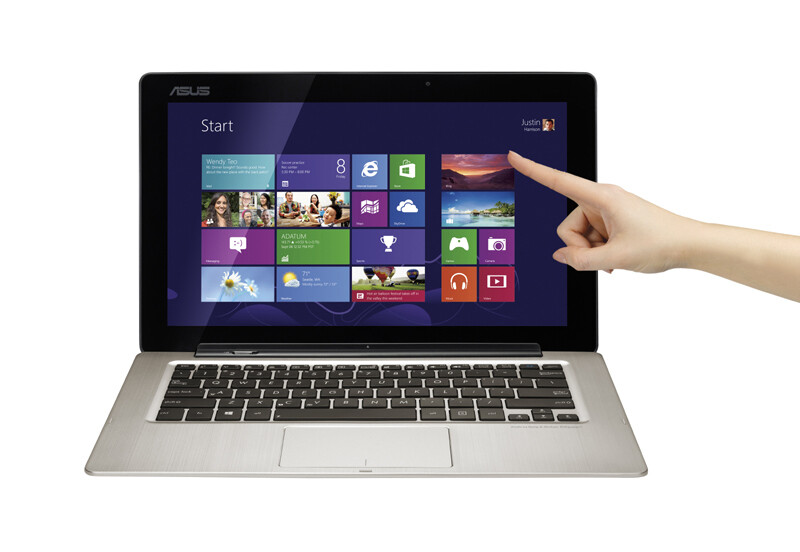
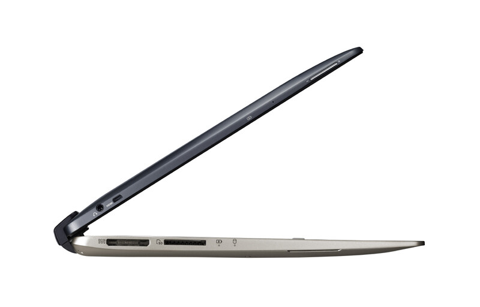
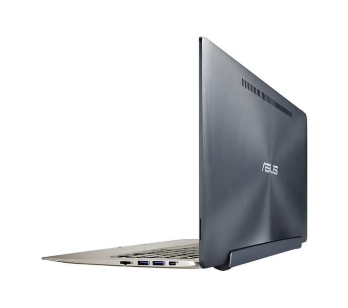

Täppäri vai läppäri eli tablet tietokone vai kannettava tietokone – vai onko kumpaakaan vai onko molempia. Tähän kysymykseen yritin löytää vastausta ja tulin siihen ratkaisuun, että tämä on enemmän läppäri kuin täppäri. Koneen erikoisuushan on se, että tässä on irroitettava näyttö ja näppäimistö toimii telakkana.

Näyttöön on ”survottu” erittäin ansiokkaasti näytönohjain, prosessori, ssd -levy, muistit, akku sekä muut koneen peruskomponentit. Telakkaosaan on laitettu sitten toinen akku, USB 3.0 portteja sekä 500 gigatavua lisätilaa. Pelkällä näytöllä siis pystyt tekemään käytännössä kaiken mitä normaalillakin koneella, ainut että et pääse tuon telakan lisätilaan käsiksi ilman että kone on liitettynä siihen.

Konehan on teknisiltä tiedoiltaan seuraavanlainen:

- 3\. sukupolven Intel® Core™ i7-3517U prosessori 1.9 GHz
- Näyttö: 13.3″ FullHD (1920×1080) IPS LED, glare touch
- Muisti: 4 GB DDR3-1600
- Kiintolevy: 500 HDD + 128 GB SSD
- Näytönohjain: Intel HD4000
- Verkko-ominaisuudet: WiFi 802.11b/g/n, Bluetooth 4.0
- Käyttöjärjestelmä: Windows 8 64-bit
- Liitännät: 2 x USB 3.0, micro HDMI, mini DisplayPort, RJ45, kuuloke
- Muuta: SD-muistikortinlukija, webkamera
- Akku: 2+2-kennoinen Li-Ion 5000 mAh + 3120 mAh
- Paino: 1.9 kg

Ulkoasultaan TX300 on erittäin hienon näköinen. Itse tykästyin välittömästi koneen muotoiluun kun otin koneen pois paketista. Näppäimistö ja kosketushiiri on hyväntuntuisia ja itse tykkäsin käyttää niitä, osittain varmaan senkin takia koska ne muistuttivat MacBookkini näppäimistöä ja hiirtä. Painoahan näytöllä on vajaa kilo ja suunnilleen samanverran painaa telakka. Parin kilon koneesta on siis kysymys ja ainut mikä itseä häiritsi tuossa painossa oli se näytön paino, sylissä pitäessä paino jakautui oudosti kun telakka osa ja näyttö oli samanpainoisia – tottumiskysymys tämäkin.

Näyttöhän on 13.3 tuumainen FullHD näyttö ja mikäli tämä olisi pelkkänä tablettina myynnissä niin ei – siis ei tuo ole tabletti. Itse en tuota kokenut tablettina jo näytön koon takia sekä tuon kilon painon takia. Se oli hieman liian iso ja kömpelö pelkkään tablettikäyttön, MUTTA pitää ottaa huomioon myös se, että näyttöosassa on tuota tehoa enemmän kuin perustabletissa – tuo on siis täysiverinen Windows 8 kone!

Niin, näyttöhän on kosketusnäyttö ja itse kun en hirveämmin käytä tuota Windows 8 tiilikäyttöliittymää niin en ehkä saa irti tuosta kosketusnäytöstä niin paljon kuin jotkut muut. Itse kun vieläkin haluan käyttää esim. Skypeä ja selainta työpöytämoodissa ja ensimmäinen asia mitä teen kun avaan koneen on se, että menen työpöydälle. Pitäisi ehkä ottaa itseä niskasta kiinni ja hyödyntää tiiliäkin enemmän, vinkkejä? Itse kosketusnäyttöhän toimi moitteetta ja otti kosketukseni oikein kivasti, ainut oli se Windows kosketusnappi siellä näytön alalaidassa, se ei vain tykännyt minusta kaikissa tilanteissa.

Pelaaminen, itsehän olen pelaaja ja vielä PC-pelaaja. Koitin jokusta peliä ja en epäillyt tämän koneen olevan mikään pelikone, kuten oma pöytäkone on. Minecraftin FTB Ultimate paketti sai koneen hieman yskimään ja ei sitä oikein jaksaisi pelailla tuolla koneella – tietty voisi tweakata asetuksia enemmän ja saada pelin toimimaan paremmin. Itse kuitenkin pelailin FTL peliä tuolla hyvinkin mielelläni, toivoin hieman parempaa kokemusta kosketusnäytöllä – toki se oli odotettavissa, että kosketusnäyttö ei toimi peleissä jos sitä ei ole erikseen sille tehty sillä muuten kosketusnäyttö emuloi hiiren käyttöä. En siis lähtisi tituleeraamaan tätä pelikoneeksi ja en usko, että tätä on tarkoitettukaan siihen käyttöön – vanhemmat pelit toimivat todennäköisesti moitteetta ja saat kulutettu aikaasi pikkupeleillä kuten em. FTL.

Konehan on omiaan kodin surffikoneeksi ja tekstinkäsittelyyn, sekä näytön voit oikeasti ottaa kainaloon ja painua sohvalle tai sängylle katsomaan leffaa tai näyttämään lomakuviasi FullHD näytöltä. Tehoja noihin tuossa on enemmän kuin tarpeeksi! Toinen käyttötarkoitus tälle koneelle löytyy toimistosta, lähtisin tätä nimittäin työkoneeksi ennemmin pistämään. Koneen koko ja paino on sen valtteja ja tämä on oikeasti kannettava tietokone, voit samaten kopata näytön kainaloon ja käydä näyttämässä dokumenttia/työtä työkaverille naapuritoimistoon.

Tämmöiseen koneeseen ei varmasti ihan heti törmääkkään, itse en ollut ennen nähnyt tätä konetta livenä ja epäilen tämän olevan hieman harvinaisempi tapaus muutenkin tuolla ”luonnossa”. Tällä koneella saat päät kääntymään viimeistään siinä vaiheessa kun napsautat näytön irti telakasta ja käppäilet se kainalossa toisaalle.

Niputetaan hieman tätä viikkoa yhteen ja lähdetään aluksi katsomaan niitä huonoja puolia mihin törmäsin tätä käyttäessäni. Mikrofonin sijoitusta voisi miettiä seuraavaan malliin uusiksi, koitettiin nimittäin kaverin kanssa Skypettää tuon mikrofonilla ja ongelmaksi tuli se, että kaverini ei kuullut minua kun oli telakassa tuo kiinni. Tuo toisen kiintolevyn sijainti telakassa oli haitta, mutta ei oikeastaan ongelma sillä sait isoimmat tiedostot sinne talteen ja ssd:lle meni kuitenkin 128 gigaa tavaraa – ssd levyn koko olisi voinut olla tähän nähden isompikin sillä Windows 8 asennus vie oman osansa tuosta tilasta. Olisin myös lisänyt täysikokoisen HDMI portin tuohon telakkaosaan tai ainakin pistänyt micro HDMI -\> HDMI sovittimen mukaan.

Itse arvostelu on hyvä päättää niihin positiivisiin asioihin. Kone näyttää ja tuntuu erittäin hyvältä ja kone ei tunnu halvata – itse pidin erittäin paljon sen ulkonäöstä ja tunnusta. Oli erittäin mukava yllätys huomata RJ45 portin toteutus ja yleensä se, että se oli laitettu telakkaan ja se oli toteutettu vielä mallikkaasti – harvemmin sitä tarvitsee, mutta kun sitä tarvitsee niin moniko ultrabookin käyttäjä muistaa sen usb palikan ottaa matkaan? Tehojen puolesta tämä on passeli läppäri sillä pienessä koossa on aimo annos tehoa ja vaikuttavammaksi tämän tekee vielä se, että se teho on ahdettu näyttöön.

Kaiken kaikkiaan olisin voinut tämän koneen pitää itselläni ja harmikseni kone pitää pistää takaisin Asukselle, voi olla että he huomaisivat tyhjän laatikon hyvinkin nopeasti. Työkoneeksihan tämä olisi pitänyt pistää ja oma MacBook Pro olisi saanutkin pistää kovan taistelun tämän kanssa, ainut heikkous olisi ollut Windows sovellukset joista pitäisi löytää sopivat minun työnkulkuuni. Hienoa on kuitenkin se, että sain tämän mahdollisuuden kokeilla täysin erilaista konetta ja toivottavasti tulevaisuudessa tulee näitä mahdollisuuksia lisääkin!

Mainitsin TX300 koneen myös parissa podcastissani, voit kuunnella ne alta.

[Osa 006](/2013/006-ipad-podcast "006 iPad podcast"):\
\[powerpress url=”https://markokaartinen.net/castit/006-iPad-Podcast.mp3″\]

[Osa 004](/2013/004-steam-asus-transformer-book-tx300-gta-online "004 Steam, Asus Transformer Book TX300 & GTA Online"):\
\[powerpress url=”https://markokaartinen.net/castit/004-Steam-TX300-GTAOnline.mp3″\]

Alla vielä video ensimmäisistä ajatuksistani TX300 kohtaan.



*Katso koneen kaikki tiedot Asuksen [sivuilta](http://www.asus.com/Notebooks_Ultrabooks/ASUS_Transformer_Book_TX300/). Kiitos vielä Asukselle koneen toimittamisesta!*
