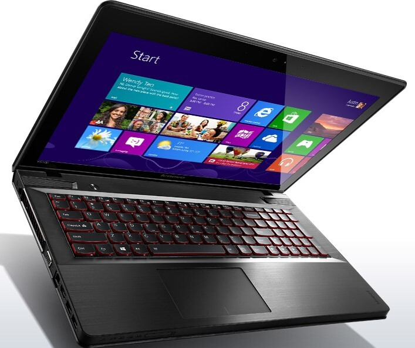

Olen kirjoitellut pari tekstiä, jossa olen katsastanut paria peliläppäriä – [Asuksen G750](/2013/katsaus-asus-g750-pelilappariin "Katsaus ASUS G750 peliläppäriin") ja [Lenovon IdeaPad Y510p](/2013/katsaus-lenovo-ideapad-y510p-pelilappariin "Katsaus Lenovo IdeaPad Y510p peliläppäriin") kannettavia. Molemmat ovat hyvä esimerkki suhteellisen järkevähintaisista pelikannettavista ja molemmissa on hillittömästi tehoja eli puhuttiin todellakin pelikäyttöön tarkoitetuista kannettavista.

Tässä artikkelissa ihmettelenkin pelikannettavien hyötyjä, haittoja sekä ihmetellään myös sitä mitä muuta sillä oikein voisi tehdä – tehojahan niissä kun kuitenkin on.

## Haitat

Akunkestossa ei pelikannettavissa päästä lähellekkään esimerkiksi Applen MacBookkeja sillä pelikannettavissa on virtaa vievää rautaa ja sitä kautta saadaankin tehoja enemmän. Pelatessa suosittelisinkin käyttämään konetta virrassa sillä pelisession aikana olisi harmillista jos akku loppusi kesken. Tämä on oikeastaan pieni haitta sillä tänä päivänä VR:n junissakin on suht toimivat sähköpistokkeet.

Paino voi olla myös joissain pelikannettavissa ongelmana. Esimerkiksi Asuksen koneet tuppaa painamaan varsinkin jos ottaa 17 tuumaisen mallin niin sillä alkaa olla jo kokoa. Positiivisena yllätyksenä Lenovon koneessa oli painoa kuitenkin vajaa 3 kiloa joten voi ne olla suhteellisen järkevän kokoisiakin – riippuu tietysti aina siitä minkä kokoisen näytön ottaa ja miten kone on muuten tehty.

Hinta on tietysti yksi huonoista puolista sillä pelikannettava on hiukan kalliimpi kuin pöytäkone samoilla spekseillä. Toki pöytäkoneen hintaa nostaa näyttö, näppis ja hiiri. Toki liikkuvuudesta saa hieman maksaakin sillä pelikannettava tuo koollaan ja kannettavuudellaan täysin uusia mahdollisuuksia sillä pelikannettavan voit ottaa mukaan kun taas pöytäkoneen mukaan ottaminen on huomattavasti työläämpää.

Päivitettävyys on kuitenkin ehkä se isoin ongelma näissä pelikannettavissa. Normaalia pöytäkonetta voit päivitellä mielesi mukaan ja se onkin niiden vahvin puoli. Pelikannettavassa on kuitenkin hyvin rajatut mahdollisuudet päivityksille. Yleensä kannettavissa voitkin päivittää muistia sekä pistää SSD kiintolevyn normaalin tilalle. Kun tehot loppuu kesken niin silloin pitää hankkia uusi kone, näissä on kuitenkin tehoja suhteellisen hyvin niin uuden koneen hankinta ei tule ihan heti eteen.

## Hyödyt

Vaikka joissain pelikannettavissa saattaa painoa olla normaaliin kannettavaan nähden enemmän, niin on sen koko silti pienempi kuin pöytäkoneen. Kannettavan kanssa sinulla on yhdessä paketissa kaikki ja oikeastaan ainoat lisälaitteet mitä tarvitset koneen lisäksi on hiiri ja headset, kun taas pöytäkoneen kanssa on kannettava erikseen myös näppäimistö, näyttö ja keskusyksikkö. Liikkuvuus onkin pelikannettavan suurimpia vahvuuksia.

Tila, tämä voi tuntua yksinkertaiselta asialta, mutta silti työpöydälläsi on enemmän tilaa kun ja varsinkin jos pidät keskusyksikköä pöydällä niin tilaa on hurjasti enemmän. Samaten johdot, näitä on paljon vähemmän sillä koneessa on virtajohto ja siihen tulee tietty em. hiiri ja headset kiinni. Pöytäkoneen takana on taas usea usb-johto, näytönjohto, virtajohto ja muut lisälaitteet jos niitä on.

Telakka, tämä olisi yksi lisävarusteista minkä hankkimista jopa suosittelisin – varsinkin jos sinulla on erillinen näyttö jonka haluat kytkeä koneeseen ja jos sinulla on vielä erillinen näppis – tällöin kannettavan näyttöä voisi käyttää kakkosnäyttönä. Itsehän käyttäisin pelikannettavaa kotona niin, että se olisi kakkosnäyttönä ja siihen olisi kiinnitetty 24″ FullHD näyttö, näppis sekä hiiri. Tällöin telakka helpottaisi elämää jo siinä sillä telakasta koneeseen menisi yksi USB 3.0 johto ja telakassa olisi sitten näyttö, hiiri ja näppis kiinnitettynä.

## Lopuksi

Lopuksi pelikannettavan suurin etu pöytäkoneeseen nähden on sen koko sillä saat sen otettua mukaan erittäin helposti ja LANeilla et oikeastaan tarvitsisi muita kuin lisävarusteita kuin headsetin ja kunnollisen hiiren.

Pelikannettavia on viime aikoina alkanut tulla yhä enemmän sillä pelaajat haluavat liikkua ja sosialisoitua LANien muodossa. Pöytäkoneen kantaminen käykin työlääksi hyvin äkkiä, tietty pöytäkonetta voi kustomoida enemmän. Onkin jokaisen oma asia haluaako maksaa hieman enemmän siitä, että saat liikuteltua pelikonettasi helposti vai haluatko täyden vapauden kustomoida mitä kone sisältää.

Itse olisin tällä hetkellä valmis hankkimaan pelikannettavan ja ainut asia mikä minua estää siinä on oikeastaan raha ja se, että nykyinen pöytäkone pelittää suhteellisen hyvin. Itse jos pitäisi päättää niin hankkisin tuon aiemmin esitellyn Lenovo [IdeaPad Y510p](/2013/katsaus-lenovo-ideapad-y510p-pelilappariin "Katsaus Lenovo IdeaPad Y510p peliläppäriin") pelikannettavan ja suosittelen sitä speksien perusteella muillekkin.

*Omistatko itse pelikannettavan? Kerro omat mielipiteesi ja kommenttisi!*
