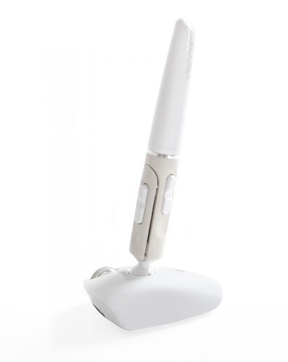

Arvomme kaikkien osallistuneiden kesken Penclic B2 bluetooth hiiren. Penclic hiiri on siitä erikoinen, että se on muotoiltu kuin kynä ja sitä käytetään kuten kynää.

Olen tehnyt tästä kynästä jokusen artikkelin niin tänne kuin Täppäriin ja alla on listaus niistä:

- [Penclic unboxaus](/2013/penclic-unboxaus)
- [Penclic B2 ja MacBook Pro](/2013/penclic-b2-ja-macbook-pro)
- [Penclic B2 ja Nexus 7](http://tappari.fi/lisavarusteet/penclic-b2-ja-nexus-7)

Arvontaan osallistutaan alla olevan Rafflecopterin widgetin kautta. Tähän arvontaan voi osallistua vain jos asut suomessa sillä paketti postitetaan vain suomessa asuvalle henkilölle.

Arvonta alkaa 26.7. eli huomenna ja se päättyy 18.8. – aikaa osallistua on siis vajaa kuukausi! Saat yhden arvan arvontaan aina kun twiittaat tästä arvonnasta (max 1 kertaa päivässä), seuraat minua twitterissä/facebookissa tai seuraat Täppäriä twitterissä/facebookissa.

Kaikki osallistumiset tulee vain ja ainoastaan suorittaa Rafflecopterin widgetin kautta.

\[rafflecopter a2aadb1\]

Arvonnan jälkeen voittajalta kysytään tietoja minne tuotteen voi postittaa. Palkinto lähetetään heti kun mahdollista ja jos järjestäjästä riippumattomista syistä voittajan tietoja ei saada ennen 23.8.2013 niin tällöin palkinto postitetaan lomani jälkeen – aikaisintaan 9.9.2013.

**Arvonta on päättynyt!**

Voittajaan on otettu yhteyttä ja voittaja ei halua nimeään julkaistavan täällä. Kunnioitamme tätä päätöstä ja julkaisemme sen sijaan tämän viestin. Arvonta suoritettiin Rafflecopterin kautta ja homma tapahtui siellä näin: Kun arvonta sulkeutui niin valittavaksi tuli ”Add winner” -painike jolloin Rafflecopter arpoo satunnaisesti (tätä osaa hoitaa Random.org) tiketin osallistujien joukosta. Tämän jälkeen tarkistan vielä, että tiketti on oikea ja voittaja on suorittanut vaativat toimenpiteet. Tarkastuksen jälkeen otimme yhteyttä voittajaan ja kysyimme yhteystietoja ja sitä haluaako hän nimensä julkaistavan.

Kiitos osallistumisesta ja onneksi olkoon voittajalle!
