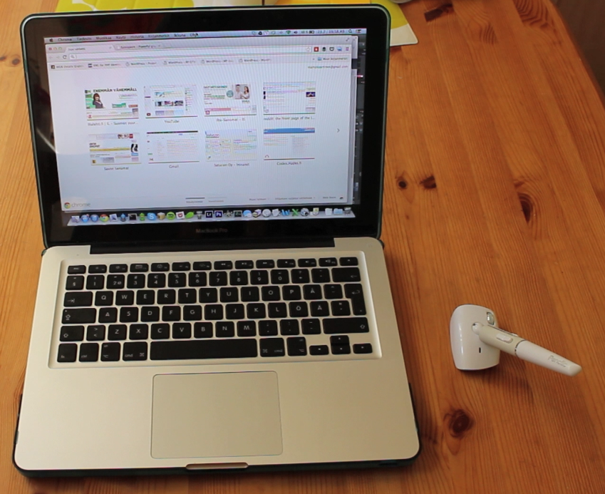

Paritin Penclic hiiren MacBook Pro:n kanssa sillä MBP on ainut kone missä minulla on Bluetooth täppärien lisäksi. Hiirestä on muuten unboxauskin tehty joka kannattaa [vilasta](/2013/penclic-unboxaus "Penclic unboxaus").

Tämä hiirihän on siitä erikoinen, että se on kynän muotoinen ja sitä pidetään kädessä kuten kynää ja oikeastaan sitä liikutellaankin kuin kynää. Minulle toimitettu hiiri oli bluetooth malli, joten sen sai hyvin näppärästi paritettua MacBookin kanssa ja näin ollen käytettyä ilman johtoa. Koska akku on ladattava niin mukana tuli USB-piuha jonka kautta sitä ladataan ja kun se kytketään koneeseen niin voit käyttää hiirtä latauksen aikana. Tuossa B2 mallissa hiiren DPI on 1200 ja nappeja löytyy 5 kappaletta, eli ihan tarpeiksi asti.

Pienen kokonsa ansiosta hiirtä on miellyttävä käyttää sillä se ei ole painava ja oikeastaan on samoissa painoluokissa kuin kynät joten sekin on luonnollista. Tuo ”mollukka” jossa on paristo, sensorit ja muut tommoiset on sopivan kokoinen ja se liukuu erittäin hyvin alla olevassa videossa nähtävällä puupöydälläkin. Mainittakoon vielä se, että tämä versio on vain oikeakätisille käyttäjille!

Alla vielä poiminta Penclicin [FAQ osiosta](http://www.penclic.se/penclic-mus/faq/):

> ***Why is Penclic Mouse™ better than a traditional computer mouse?***\
> *Penclic Mouse is designed to enable you to perform the smallest precision movements on your computer, whilst utilising the parts of your body designed for such movements. Penclic Mouse allows your fingers to carry out these delicate and precise movements, compared with traditional computer devices which require the user to utilise their shoulders and arms in an unnatural and unhealthy position. The likelihood of a user obtaining Repetitive Strain Injury (RSI) or Carpel Tunnel Syndrome, are drastically reduced when using Penclic Mouse instead of a traditional mouse.*

Pitemmittä puheitta alla on video tästä Penclicistä.



Tämä hiiri arvotaan jollekkin lukijalle, arvonta alkaa piakkoin joten pysykäähän kuulolla!

*Kokeilin Pencliciä myös täppärin kanssa ja siitä voitte käydä lukemassa tuolta Täppärin [puolelta](http://tappari.fi/lisavarusteet/penclic-b2-ja-nexus-7).*
