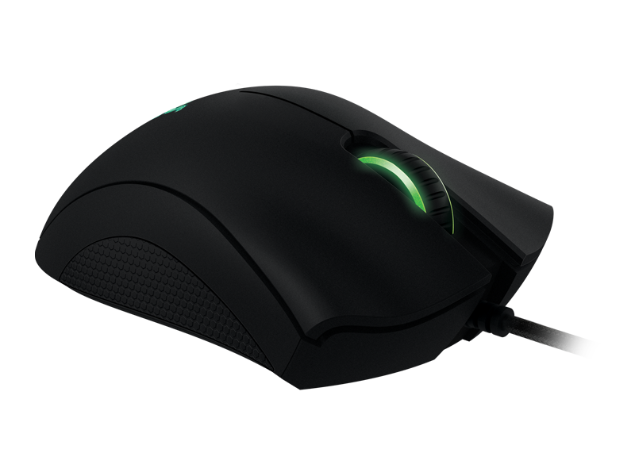
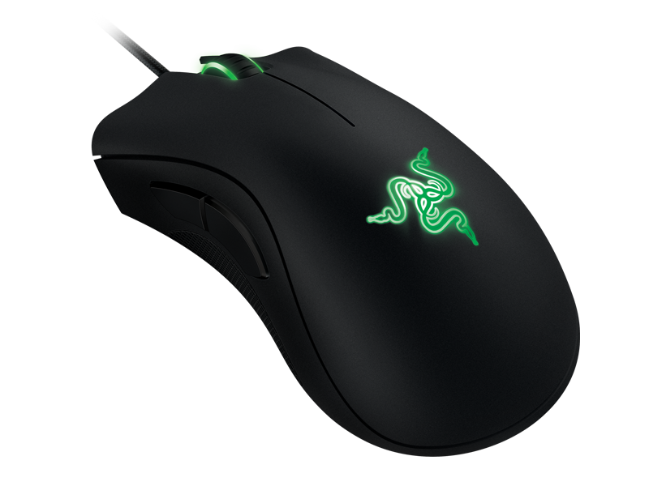
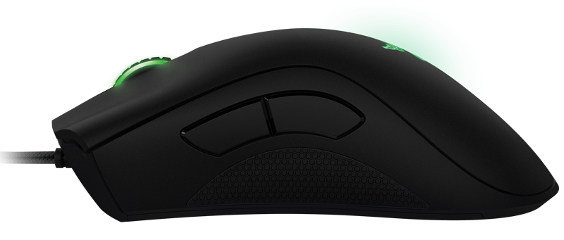
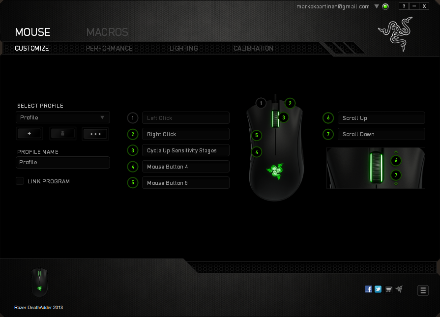

Vanha rotta alkoi olla tiensä päässä omassa käytössä ja kyselin sitten veljeltä mikä hänellä oli sillä olin sitä koitellut ja se vaikutti varsin passelilta peliltä. Päädyin siis hankkimaan Razer Deathadder 2013 hiiren.

Hiiri tuntui aluksi hieman kevyeltä, mutta eroa olikin vain jokunen gramma kun keittiövaa’alla sen punnitsin. Ehkä se muotoilu vain hämäsi hieman. Muotoilu on erittäin passeli omalle kädelleni ja olenkin tykästynyt tuohon hiireen.

Hiiren musta väri vihreine valoineen tekeekin Deathadderista erittäin hyvän näköisen hiiren. Valot saat Razerin sovelluksesta pois päältä mikäli näin haluat, mutta itse olen pitänyt ne päällä. Rullan vihreä valo on jatkuvasti päällä kun konekin on päällä ja tuo logo ikään kuin ”välkkyy” tuossa, mutta ei häiritsevästi – kätesihän on hiirellä kuitenkin suurimman osan ajasta.

Deathadderissa on 6400DPI optinen sensori ja vaste onkin 1ms luokkaa (1000mhz polling) eli käytännössä kone tietää 1ms välein missä hiirenosoitin on. Hiiren DPI:tä on myös mahdollista säätää ”lennosta” kun määrittelet sopivat välit ohjelmasta. Itse säädinkin hiiren keskinapin painalluksen DPI:n säätöä varten – näin keskinapin klikkaus nostaa DPI:tä seuraavaan pykälään.

Hiiren sivussa on myös kumimainen kohta mistä saat varsin hyvin otteen ja ei pääse liukumaankaan kun materiaali on kumia. Vasemmalta sivulta löytyy myös pari nappia ja nehän on perinteisesti olleet hiiren eteeen/taakse napit. Yhteensä nappeja on siis 5 (vasen, oikea, eteen, taakse ja rullan painallus) sekä tietysti itse rulla pyörii. Harmillisesti rullaa ei voi klikata vasemmalle ja oikealle.

Hiiren säätöohjelmana toimii Razer Synapse 2.0 josta saakin säädettyä monipuolisesti hiiren asetuksia. Halutessasi voit nauhoitella vaikka makroja ja bindata niitä painikkeisiin.

Ohjelma toimii erittäin hyvin ja tallentaakin asetuksia pilveen, joten jos kone pitää formatoida niin sitten kirjaudut tunnareilla ohjelmaan niin se hakee asetukset hiirelle valmiiksi.

Tätäkin hiirtä voin suositella muille varauksetta! Itselläni tämä on toiminut vallan mainiosti ja en ole katunut tämänkään hankintaa.

### Plussat

- 6400dpi 4G Optical Sensor
- Toimii hyvin
- Razerin sovellus
- Väri ja muotoilu
- ”Grippi” sivulla
- Vihreät ledit!

### Miinukset

- Rullaa ei voi klikata vasemmalle ja oikealle
- Hiiressä ei taida itsessään olla muistia
- Razerin logo voisi olla koko ajan päällä (valinta sovelluksen kautta esim.)
