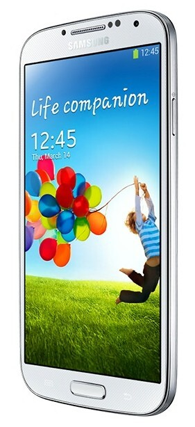
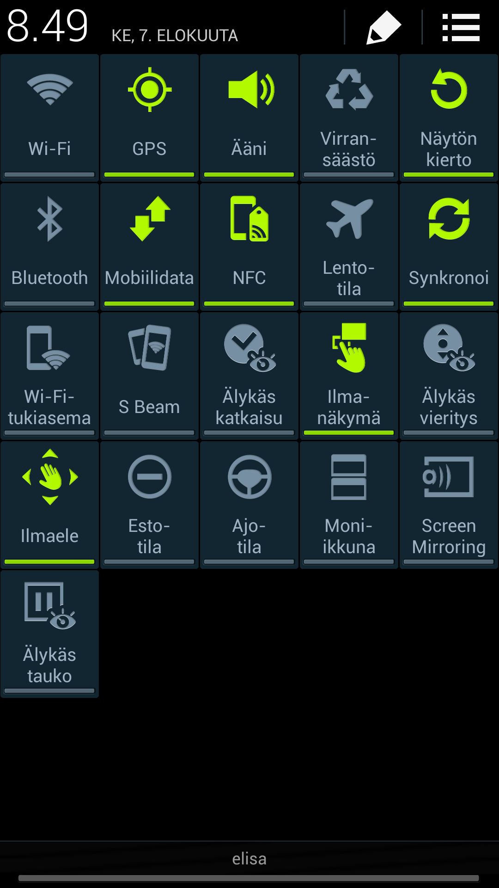
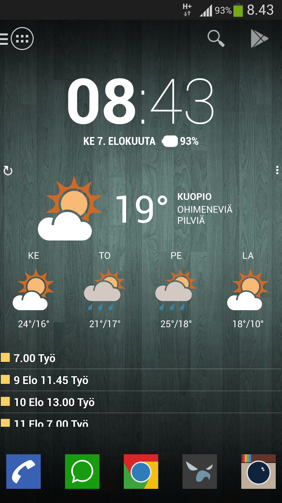
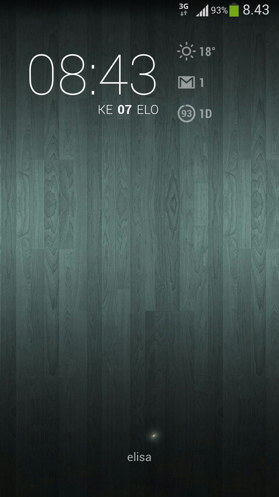
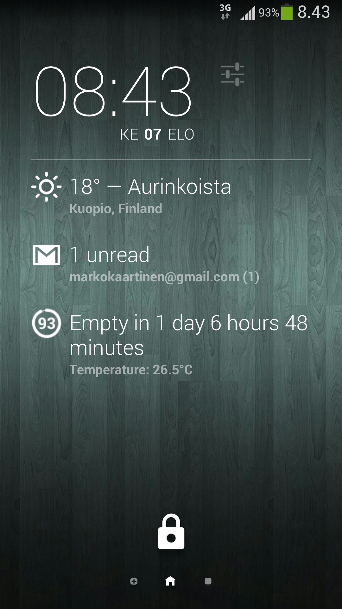
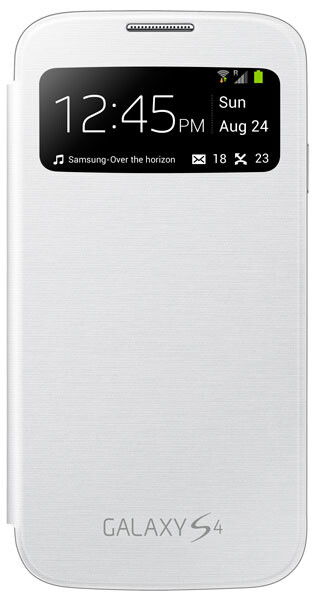

Samsung Galaxy S4 tuli hankittua  pari kuukautta [sitten](/2013/samsung-galaxy-s4-ensipuraisu "Samsung Galaxy S4 – Ensipuraisu") ja ajattelin jakaa hieman kokemuksiani ko. puhelimesta. Itsehän siirryin tähän puhelmieen oikeastaan seuraavanlaisen kaaren kautta: iPhone 4 -\> Lumia 900 -\> iPhone 4 -\> Galaxy S4. Eli kävin hieman tuolla Windows Phone leirissä ja totesin sen ettei se ollut minua varten ja siirryin takaisin iPhoneen väliaikaisesti. Tuo nelonen kuitenkin alkoi olemaan aikansa elänyt omassa käytössä joten päätin hankkia Samsungin lippulaivamallin Galaxy S4:n.

Galaxy S4 puhelinta markkinoidaan elämänkumppanina ja kohderyhmänä ovat selkeästi tavalliset ihmiset sillä heitä haeskellaan ”wau”-ominaisuuksilla kuten videon pysäytys kun et katso ja kättä heiluttamalla puhelimen käyttö yms. eleitä löytyy.

Puhelimessa on myös ruokapäiväkirjaa, askelmittaria ja liikunnan seurantaa. Tuota jos orjallisesti käyttäisi niin S Health olisi oikein mainio asia, mutta itsellä on noista käytössä oikeastaan tuo askelmittari ja Tallinnan reissulla tulikin käveltyä ihan rutkasti tuon mukaan. Se ei kuluta akkuakaan kauheammin joten se voi olla oikeastaan aina päällä.

Itseltähän nuo ”wau”-ominaisuudet lähti oikeastaan kokeilujen jälkeen pois päältä sillä en oikeastaan tehnyt niillä mitään ja akkuakin sen luulisi kuluttavan jos etukamera tutkii silmiäsi vähän väliä. Oikeastaan ainut noista ominaisuuksista jota käytän on se, että voin kättä heilauttaa puhelimen näytön yli sen ollessa lukittuna jolloin se näyttää minulle kellon yms. tietoa kuten lukemattomat tekstarit, vastaamattomat puhelut ja mailit. Yöllä ihan näppärä ominaisuus sillä näyttää sen vielä tummalla taustalla.

Akun kulutus on muutenkin ollut hieman mielenkiintoinen välistä tällä sillä jos on kaikki palvelut Google Now:sta lähtien päällä niin silloin akkua menee ja paljon. Joskus en pärjännyt päivääkään lataamatta kun akku huusi hoosiannaa ja päätti loppua kesken päivän. Hyvä lisävaruste olisi siis jonkinlainen vara-akku tai sitten jonkinlainen mukana kulkeva laturi. Itse sain akun kestoa pidennettyä ottamalla juurikin Google Now:n pois päältä sekä estämällä sijaintitiedon päivittämisen Googlen suuntaan – nämä tuntuivat vievän akkua hurjasti.

## Kustomointia

Käyttelin tuota puhelinta noin 1.5 kuukautta tuolla Samsungin omalla TouchWiz launcherilla ja sen jälkeen halusin kokeilla jotain täysin uutta. Asensinkin Action Launcher Pro launcherin ja siihen teeman ja tuunailin sitä pari päivää sen jälkeen vielä sopivaksi. Nyt olen päässyt todella hyvään lopputulokseen ja ainut mitä nykyään teen tuolle ulkoasulle on se, että vaihtelen taustakuvaa silloin tällöin.

Tietty lukitusruutu piti saada saman henkiseksi kuin itse launcheri joten tuunailin sitäkin lähinnä yhdellä widgetillä. Asentelin DashClock widgetin ja heitin sen lukitusruudulle sekä pidän taustaa samana kuin tuossa launcherissakin. Alla vielä pari kuvankaappausta niin launcherista kuin tuosta lukitusnäytöstä ja DashClock widgetistä.





## iPhone vs. Android?

Sitten ehkä siihen kysytyimpään kysymykseen. Miltä tämmöinen siirto iPhone maailmasta Android maailmaan on tuntunut? Tähän jos vastaan lyhyesti niin ei tässä mitään ihmeellistä ole. Aiheesta voisin toki kirjoittaa isommankin räntin, mutta jätän nyt väliin sen. Tietty ekosysteemi on erilainen ja kaikkea mitä sinulla oli iPhonella et välttämättä saa Androidiin – lähinnä jotain sovelluksia. Itse kuitenkin sain kaikki tärkeimmät siirrettyä eli yhteystiedot, sähköpostit, kalenterin ja WhatsApp toimii tuossa. Tietty asentelin kasan muita ohjelmia kuten Dropbox, Spotify, Youtube yms.

Ehkä se paras puoli Androidissa on sen kustomoitavuus, jos minulla olisi iPhone niin en voisi ilman JailBreikkiä kustomoida puhelinta näin paljon mitä olen tehnyt tälle Galaxy S4:lle. En ole omaa puhelinta edes rootannut sillä tuo launcherin vaihto onnistuu helposti, asennat ja aktivoit ja säädät. iPhonessa oli myös se ongelma, että työpöydällä oli oikeastaan vain kuvakkeita – Androidissa taas sinulla on widgettejä ja kuvakkeita ihan miten olet itse ne järjestänyt. Itselläkin on usealla sivulla eri asioita ja tuo pääsivu on suhteellisen selkeä ja siitä saan sen infon mitä itse haluan, jos haluan jotain muuta niin pompin seuraavalle sivulle tai sitten aukaisen ohjelman jos näin haluan.

## Kamera

Vaikka en yleensä kauheammin välitä kännyköiden kameroista niin on pakko mainita se, että tässä tuo kamera on oikeastaan aika hyvä. Olen ottanut sillä kuvia niin Instagrammiin kuin ihan kännykän muistiin sillä kännykkä nyt on aina mukana ja sillä saa helposti näpättyä sen kuvan. Voisinpa melkein väittää, että tämä korvaa totaalisesti pokkarin tarpeen jo tänäpäivänä. Mikäli haluaa sitten parempaa laatua niin mikrojärkkäri tai järkkäri saa astua kehiin. Galaxy S4 puhelimen kameran 13 megapikselin kamera tekee minulle oikein mukavaa laatua ja niitä kuvia kyllä kehtaa jakaa sosiaalisessa mediassakin.

## Lisävarusteista

Lisävarusteita en ole juurikaan tälle hankkinut, mitä nyt yhden S-view coverin hankin ja täytyy siitäkin pari sanaa sanoa. Tämä suojahan on siitä mielenkiintoinen, että tämä kääntyy näytön päälle suojaamaan sitä – mielenkiintoiseksi siitä tekee sen että tässä on pieni ikkuna josta näet kellon yms. tietoja ilman läpän aukaisemista. Voit myös vastata puheluihin tuosta helposti, liu’utat vain sormea kuten vastaisit normaalistikkin puhelimeen Galaxy S4:llä.

Ainoa huono puoli tuossa suojassa on se, että tuo ei tue langatonta latausta suoraan vaan pitäisi kikkailla se erinäisten lisäsysteemien kautta. Ilmeisesti tuostakin on tulossa versio joka tukisi langatonta latausta, mutta vielä en siihen ole törmännyt ja hinta voi olla aika kova.

Mainitsinkin aiemmin jo siitä, että pitäisi olla lisäakku tai akku josta voisi ladata matkan päällä tätä puhelinta. Tietty se auttaa jos kuljetat laturia matkassa ja löydät pistokkeen, mutta itse olen miettinyt hieman yleispätevää ratkaisua. Olen pohtinut jonkinlaisen ulkoisen akun hankkimista josta saan sitten usb piuhan kautta ladattua iPadiä, Galaxy S4 tai muuta laitetta joka sattuu virtaa tarvitsemaan. Näin saisin yhden lisäakun jota voisi käyttää sitten usea eri laite, jos taas ostaisin lisäakun vain Galaxy S4 puhelimeen niin sitten muut laitteet ei hyötyisi siitä niin paljoa.

## Lopuksi

Parin kuukauden jälkeen olen ollut aika tyytyväinen siihen, että ”vaihdoin leiriä” ja hankin Galaxy S4 puhelimen. Se seikka, että Samsung päivittää vielä Galaxy S2 mallia auttoi tämän puhelimen hankinnassa. Viralliset päivitykset ovat hyvä asia ja niiden kautta saat aina pientä jotain parannusta puhelimeesi. Itse en halua alkaa tämän kanssa säätämään roottaamisen tai rommien kanssa sillä haluan oikeastaan, että puhelin toimii ja on omannäköinen. Olen saanut tuon puhelimen itseni näköiseksi ja voin halutessani vaihtaa teemaa, launcheria tai taustaa. Rommi saakoon olla tuo Samsungin niin kauan kuin päivityksiä tulee ja en jää paitsi Androidin ominaisuuksista.

Itse voin kyllä lämpimästi suositella Samsung Galaxy S4 puhelinta ja mikäli sinulla olisi kysymyksiä tästä puhelimesta niin kysy pois!

*Onko sinulla Samsung Galaxy S4 puhelin, jos on niin voit kertoa omat kokemukset alla olevan kommentointilomakkeen kautta!*
