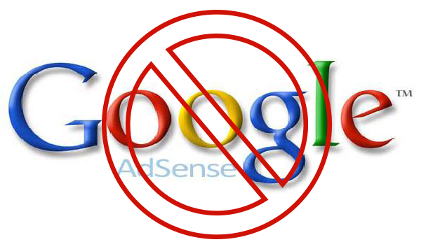

So, I’m banned from AdSense and after couple of years all I can do is to write this blog post. Normally I write in finnish but with this post I want to get a bigger audience so this will be in english (pahoittelut suomalaisille lukijoilleni). Well as I said, I have been banned couple of years now and sometimes I try to fill the appeal form and get my account unbanned. With no luck of course. I wrote this blog post since I am tired of filling those forms since it is always a robot that answers me. By the way the answer is the same – every single time…

I do not even remember exact time when I got banned from AdSense but I remember that they accuse me of some kind of wrong usage or clicking ads or something like that. I have no proof of my innocence since it has been so long time of this ban and I have switched hosts couple of time after that. I have a feeling that somebody trolled me back then and clicked those ads – a lot. But I have no proof of that at the moment and I was a bit noob back in the day.

I have filled many, maybe even too many appeal forms with no result and with no human connection – at least I think it is a robot since it is the same message every single time. I even tried [konami code](http://en.wikipedia.org/wiki/Konami_Code) in the form – that did not work either. I have demanded to talk with real person and I have asked how to get my account unbanned – no real answer received.

I have not created a new AdSense account since I have been a good sport and I have tried to get my account back. I don’t care about the money that was in there, it was only about 20-30 dollars worth of money. I only care that I could use it now since I want to try to make better content in the YouTube and try to get few extra bucks out of it.

So this is how the AdSense ban limits my life in the web at the moment:

- I can’t have Google Ads in my site (any of them)
- I can’t monetize my YouTube account (any of them)
- I can’t be a partner in any YouTube network (at least I would like to try to make it!)
- I can’t recommend AdSense to anyone if the policy is like this

I have read many articles similar to this and people are banned and they lost their money and they have to get rid of Google Ads etc. Some of them have a happy ending though, some gets their account unbanned – but… some of them don’t. Also some of the people who are banned from AdSense have created new accounts. I could do that, but I choose not to. I want to be honest person and I don’t want to get banned again with another account.

This post is a bit messy but hey, that is who I am – I write messy blog posts! I hope to get some advices from you guys and I hope to get some kind of feedback/response. Best case scenario is that I get my AdSense account unbanned and have the extra motivation to create better content.

*If you want to contact me in person, please send me an email to my Gmail: markokaartinen@gmail.com*

***Please comment and/or share this post!***
