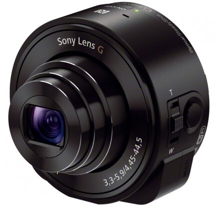
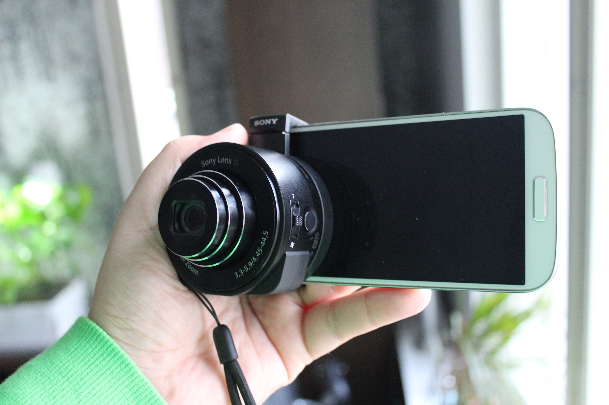
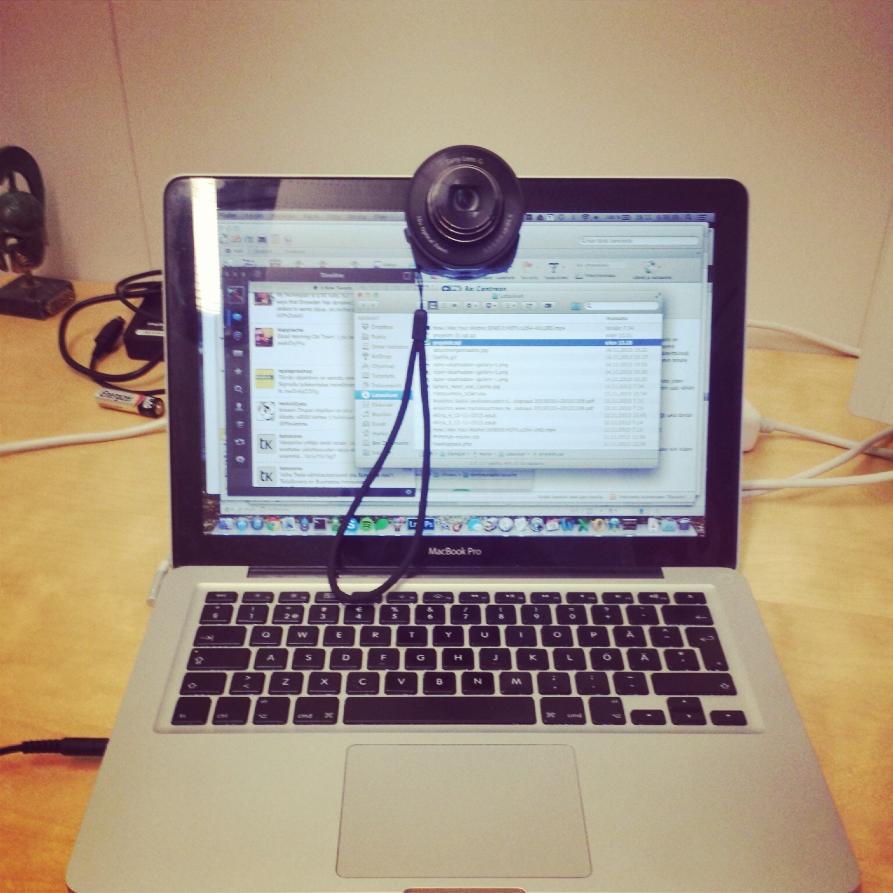
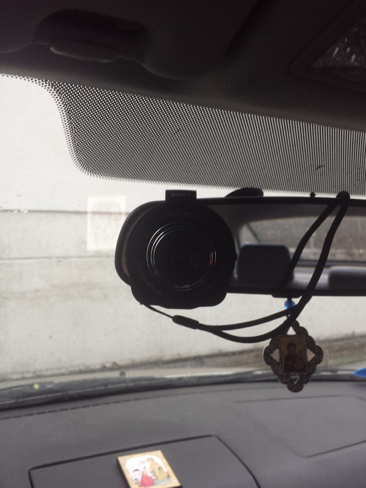
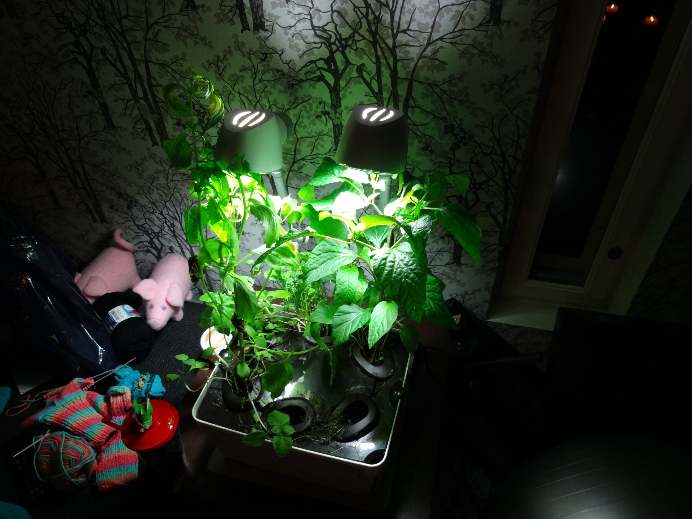
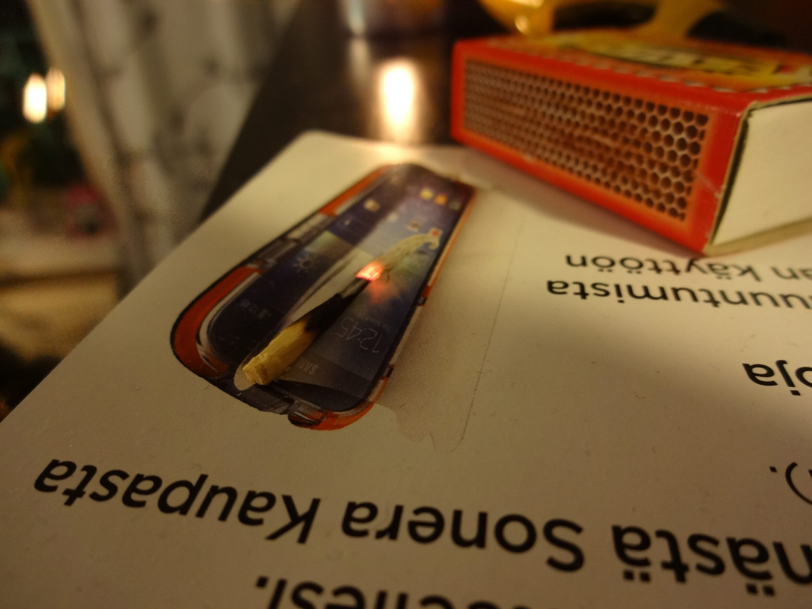
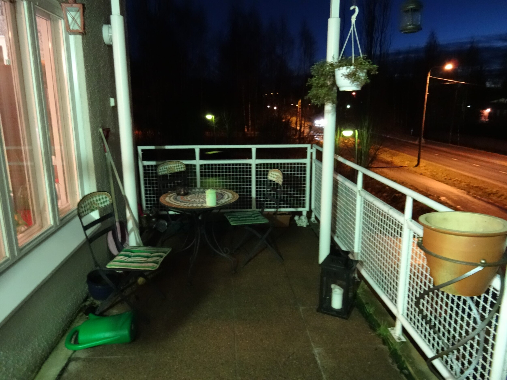
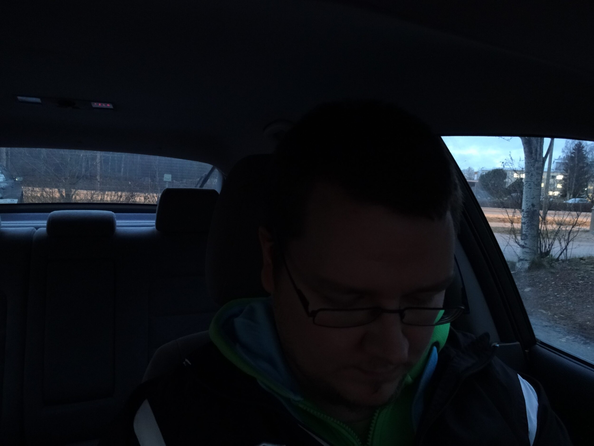
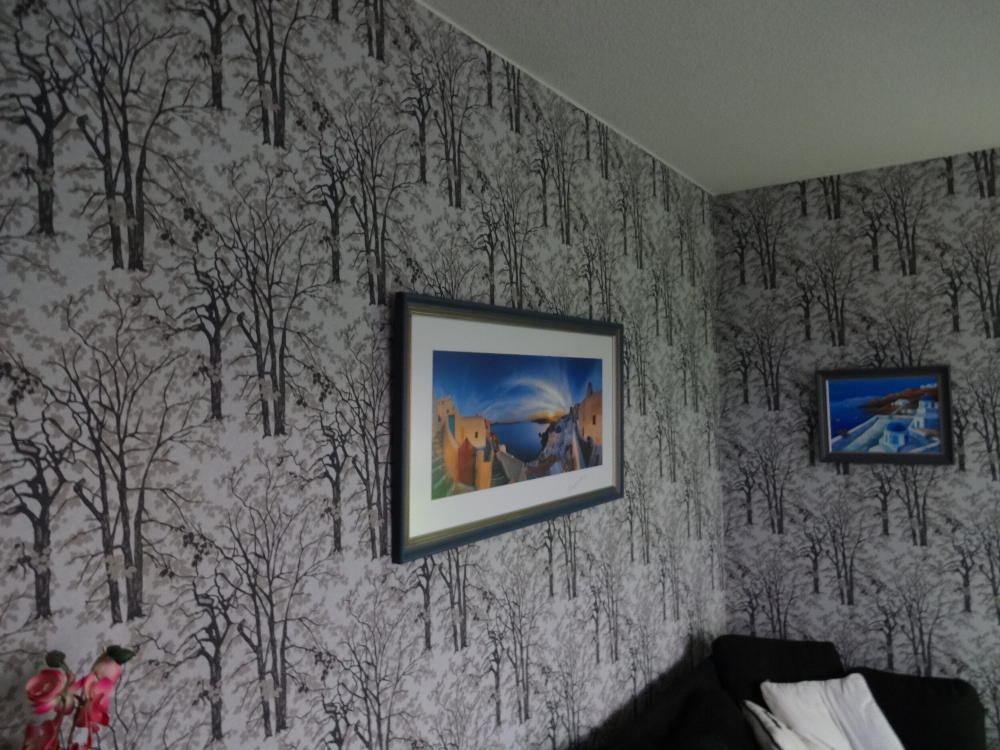

Sain vajaa pari viikkoa sitten käsiini Sonyn DSC-QX10 kameran. Tämä kamerahan on tarkoitettu käytettäväksi kännykän kaverina. Tällöin kännykkä saa varsin passelin kameran. QX10:n etsimenä toimii käytännössä kännykkä ja voitkin laittaa sen kännykkään kiinni mukana tulevan adapterin avulla.

Itse keskityinkin lähinnä mitenkä tämä soveltuu vlogaamiseen ja esimerkiksi [tämä vlogi](https://www.youtube.com/watch?v=2K-KLdl8o7w) on kuvattu tuolla Sonyn kameralla. Vasemmalla onkin kiinnitetty kamera kännykkäni etupuolelle sillä halusin nähdä itseni kun vlogaan.

Hieman kun käyttää mielikuvitusta niin tämän saa kyllä mainiosti kiinni esineisiin jotka on suunnillen samanlevyinen kuin älypuhelin. Kannattaa kiinnittelyssä muistaa se, että varmistaa ettei puhelin pääse tippumaan ja se ei estä esim. näkyvyyttä autossa ja muutenkin on turvallisesti kiinni. Alla on vielä pari kuvaa siitä miten ne kiinnitin esim. autoon ja tietokoneen näyttöön.





Kamerassa on toki myös jalustaan ruuvinpaikka joten vaikka sopiva gorillapodi sattuisi olemaan kotona niin tämän saa siihenkin hyvin näppärästi kiinni.

Itse kameran käyttöhän on simppeliä ja varsinkin jos sinulla on NFC:tä tukeva puhelin. Hipaiset vain kameran NFC logoa puhelimellasi niin se yhdistää WiFiin ja avaa sovelluksen, ellei softaa ole niin se menee sen Play Store sivuille. Tämä on kuitenkin samalla myös heikoin osa tätä laitetta. Sinun pitää käytännössä toistaa tuo hipaisu joka kerran kun haluat ottaa kuvan ja samaten kiinnittää kamera puhelimeen. Sovelluksen aukaiseminen kestää hetken ja samaten se, että ohjelma yhdistää kameraan. Siinä vaiheessa kun saat kameran kuvaustilaan niin normaalilla pokkarilla tai järkkärillä olisit jo ottanut kasan kuvia.

Toki kameralla voit ottaa kuvia normaalistikkin eli kameralla voit zoomata ja ottaa kuvia kameran nappien avulla. Ongelma siinä on toki se, että sinä et näe mitä sinä olet tarkalleen kuvaamassa. Puhelimessa oleva sovellus (testattu Android sovellusta) taas vaikuttaa muuten passelilta, mutta hieman sitä voisi parantaa. Videokuvauksessa ei esimerkiksi näkynyt aikaa kauanko olit kuvannut ja miten paljon muistikortille oikein mahtui vielä. Sovellus myös jumahti totaalisesti kun kuvasin erästä vlogi jakso ja en ollut varma nauhoittiko se enää vai ei – kameran sammuttaminen lopetti ilmeisesti nauhoittamisen.

Pääpointti oli oikeastaan selvittää se olisiko tämä se kamera vloggaajalle. Toki tuolla saat parempaa jälkeä kuin kännykän etukameralla ja toimiikin todella näppärästi puhelimen kanssa. Tietty jos haluaa itsensä nähdä samalla kuin kuvaa niin silloin pitää pistää se ns. väärälle puolen ja silloinkin itse kamera peitää osan näytöstä. Itse en ehkä tätä hankkisi vlogi käyttöön. Tämä voisi olla parempi pelkästään kuvaamiseen, mutta samalla rahalla taitanee saada pikkupokkarin, joka on hieman nopeammin kuvauskunnossa kuin tämä.

Vaikka keskityinkin vlogipuoleen enemmän niin alla on muutama kuva, jotka on suoraan siirretty kamerasta tänne.





### Plussat

- Näppärän kokoinen kameraksi
- Kuvanlaatu
- Kiinnitys puhelimeen ja miksi ei muuallekkin
- NFC tuki

### Miinukset

- Hidas käyttöönotto
- Hieman turhake
- Puhelimen sovellus (Android) jummasi pariin otteeseen

Kiitos Sonylle kameran toimittamisesta testiin, voit tutustua kameran tuotesivuun [Sonyn kotisivuilla](http://www.sony.fi/product/dsc-qx-series/dsc-qx10).
