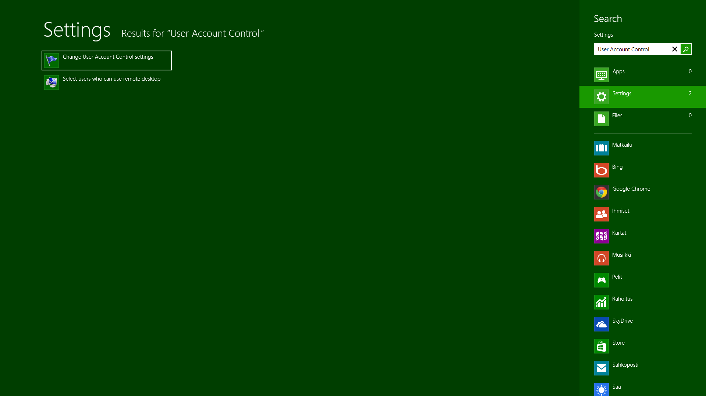
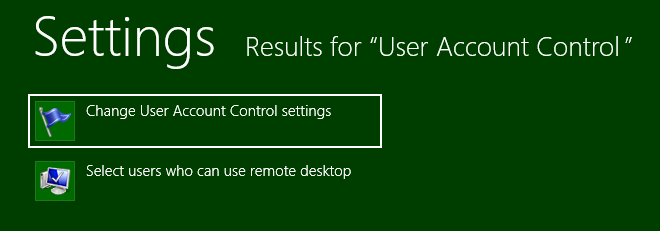
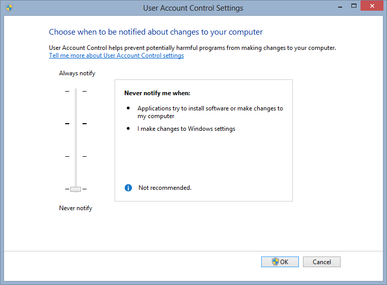

Jatketaan nyt tätä Windows 8 sarjaa kun alkuun päästiin. UAC eli User Account Control on kaikille tuttu ikkuna joka on hypännyt silmillesi aina Windows Vistasta lähtien. Tämä ikkuna tulee aina kun haluat asentaa jotain ja pakottaa sinut tiedostamaan sen, että olet oikeasti asentamassa nyt jotain mikä voi mahdollisesti muuttaa koneen asetuksia yms.

Mikäli tiedät mitä teet niin tämä vaihe on turha, mutta mikäli et ole aina ihan varma mitä olet tekemässä niin lopeta lukeminen tähän ja kuuntele vaikka [podcastiani](/kategoria/podcast).

Te jotka jatkoitte lukemista niin varoitan jo nyt, että käytössäni on Windows 8 englanninkielinen versio, joten kuvat ja ohjeet ovat sitä varten.

1.  *Windows + W* näppäinyhdistelmällä sinulle aukeaa haku ja kirjoittele hakuun *”User Account Control”\
    \*
2.  Sinulle jää kaksi vaihtoehtoa ja valitaan tuo ”Change User Account Control settings”\
    
3.  Tämän jälkeen aukeaa ikkuna, jossa vasemmalla on liukukytkin jonka kun liu’utat alas niin UAC ei enää halua sinun varmistusta asennuksiin yms.\
    
4.  Tämän jälkeen on tärkeä käynnistää kone uudestaan sillä muuten tämä asetus ei tule voimaan joka kohdassa. Ellet boottaa konetta ja asennat ohjelman niin ohjelman asennus voi mennä pieleen.

Lisää Windows 8 ohjeita ja vinkkejä tulee kunhan näitä keksin ja löydän passeleita!
