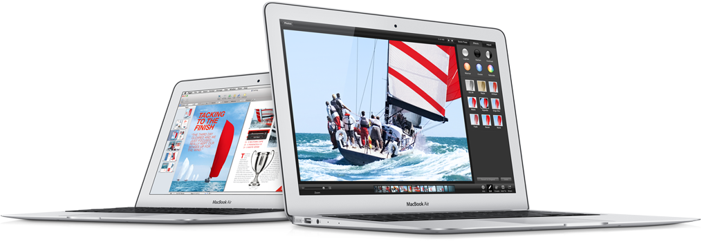

Olisin voinut kirjoitella tämän artikkelin jo aiemmin kun Apple piti oman settinsä joku aika sitten, jossa julkaistiin mm. uusi MacBook Air. Olen oikeastaan ensimmäisestä Airistä lähtien halunnut tämmöisen koneen ja kun oma MacBook Pro on vielä hyvin hönkinyt niin ei ole oikein perusteita ostaa vaikka halu olisi kova.

Itselläni kannettava on pääasiassa työkone ja MBP on hoitanut hommansa loistavasti. Välistä kuitenkin vanhuus tulee esille kun esim. akun kesto ei ole enää sitä mitä se ennen oli. Tehoja sinänsä ei tarvitse lisää sillä kuvankäsittely yms. on satunnaista ja raskain homma mitä teen on videoiden käsittely iMoviella Youtubeen.

Heti kättelyssä lähtisin 13 tuuman mallia katselemaan sillä nykyinen MBP on 13 tuuman näytöllä ja olen tullut sen kanssa oikein hyvin toimeen ja tuo näyttökoko tuntuu sopivimmalta. Apple myös lupailee 12 tunnin akkukestoa tuolle 13 tuuman mallille, aika hurjaa. Koon puolestahan tuo eroaa hurjasti esim. MBP:stäni sillä tuo on PIENI, siis hurjan pieni. Tuo painaa vain 1.35 kiloa (13″ malli)  ja paksuuttakin sillä on vain 1.7cm paksuimmasta kohti ja 0.3cm ohuimmasta kohtaa – hurjaa.

Lähdetääs rakentamaan minulle sitä konetta tässä ja nyt, katsotaan mitä Applen saitti sanoisi tuosta koneesta lopulliseksi hinnaksi jos saisin sen mitä tahtoisin:

1.  Kuten sanoin niin valkkaisin 13 tuuman mallin
2.  Seuraavaksi pitäisi valita 128 ja 256 gigatavun SSD:n väliltä, 1149 tai 1349 euroa. 128 gigaa ei riitä mihinkään ja nykyisessäkin on 256 eli valitsisin sen.
3.  Mikäli olisin tyytyväinen tuohon niin 1349 euroa olisi viimeinen hinta. MacBook Airiin et kuitenkaan voi itse pistää muistia joten muistin nosto 8 gigaan tuo satasen lisähintaa. Hinta siis 1449 euroa.
4.  Jollain tapaa prosessorin päivitys oletuksesta (1.3GHz Dual-Core Intel Core i5, Turbo Boost up to 2.6GHz) tuohon i7 malliin houkuttelisi (1.7GHz Dual-Core Intel Core i7, Turbo Boost up to 3.3GHz). Hintaa tulisi lisää 150 euroa eli totaali olisi 1599 euroa. En kuitenkaan usko, että tuo toisi minun käyttöön niin kauheaa eroa joten jätän tuon pois. Lopullinen hinta olisi siis tuo 1449 euroa.

Jos otetaan samanlainen päätäntäkaari ja valittaisiin 11 tuuma malli:

1.  11 tuuman mallissa on myös SSD:n valinta 128 ja 256 gigan väliltä. Valkkaisin tuon 256 gigan eli hinta lähtisi liikkeelle 1249 eurosta.
2.  Muistin nosto 8 gigaan toisi sen saman satasen hintaa lisää eli 1349 euroa.
3.  Prosessoria en lähtisi nostamaan joten hinta jäisi tuohon 1349 euroon.

Isompi näyttö ja 3 tuntia lisää akkukestoa (11 tuuman mallille lupaillaan 9 tunnin akkukestoa) toisi hintaa lisää 100 euroa. Mainitsen vielä sen, että 11 tuuman mallissa ei ole muistikorttipaikkaa.

Toki olisihan uusissa MacBook Pro läppäreissä tehokkaampi prosessori ja akkukestoa jopa 7 tuntia, mutta koko olisi silti isompi. Tietty Retina näytöllinen MBP olisi kiinnostava värkki, mutta lähtöhinta on jo 1549 euroa. MacBook Air tulee olemaan seuraava MacBookkini ja se hankitaan sitten kun sattuu olemaan rahaa siihen ja MBP alkaa vedellä omassa käytössäni viimeisiään.

Mainitsen vielä lopuksi, että hinnat on katsottu Applen omalta sivulta ja lisäykset on myöskin tehty Applen oman sivun tilauksen mukaisesti. En osaa sanoa miten Suomesta saisi noita lisäyksiä esim. muistia boostattua noihin Aireihin. Viisaammat voivat minua tässäkin asiassa opastaa.
