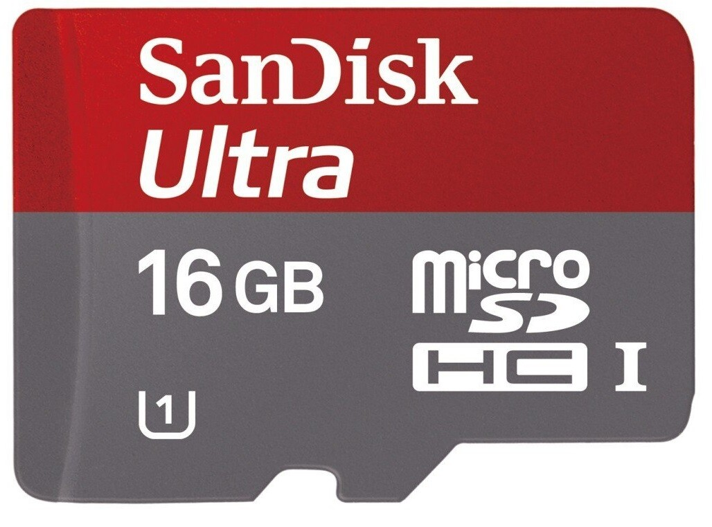
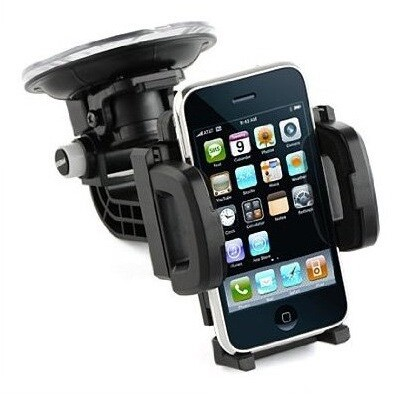
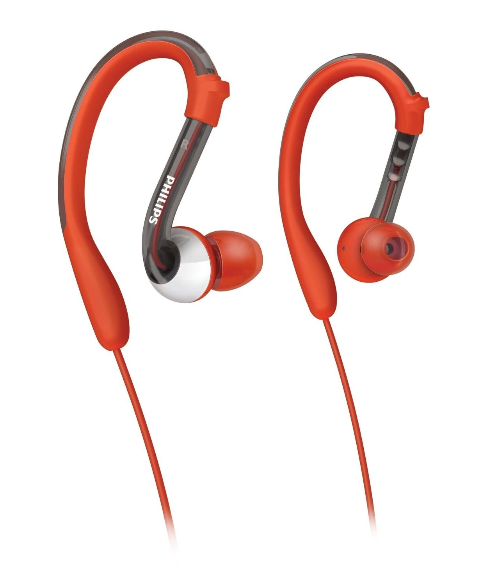
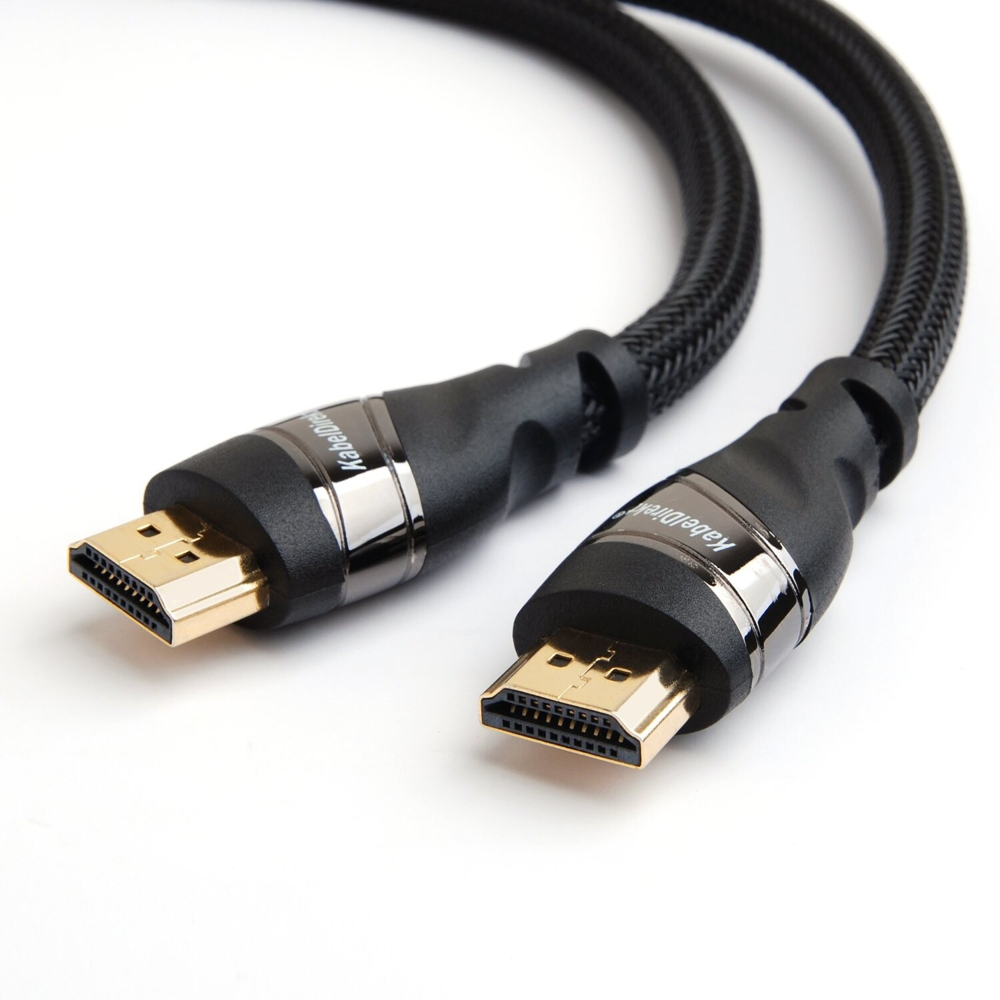
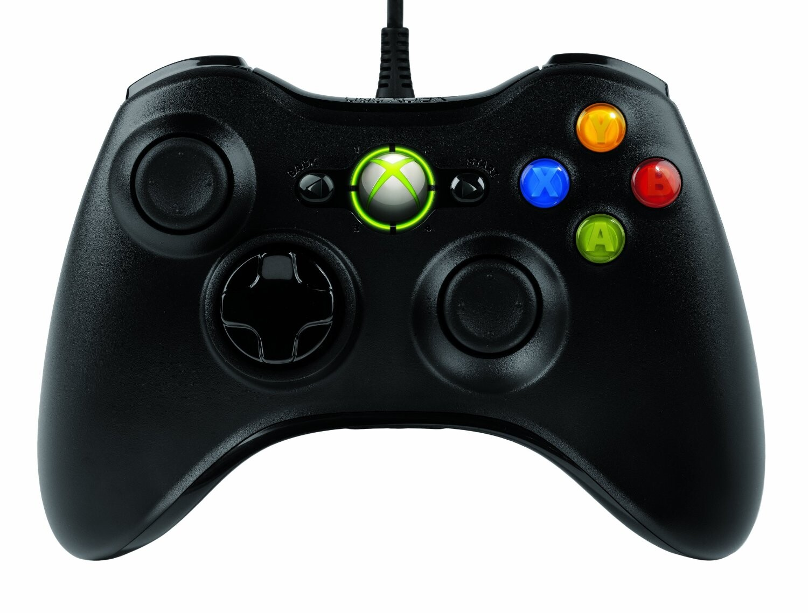

Ajattelin tehdä teille pienen listan linkkeineen, kuvineen ja lyhyine arvosteluineen viimeaikaisista hankinnoista, joista ei sen kummosempaa videota/artikkelia ole tullut. Tässä on kylläkin parin kuukauden sisällä hankittuja roippeita, mutta kaikki ovat jollain tapaa tekniikkaan liittyviä. Näistä kaikki on vielä hankittu [Amazonista](http://www.amazon.co.uk/?_encoding=UTF8&camp=1634&creative=19450&linkCode=ur2&tag=markokaartinennet-21) sillä sieltä saa niin paljon halvemmalla tilattua kuin Suomesta – pitää vain jaksaa odottaa hieman.

## [SanDisk MicroSDHC Ultra 16GB](http://www.amazon.co.uk/gp/product/B0084DWCT2/ref=as_li_ss_tl?ie=UTF8&camp=1634&creative=19450&creativeASIN=B0084DWCT2&linkCode=as2&tag=markokaartinennet-21)

Uuden puhelimen, eli sen Samsung Galaxy S4 myötä piti hankkia muistikortti. Tämä siksi ettei puhelimen muisti täyttyisi aivan totaalisesti kuvista, musiikista ja sovelluksista. S4:ssä voit muuten asentaa sovellukset myös muistikortille! SanDiskin muistikortit ovat olleet yleensä päteviä ja tämä oli suhteellisen edullinen vielä. Tällä hetkellä hintaa näyttäisi olevan 10,97 puntaa eli noin 12,7 euroa. Muistikortti tuli vielä todella nopeasti ja siitä ihan yllätyinkin – positiivinen yllätys tietenkin!

Muistikortti on toiminut vallan mainiosti ja sen kanssa ei ole ollut mitään ongelmaa. Kortti meni suoraan puhelimeen ja on ollut sen kanssa siitä asti ja 16 gigaa tuntuu riittävän omiin tarpeisiini vallan mainiosti.

[SanDisk muistikortti Amazonissa »](http://www.amazon.co.uk/gp/product/B0084DWCT2/ref=as_li_ss_tl?ie=UTF8&camp=1634&creative=19450&creativeASIN=B0084DWCT2&linkCode=as2&tag=markokaartinennet-21)

## [Autoteline puhelimelle](http://www.amazon.co.uk/gp/product/B008I03Z6A/ref=as_li_ss_tl?ie=UTF8&camp=1634&creative=19450&creativeASIN=B008I03Z6A&linkCode=as2&tag=markokaartinennet-21)

Uuden puhelimen myötä piti saada myös autoteline. Tilasin universaalin mallin sillä autossani on vanha iPhone 4 teline ja siinä on aika yleinen kiinnitys. Toivoinkin, että tässä olisi samanlainen kiinnitys ja näin ollen saisin helpon telineen uudelle puhelimelle ja tuohonhan käy myös sitten muutkin puhelimet kuin Samsung Galaxy S4.

Hintaahan tuolla on vain 4,19 puntaa ja euroissa se on noin 4,85 euroa. Tuon hinnan takia uskalsinkin tilata tuon hieman tuntemattoman merkkisen telineen ja sanotaanko näin, että oli hintansa arvoinen. Itsellähän turhaksi jäi (ainakin toistaiseksi) tuo imukuppi osa ja pääpaino oli tuolla telineellä tuossa. Sen nimittäin sain siihen samaan paikkaan missä oli iPhonen telinekin ruuveilla kiinni.

[Autoteline Amazonissa »](http://www.amazon.co.uk/gp/product/B008I03Z6A/ref=as_li_ss_tl?ie=UTF8&camp=1634&creative=19450&creativeASIN=B008I03Z6A&linkCode=as2&tag=markokaartinennet-21)

## [Philips SHQ3000 kuulokkeet](http://www.amazon.co.uk/gp/product/B0038AEZH8/ref=as_li_ss_tl?ie=UTF8&camp=1634&creative=19450&creativeASIN=B0038AEZH8&linkCode=as2&tag=markokaartinennet-21)

Nämä kuulokkeet piti oikeastaan tilata jo ihan tarpeeseen. Itsellä oli useamman vuoden Philipsin samankaltaiset kuulokkeet ja niissä alkoi olla ongelmia ja hävisipä niistä yksi tuommoinen tulppakin. No tutkin taas Amazonia ja löysin nämä. Katselin vielä hintaa suomesta ja saipa pistää ainakin kertoimen kaksi hintaan ja hops laitetaas nämä tulemaan kotiin päin.

Näillä on Amazonissa hintaa 20,99 puntaa eli noin 24,3 euroa ja suunnilleen tuon verran maksoin jokunen vuosi sitten hankituista vanhoista kuulokkeista. Ne kestivät hirveän hyvin ja uskon, että nämä kestävät saman ja toivon jopa parempaa kestoa. Nämä nimittäin ovat huuhdottavat kuulokkeet ja uhkaavat jopa washableiksi eli pestäviksi. En uskalla ehkä alkaa pesemään näitä vaan siistin niitä ihan ilman kraanan alle pistämistä.

Nämä ovat toimineet vallan mainiosti ja pidänkin näistä sankamallisista in-ear kuulokkeista juuri sen takia, koska ne pysyvät korvassa. Noissa tuli mukana vielä klipsi jolla saat kiinnitettyä johdon paitaan niin liikkeessäkin nuo pysyvät suhteellisin hyvin korvissa ja ongelmia ei tällä saralla siis ole.

[Philips SHQ3000 kuulokkeet Amazonissa »](http://www.amazon.co.uk/gp/product/B0038AEZH8/ref=as_li_ss_tl?ie=UTF8&camp=1634&creative=19450&creativeASIN=B0038AEZH8&linkCode=as2&tag=markokaartinennet-21)

## [5m HDMI piuha](http://www.amazon.co.uk/gp/product/B005CWOTGM/ref=as_li_ss_tl?ie=UTF8&camp=1634&creative=19450&creativeASIN=B005CWOTGM&linkCode=as2&tag=markokaartinennet-21)

Päätin vihdoin hankkia HDMI piuhan jolla saisin kuvaa televisiooni. Päädyin tilaamaan 5 metrin pituisen HDMI piuhan sillä mittauksieni mukaan se riittäisi vallan mainiosti koneelta televisiolle. Löysinkin Amazonista KabelDirekt Pro piuhan jolla on hintaa vaivaiset 7,59 puntaa eli 7,89 euroa. Suomessa saisit pulittaa mansikoita, jotta saisit tuon pituisen piuhan.

Johto tuli ja taas sain yllättyä – tällä kertaa nimittäin laadusta. Piuha on todella laadukkaan tuntuinen ja sen ympärillä on punottua … jotain … en osaa tarkemmin sanoa mitä se on. Kuva siirtyy ilman mitään ongelmia tuolla piuhalta fullhd töllöön joten mitään pahaa sanottavaa tästäkään ostoksesta ei taas ole.

Hieman epäilytti tuon pituuden riittäminen, mutta kyllä se sitten riitti ja kun tuo ei ole tarkoitettu siihen, että se olisi aina käytössä niin se saa mennä hieman keskeltä lattiaakin. Olen tuon kautta katsonut leffoja koneelta ja pelannut Steamin Big Picturessa pelejä – loistavaa!

[5m HDMI piuha Amazonissa »](http://www.amazon.co.uk/gp/product/B005CWOTGM/ref=as_li_ss_tl?ie=UTF8&camp=1634&creative=19450&creativeASIN=B005CWOTGM&linkCode=as2&tag=markokaartinennet-21)

## [Langallinen XBOX 360 ohjain](http://www.amazon.co.uk/gp/product/B004JU0JSK/ref=as_li_ss_tl?ie=UTF8&camp=1634&creative=19450&creativeASIN=B004JU0JSK&linkCode=as2&tag=markokaartinennet-21)

Oikeastaan HDMI piuhan innoittamana päätin tilata langallisen XBOX 360 ohjaimen sillä tiesin sen toimivan PC:n kanssa moitteetta ja eipähän tarvitse paristoja vaihdella. Toinen syy tähän oli se, että Nexus 7 täppäriin saa OTG kaapelin ja sitä kautta siihen saa juurikin langallisen XBOX ohjaimen kiinni. Voin siis pelailla Nexus 7 täppärillänikin tällä.

Taaskin Amazonista löytyi tämä edullisesti ja tämä maksoi 19,99 puntaa eli 23,15 euroa. Ainut epäilys oli siinä onko tämä aito ohjain. Kuvien ja arvostelujen perusteella lähdin luottavaisin mielin tilaamaan tätä ohjainta – veli teki muuten saman tempun (taisi vinkatakin tästä).

Ohjain tuli ja se oli aito – vieläpä Microsoftin omassa pakkauksessaan. Hieno homma ja eikun kokeilemaan vielä sen toimintaa. Ahh… uusi ohjain tuntuu niin hyvältä ja no uudelta. Se toimi kuin rasvattu joten ei mitään ongelmaa tämänkään kanssa.

[Langallinen XBOX 360 ohjain Amazonissa »](http://www.amazon.co.uk/gp/product/B004JU0JSK/ref=as_li_ss_tl?ie=UTF8&camp=1634&creative=19450&creativeASIN=B004JU0JSK&linkCode=as2&tag=markokaartinennet-21)

Tämä oli tämmöinen tuotekatsaus ja jos haluatte lisätietoa jostain tuotteesta niin löydätte sitä joko Amazonin sivuilta tai sitten voitte kysyä minulta kommenttilootan kautta. Noissa Amazonien hinnoissa ei ole sisällytetty mahdollisia postikuluja, mutta muistaakseni osa tuli täysin ilman postikuluja perille!
