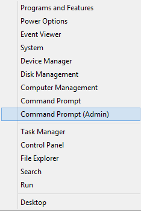
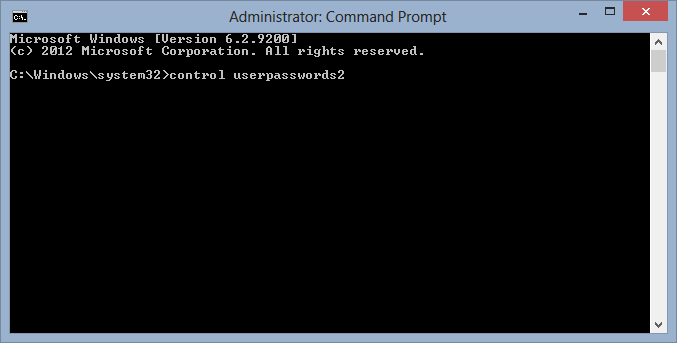
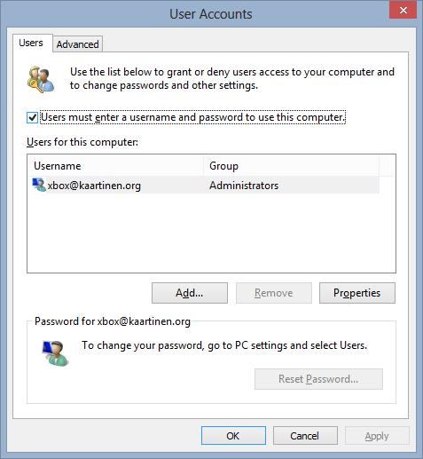
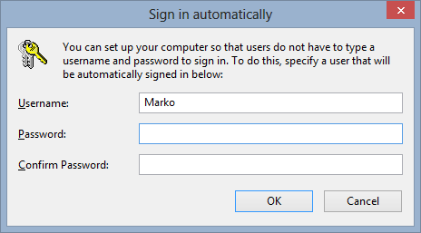

Säädin aiemmin tällä viikolla pääkoneeni tunnuksia ja kirjauduin Live tilillä sisään, jotta sain Storen käyttöön ja näin ilmeisesti asetukset synkkautuisivat tuonne Live tilille. No tästä sitten tuli harmillinen takaisku kun jokainen bootti alkoi kysellä tilin salasanaa ja paikallisella tilillä näin ei ollut. Tänään päätin sitten säätää ja tutkia miten pääsisin eroon tästä kirjautumisesta.

Alla onkin ohjeet teille miten saatte tämän tehtyä ja minulla kun on englanninkielinen Windows 8 niin kuvat on englanniksi. Suomenkielisessä Windowsissa homma toimii kyllä samalla tavalla.

1.  Ensin lempiyhdistelmäni [Windows-nappi + X](/2013/windows-x-pirun-hyodyllinen-nappainyhdistelma "Windows + X = Pirun hyödyllinen näppäinyhdistelmä"), josta valitaan Command prompt (admin)\
    
2.  Sen jälkeen kirjoitetaan komento: *control userpasswords2* ja klikataan *Enteriä*.\
    
3.  Tämän jälkeen aukeaa ikkuna, josta kun otat täpän kohdasta *”Users must enter a username and password to use this computer”* pois.\
    
4.  Tämän jälkeen kirjoitat salasanasi pari kertaa.\
    

Boottaile kone ja homman pitäisi olla kunnossa.

Syy miksi en halua kirjautumista tälle koneelle on se, että tätä konetta käyttää yhteisesti välillä toinenkin henkilö ja samat tunnukset toimii meillä hyvin sillä tämä kone on lähinnä pelikäyttöä ja mediakäyttöä varten.
