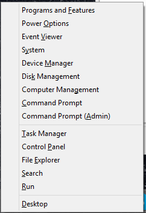

Olen käyttänyt Windows 8 käyttöjärjestelmää omassa koneessani jo jonkun aikaa ja se on ihan ok. Tänään kuitenkin opin TODELLA hyödyllisen näppäinyhdistelmän. Windows näppäin + X -näppäin aukaisee vasempaan alanurkkaan aivan älyttömän hyvän valikon (kts. kuva oikealta).

Tästä pääsen käytännössä kaikkiin tarvitsemiini asioihin helposti ja näin minun ei tarvitse kiertää valikoiden kautta.

Jaan tämän vinkin täällä blogissani sillä itseltäni meni kauan tämän tajuamiseen ja toivon, että joku muu bongaa tämän näppäinyhdistelmän tästä!
