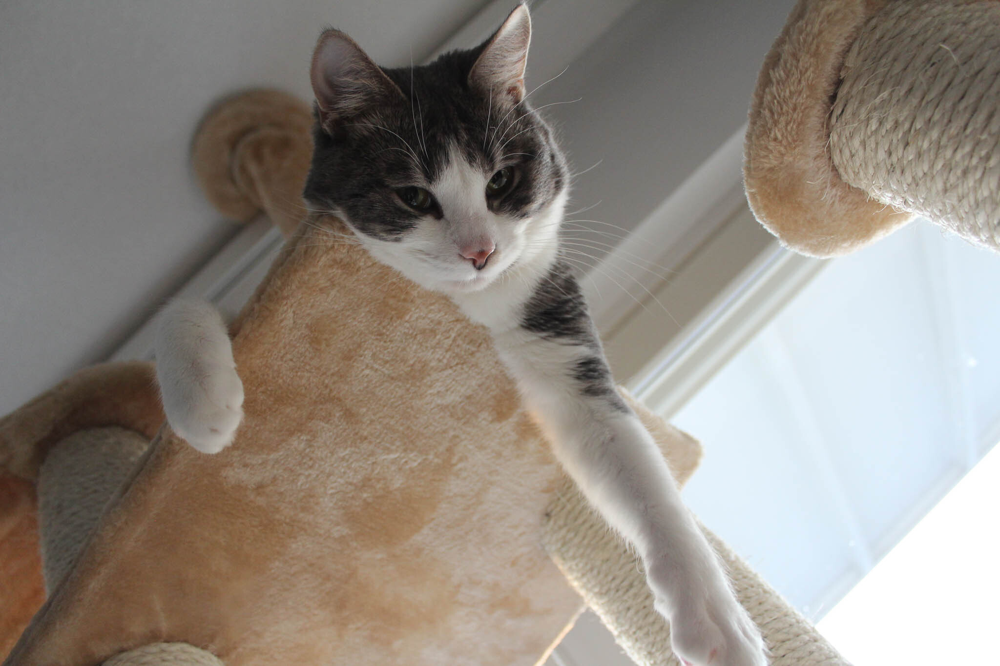
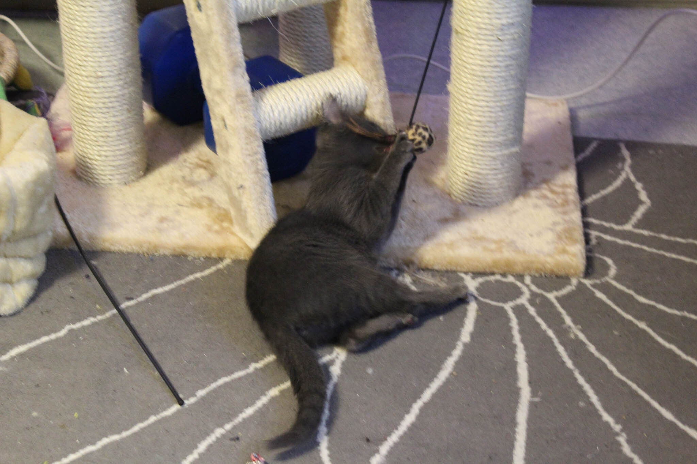
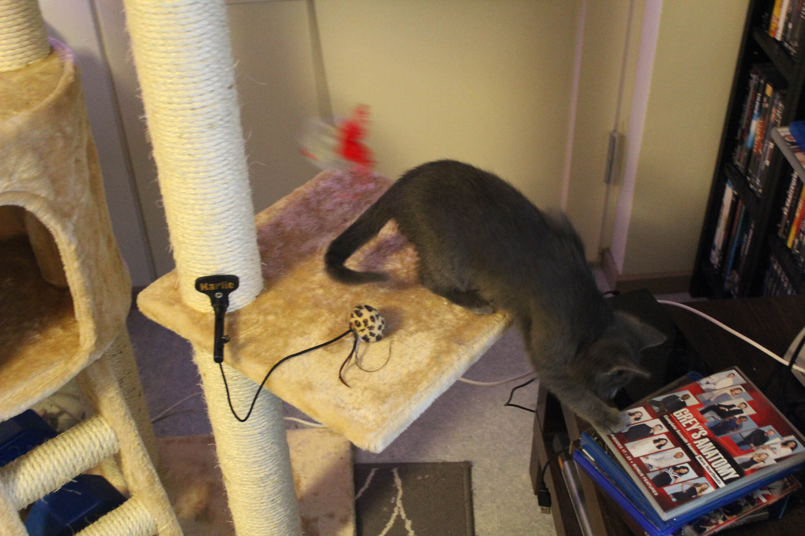
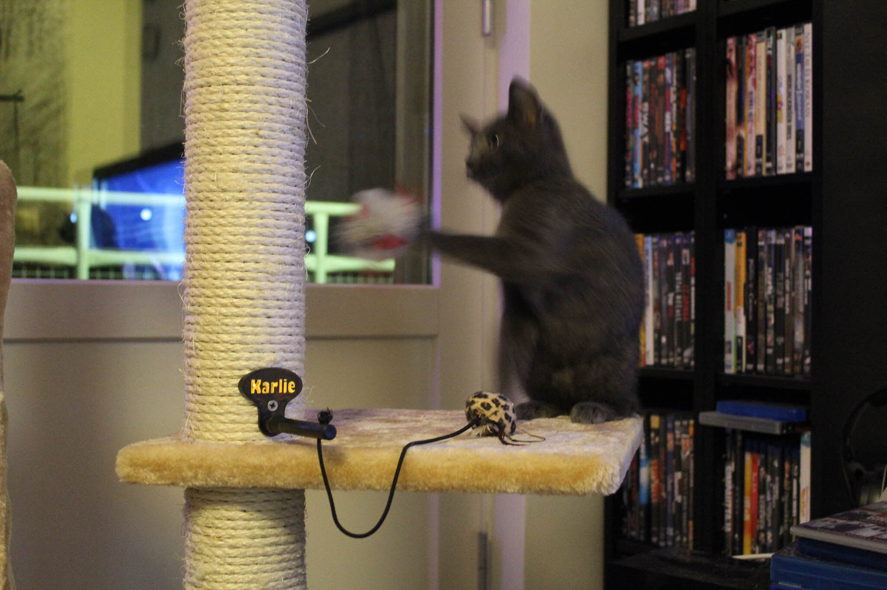
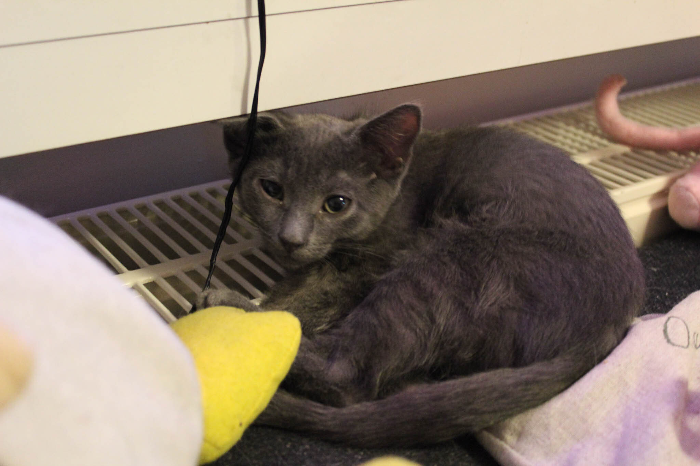
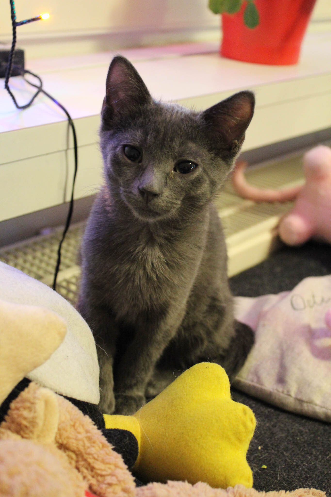
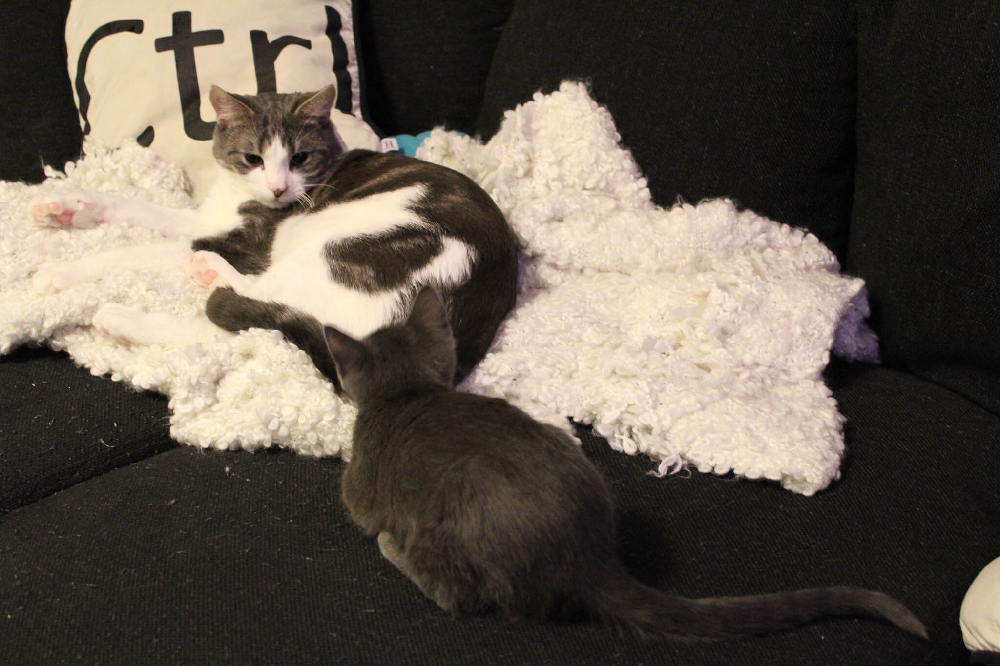
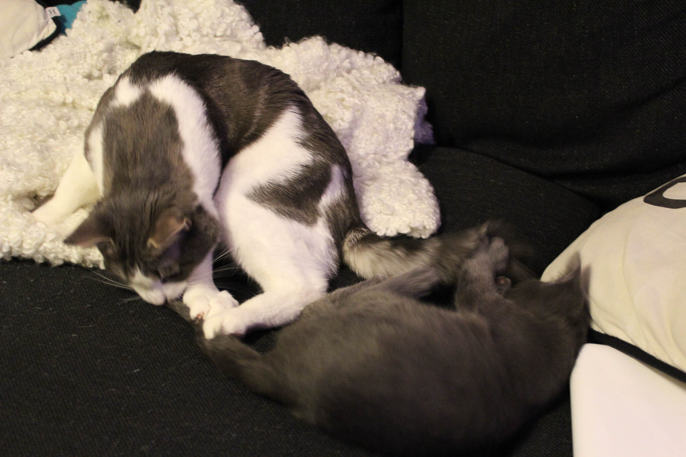

Tässä jaksossa oli tarkoitus saada segmentoitua podcastia fiksusti ja jaoteltua aiheita omiin osioihin – eihän se mennyt kuten Strömssössä…

Muutama linkki:

- [Blubrry](http://create.blubrry.com/resources/podcast-media-hosting/?code=markokaartinen)
- [Twitter](https://twitter.com/MarkoK)
- [Facebook](https://www.facebook.com/MarkoKaartinen.net)
- [Instagram](http://instagram.com/MarkoK)
- [Codekit](https://incident57.com/codekit/)
- [Tower](http://www.git-tower.com/)
- [Sublime Text](https://www.sublimetext.com/)
- [SourceTree](http://www.sourcetreeapp.com/)

Kasa kysymyksiä teille:

- Miten podcastia olisi teistä fiksuin tehdä?
- Vinkkejä webdevaus workflowhun?
- Muuta?

Ja lopuksi niitä kissoja joita lupasin teille!




