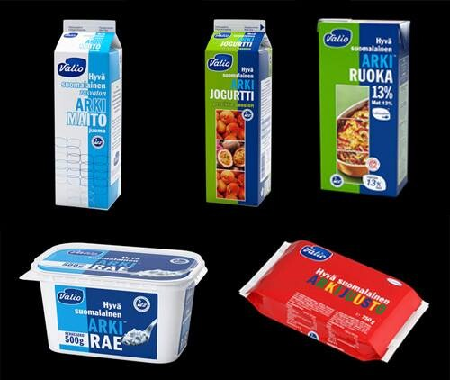
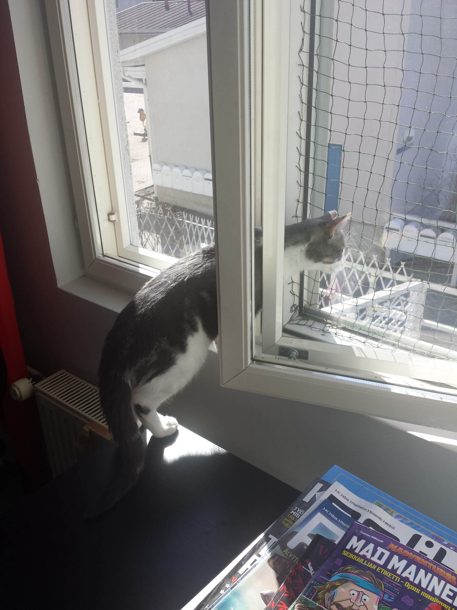
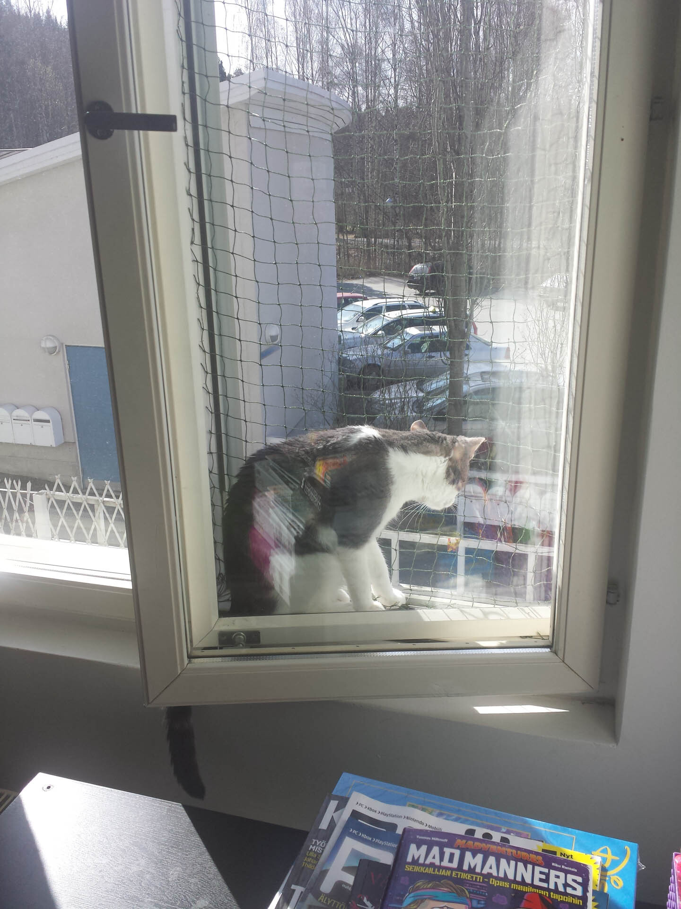
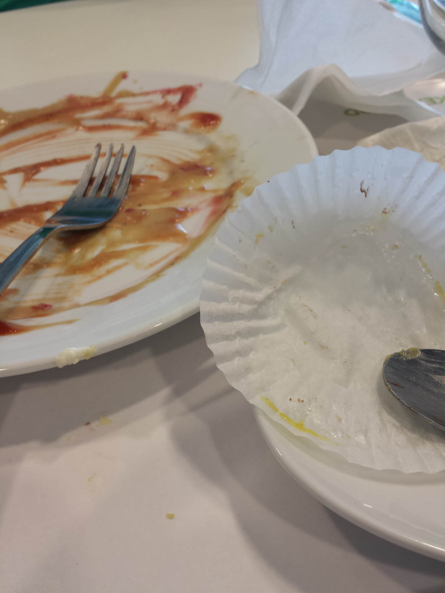
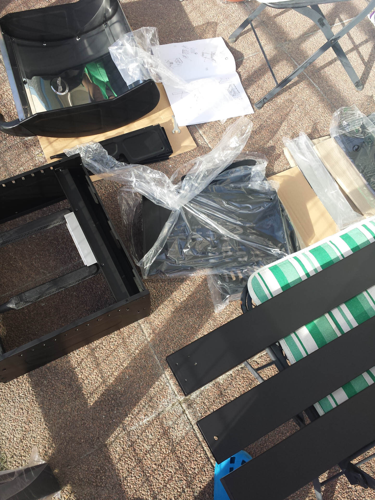
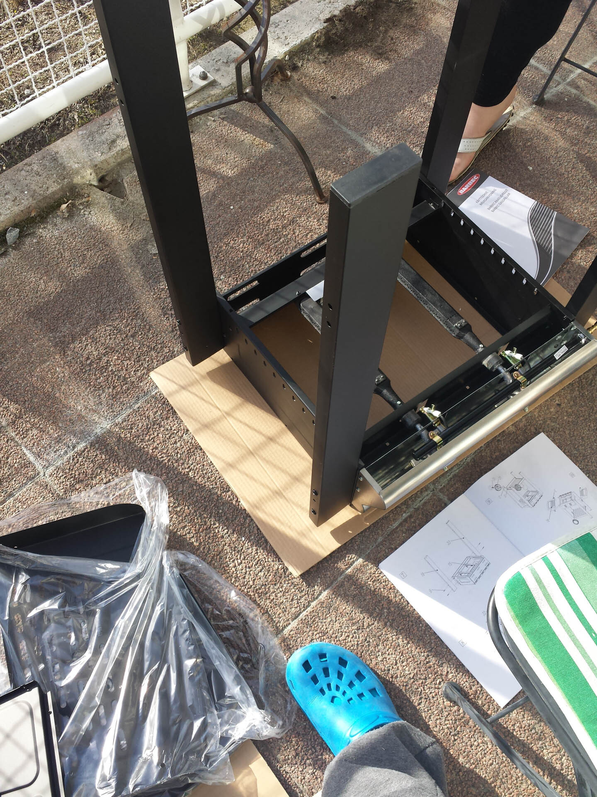
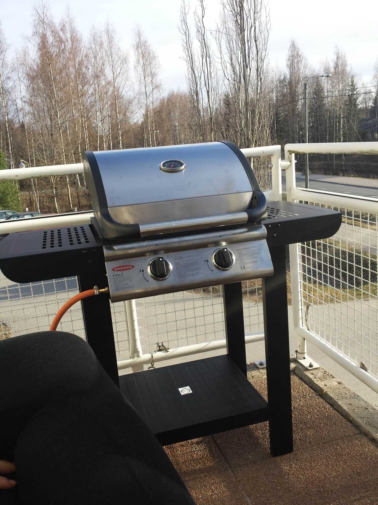
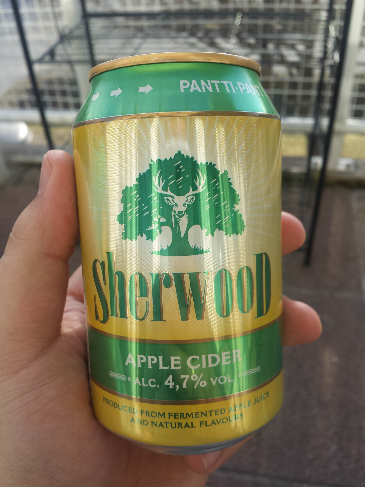

Sattuihan se tämäkin arkihaaste omalle kohdalle. En kuitenkaan **halua** Facebookissa tehdä tätä, joten teen tämän täällä blogissa. Mieli teki pistää tuo oikealla oleva kuva heti, mutta laitankin sen tähän extraksi heti alkuun!

Hupi sikseen ja katsellaan eilistä päivää. Arkihaasteessahan tarkoitus on pistää arkipäivän kuvia viiden päivän ajan. Tarkoitus olisi myös haastaa joku tähän, mutta tässä poikkean ja sanonkin vain tämän: Bloggaajat, jotka haluaa tehdä niin tehkööt, heittäkää linkkiä kommentteihin!
















