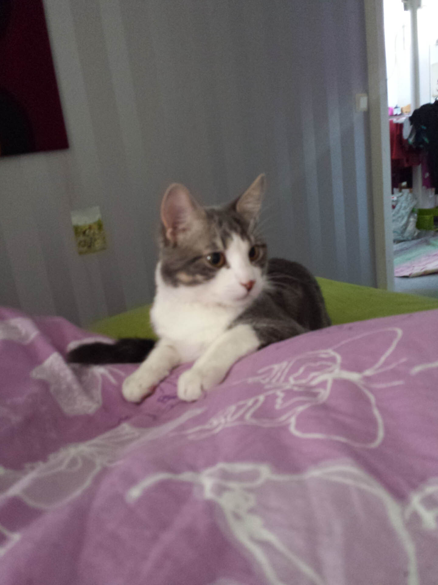
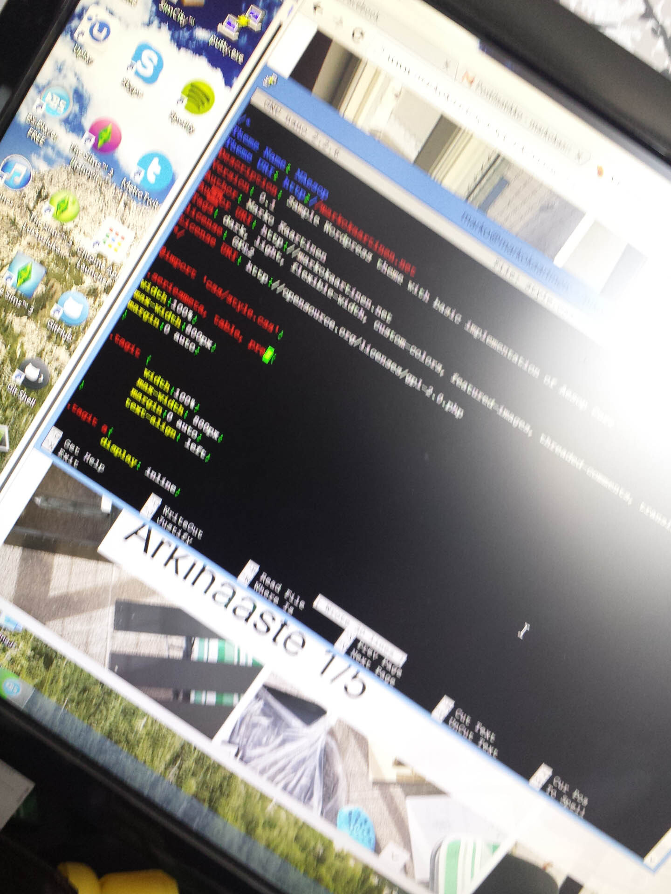
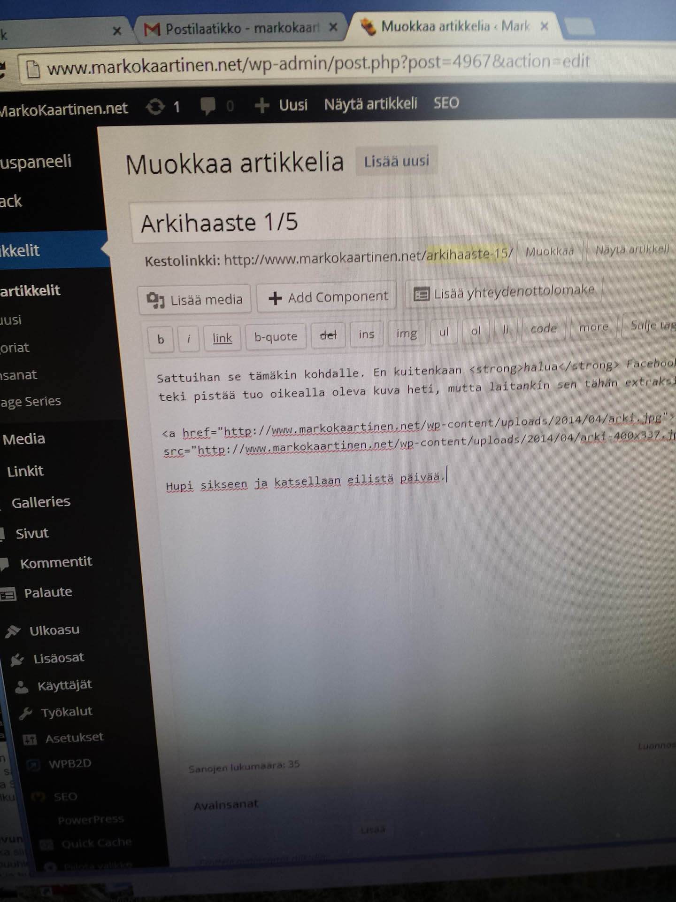
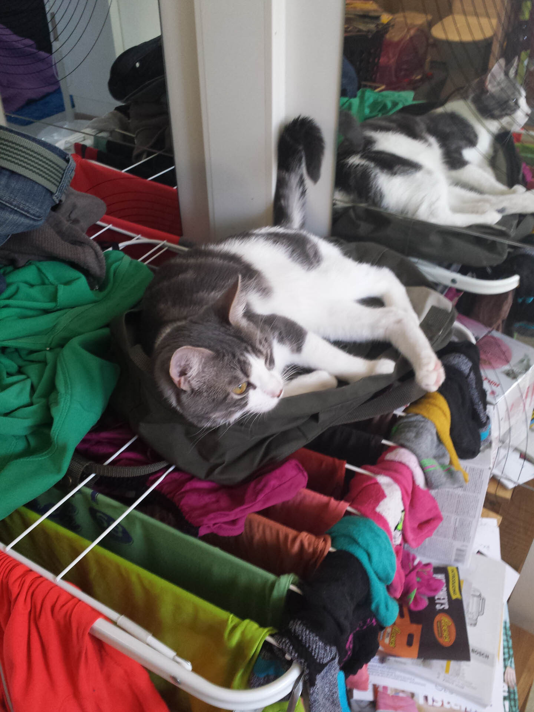
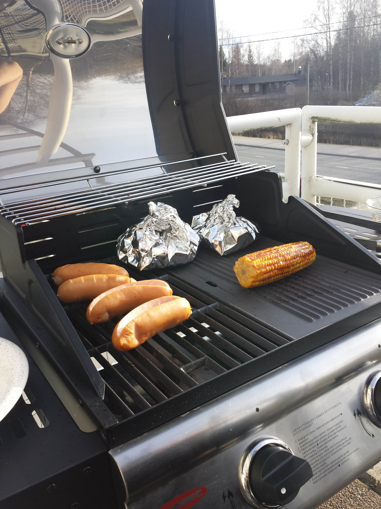
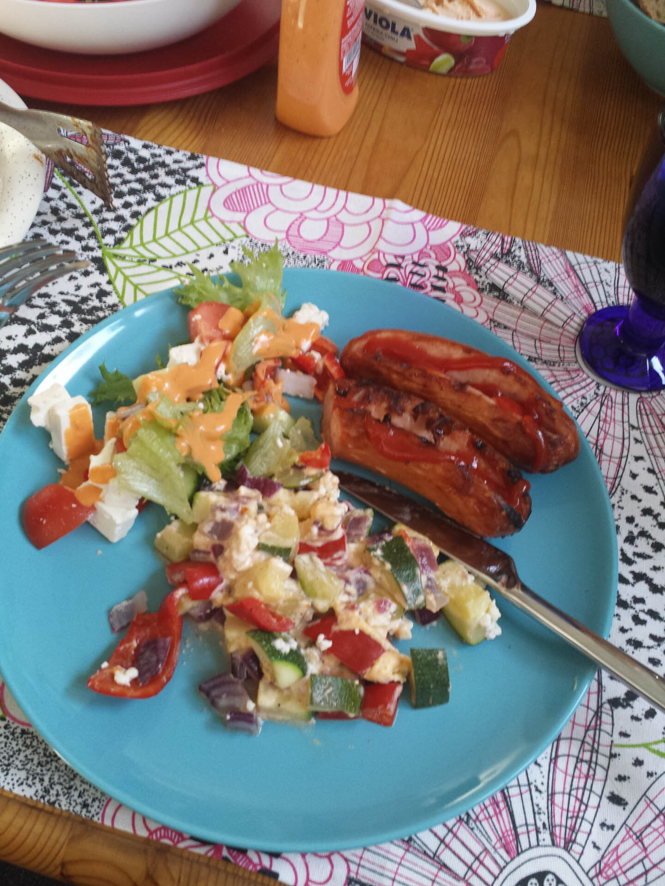

Arkihaaste jatkui sunnuntain merkeissä ja ohjelma olikin laiskan sunnuntain mukaista.

Aamu alkoikin sillä, että tämä meidän Paavo-Herra tuli herättämään aamusella, tämä toistui kyllä useita kertoja aamun aikana ennen kuin kumpikaan jaksoi vaivautua heräämään.

Tästä sitten päästäänkin sunnuntain aamutouhuihin eli bloggaamiseen. Tällä kertaa bloggaamisen lisäksi piti hieman säätää WordPressin ja VPS:n kanssa sillä esikatselu ja kirjautumisen sessiot eivät toimineet omassa blogissani oikein. Tähänkin selvisi syy sitten lopulta, sivuston ja WordPressin osoite oli hallinnassa eri – toisessa oli www alku ja toisessa ei.





Kauppareissusta en kuvaa nappassut, mutta päivän ruoan valmistuessa Paavo-Herra päätyikin makoilemaan yhdelle lempipaikoistaan – hän nimittäin tykkää makoilla pyykkitelineen päällä. Jos siinä on vaatteita niin sitä parempi siinä on olla – ei haittaa jos se on tyhjä tällöin tuppaa olemaan vain hieman hankala liikkua siinä.

Päivän kuvat onkin hyvä päättää ruokakuviin tai oikeastaan grillaamiseen.




