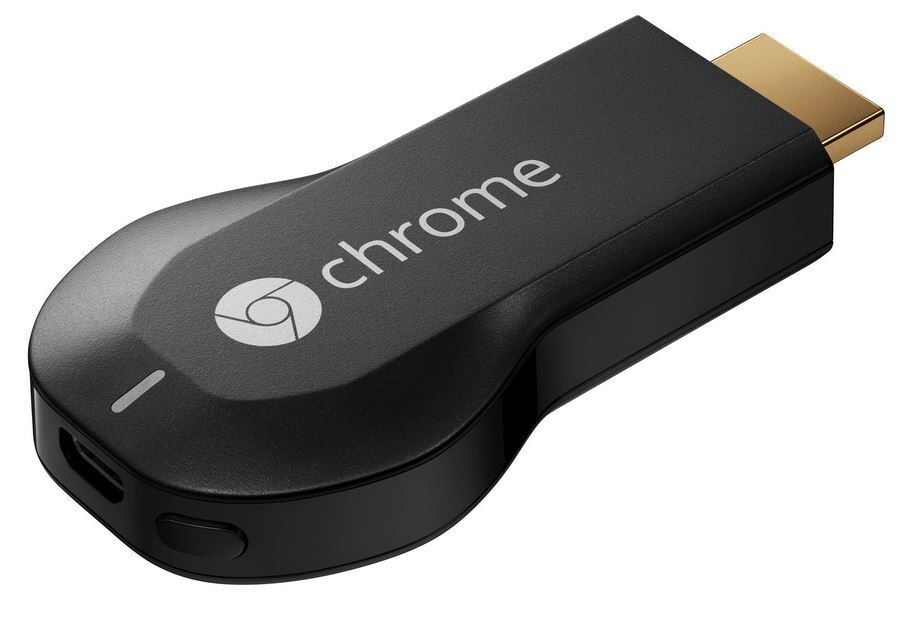
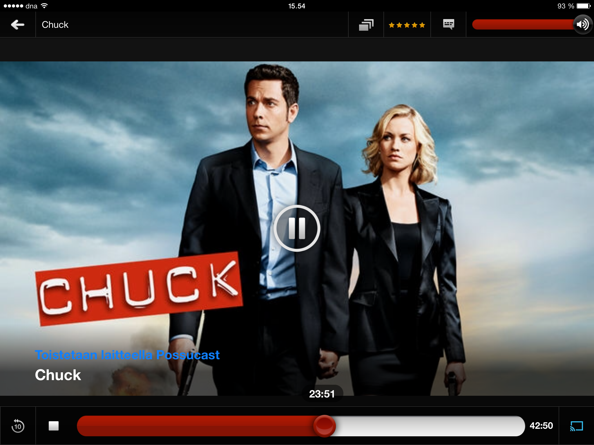

Chromecast on suoratoistolaite, joka kiinnitetään television HDMI liittimeen. Chromecastin kautta voit toistaa televisiossa esimerkiksi Netflixiä tai YouTubea. Paketissa tulee mukana itse Chromecast, HDMI jatkopiuha (lyhyt), USB-johto ja virta-adapteri USB:lle. Chromecastin käyttöä varten tarvitset kotiisi langattoman lähiverkon, jota kautta pääsee Internettiin ja hallitaksesi Chromecastia sinun puhelimesi/tablettisi/tietokoneesi pitää olla samassa verkossa.

Käyttöönotto oli simppeliä kuin mikä. Artikkelikuvassa näkyykin oma kiinnitykseni eli pistin Chromecastin kiinni HDMI porttiin ja USB piuhan laitoin telkkarin USB porttiin kiinni sillä se saa virtansa siitä. Mikäli telkkarissa ei ole USB liitäntää niin voit aina pistää sen kiinni virta-adapterilla kiinni. Tämän jälkeen hoidin asennuksen itsessään iPadilläni ja käytännössä voit tehdä sen millä laitteella vain mikä on samassa lähiverkossa, kuin Chromecastisi.

Chromecastille on tullut muitakin sovellutuksia, kuin elokuvien katsominen – voit esimerkiksi Chromewallin avulla katsella kuvia television kautta. Chromewall olisikin parhaimmillaan joillain messuilla tai tapahtumassa, jossa halutaan näyttää kuvia yleisölle.

Itselläni on vielä etsinnässä passeli sovellus lomakuvien katseluun Chromecastin kautta. Olen lähinnä keskittynyt katselemaan Netflixiä telkkarista – nyt kun se on hieman liiankin helppoa. Tulen kuitenkin etsimään muitakin käyttötarkoituksia Chromecastille kuin helppo Netflixin katselu.

Hintaahan tällä oli 35 euroa ja tilasin sen suoraan Googlen Play kaupasta sillä samana päivänä, kun Chromecast tuli Suomeen myyntiin niin tuli myös Play kauppa tänne pohjolaan. Toimituksessa meni about viikko ja sen jälkeen se olikin postissa haettavissa.

Chromecastiahan hallitaan joko puhelimella, tietokoneella tai tabletilla. Google on avannut kehittäjätyökalut muille kehittäjille, joten lisää sovelluksia on tulossa. Chromecast toimii niin, että sinä valitset mitä toistetaan ja Chromecast toistaa sen. Toistaminen tapahtuu suoraan palvelimelta eikä esimerkiksi puhelimeltasi.

Chrome selaimeen on saatavilla lisäosa jonka avulla voit jakaa välilehden telkkarille ja tätä kautta ihmetellä verkkoa. Tulen myös jossain välissä testaamaan Plex nimistä sovellusta, jota kautta voisin myös katsoa leffoja/sarjoja joita minulla on tallessa pöytäkoneellani.

https://www.youtube.com/watch?v=cKG5HDyTW8o

## Plussat

- Pieni
- Helppokäyttöinen
- Hinta
- Helppo asennus
- Laitetuki

## Miinukset

- Vähän sovellutuksia tällä hetkellä

Kysymykset ja kommentit ovat tervetulleita ja niitä voikin jättää tuohon kommenttiboxiin!
