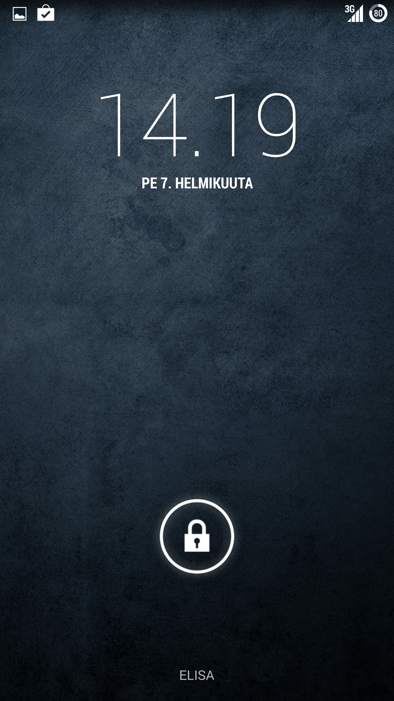
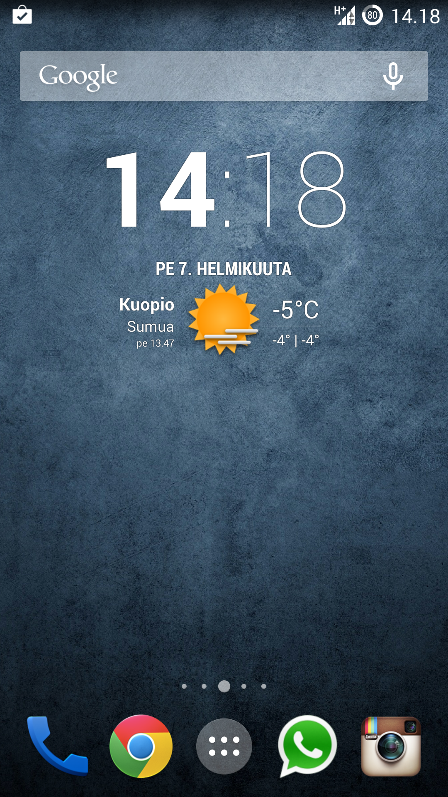
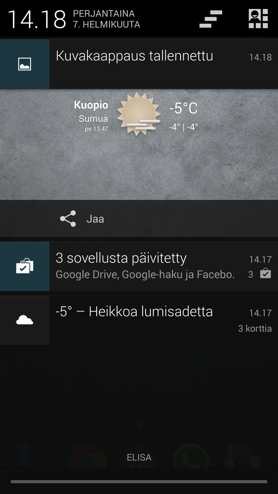
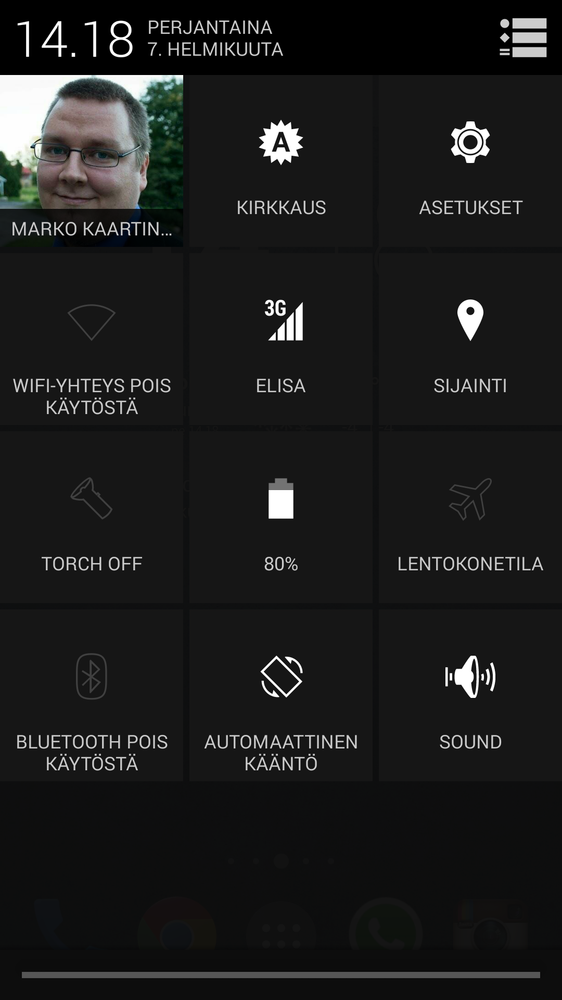
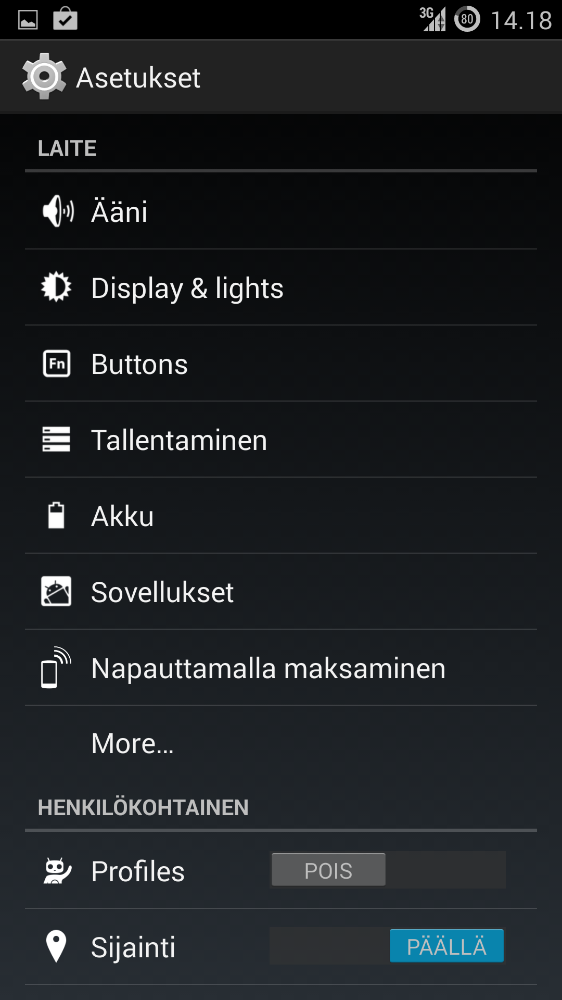
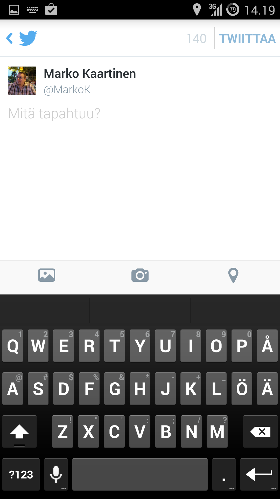
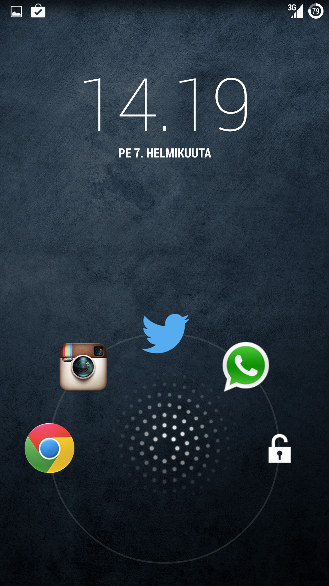
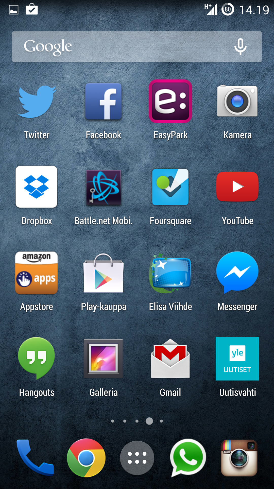
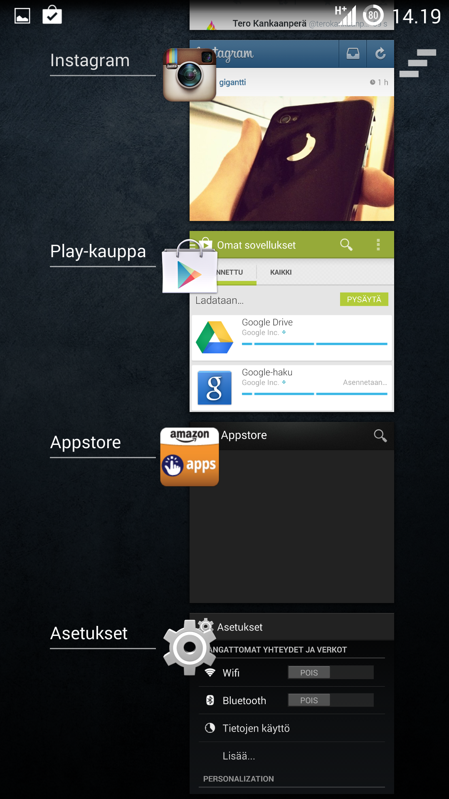

Cyanogenmod saapui Samsung Galaxy S4 puhelimeeni – tarkalleen sanottuna se saapui eilen kun asentelin sen. Syynä Cyanogenmodin saapumiseen oli ärsyyntyminen Samsungin omaan huonoon näppikseen ja muutenkin tahmailuun sen kanssa. Aikoinaan kun asentelin niin piti rootata ja tehdä vaikka mitä taikatemppuja, että sain taannoisen puhelimen säädettyä kuntoon. Nyt kuitenkin huomasin, että Cyanogenmod on tuonut beta asteella olevan [installerin](http://beta.download.cyanogenmod.org/install) julki – päätin siis koittaa sitä.

Kuten joskus [podcastissani](/2013/003-cyanogenmod-pelittaa-fi-surface-2-jolla) puhelin niin Cyanogenmod on varsin suosittu custom rom. Cyanogenmod pyrkii olemaan mahdollisimman lähellä Googlen omaa Androidia ja tekemään siihen vain pieniä parannuksia. Tykkäsin Nexus 7 täppäristä ja sen puhtaasta Androidista, joten Cyanogenmod oli passeli vaihtoehto minulle.

Asennus olikin vähän liian helppo sillä latailin ensin appsin puhelimeeni ja tein sen mitä sovellus käski. Tämän jälkeen koneeseen sovellus ja taas tehdään mitä se sanoo. Sitten vain odottelet kun sovellus hoitaa kaiken sinun puolestasi. Puhelin boottailee, roottaa itsensä ja asentaa Cyanogenmodin – sinä voit sillä välin koppasta kupposen kahvia.

Luulin ettei tämä roottaisi puhelinta, mutta kappas kummaa kun Root Checker nimisellä appsilla katsoin niin se väitti puhelinta rootatuksi. No mikäs siinä, hieno homma ettei minun tarvitse tehdä tätä askelta itse.

Kuten Twitterissä seuranneet saattoivat huomata niin Cyanogenmodia kun aloin käyttämään niin olo oli kuin olisi kädessä ollut täysin uusi puhelin. Iltahan sen säätämisessä sitten menikin kun piti tietty etsiä taustakuvaa ja soittoääntä sekä tietysti säätää asetuksia kuntoon.

Näin päivän jälkeen olen ollut äärettömän tyytyväinen päätökseeni asentaa Cyanogenmod ja paljon tutustumista on vielä edessä. Tällä hetkellä eräs lemppareistani on lukitusnäytön aukaisu kun voit määrittää jokusen ohjelman jotka saat heti auki kun viet sormen päälle.

Toinen asia miksi oikeastaan Cyanogenmodin asensin oli näppäimistö, sillä Samsungin oletus on surkea ja korvikkeet oli kehnoja. Tämä Googlen oma näppis taas on mitä mainioin minulle!

Alla on vielä kuvagalleria tämän hetkisestä tilanteesta (löytyy mm. tuo em. lukitusnäyttö sekä näppäimistö).

**Kaikki vinkit ovat muuten tervetulleita!**




