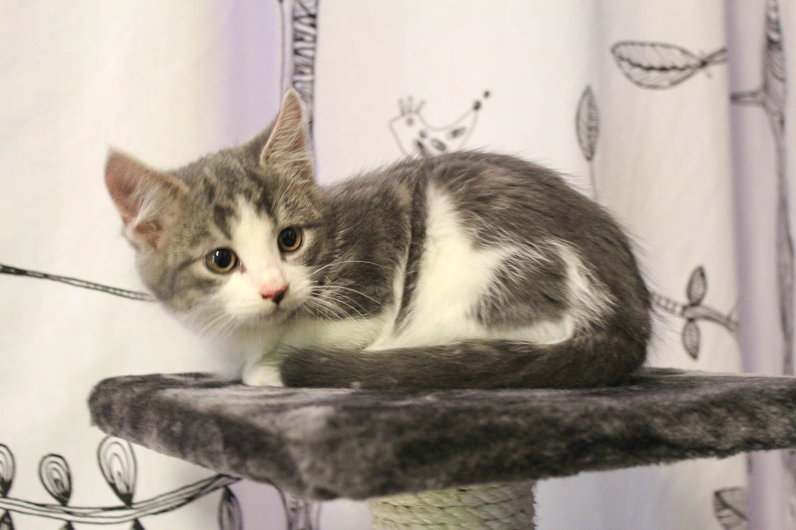
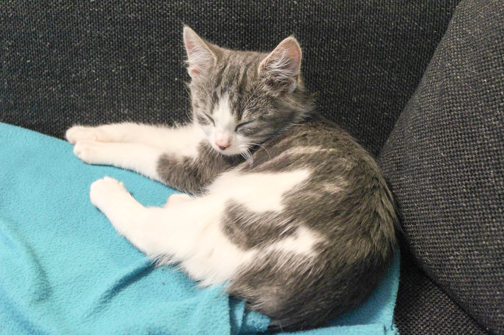

Kuten viime vuonna [esittelinkin](/2013/20-saanko-esitella-paavo), niin meillä on tänä päivänä kissa nimeltä Paavo. Ajattelinkin kirjoitella jokusen rivin siitä millaista on nyt ollut elää kissan kanssa. Paavo on oikeastaan ensimmäinen lemmikkia joka minulla on ollut, joten siltäkin osalta on ollut suhteellisen mielenkiintoista.

Paavo on nyt ollut meillä nelisen kuukautta ja ikää sillä on reilut puoli vuotta jo. Ei siis mikään alla olevan kuvan mukainen pikku kissa enää ole. Artikkelikuva on otettu eilen ,joten se taitanee olla tuorein kuva herrasta.

Paavolla on muuten oma [blogikin](http://paavoherra.kisut.fi/) tänä päivänä, näin mainoksena se onkin osana Kisut.fi sivustoa joka on myös näitä minun projektejani. Kannattaa käydä vilasemassa.

Itsellänihän ei ollut mitään hajua kissojen hoidosta saati mitenkä ne muutenkaan käyttäytyy. Onneksi Outilla oli käryä näistä asioista, joten sillä mentiin.

Olemme ehkä päässeet suhteellisen helpolla Paavon kanssa, sillä se ei ole kuseksinut nurkkiin ja on muutenkin on ollut suhteellisen helppo tapaus tai no niin. Onhan se tietty verhoissa roikkunut, juossut ympäri taloa ja meuhkannut missä sattuu. Pahimmat vauriot on saanut kokea makuuhuoneen tapetti sillä se kiinnosti herraa yli kaiken ja sitä pitikin hieman repiä. Tämä ratkaistiin valelemalla etikkaa tapettiin – eipä ole sen jälkeen tapetteihin koskenut.

Yöt on mennyt suht hyvin sen kanssa, mutta ennen se nukkui sängyssä meidän kanssa ja nyt sillä on ollut tapana meuhkata ja juosta yöllä kun me aletaan nukkumaan ja sitten se nukkuu vähän missä sattuu. Usein se tuntuu yöllä olevan raapimapuussaan nukkumassa.

Ilmeisesti Paavo on ollut tyytyväinen saamaansa palveluun tässä kissahotellissa sillä eipä tuo ole mennyt vielä yhtään minnekkään ja näkyy nytkin nukkuvan tyytyväisenä raapimapuussaan. Eipä ole itselläkään ollut katumusta siitä, että Paavo tuli taloon. Onhan se ihan mukavaa kun joku on kotosalla kun itse tulee kotiin – aamusella on tosin hitusen ärsyttävää kun herra pyörii jaloissa ja puree varpaita, teepä siinä sitten mitään aamutoimia.

Saa nähdä milloin Outi tuo kotiin Paavolle kaverin sillä hän on meuhkannut siitä jo jonkun aikaa.  Ehkäpä tuo pitäisi leikata ensin ennen kuin tulee uutta kissaa taloon – varsinkaan eri sukupuolta olevaa. Muuten on talo täynnä kissoja.

Toivotaan Paavolle monia vuosia tässä taloudessa ja tulemme tosiaan päivittelemään Paavon kuulumisia säännöllisen epäsäännöllisesti tuonne herran omaan blogiin.
