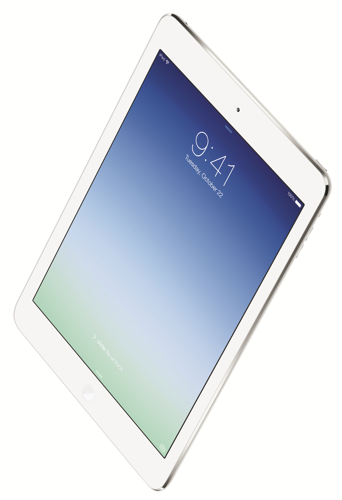

Olen jo pari kolme viikkoa pyöritellyt käsissäni Applen iPad Air täppäriä. Kirjoittelen tähän lyhyen katsauksen tuosta ja lähinnä vain omia fiiliksiä. Tarkemman artikkelin tulen kirjoittelemaan tuonne [Täppärin](http://tappari.fi) puolelle.

Itselläni oli oikeastaan yksi vaihtoehto iPadille. Nimittäin 32 gigan 4G malli sillä en pärjää pienemmällä tilalla saati ilman mobiilidataa. Hieman tuo iPad Mini Retinalla houkutteli, mutta sivuutin sen sillä halusin kuitenkin isomman ruudun. Väriksi valikoitui valkoinen vaikka mustaakin oli saatavilla – valehtelisin jos väittäisin, ettei huushollin toisella osapuolella ollut sanottavaa tähän.

Ensimmäisenä asiana pistää silmään koko ja muotoilu. Tämähän on kapeampi ja hieman pyöreämmin muotoiltu kuin esim. iPad 2 tai 3. Koko olikin yksi syy miksi en miniä ottanut sillä ero ei ole enää niin merkittävä ja painoa tällä ei loppuunsa ole niin paljoa.

Näyttö on taattua Retinaa ja mitään ongelmia ei sen suhteen ole ollut. Ainut ongelma on iOS 7 joka haluaa silloin tällöin kaatua, mutta jospa ne tämänkin korjaisivat päivityksissään.

Entisessä iPadissäni oli 30 pinninen liitin ja tässä uudessa on Lightning adapteri. Pitäisi vielä hankkia adapteri tuolle sillä itselläni on vielä tallessa tuo camera connection kit ja tämän haluan toimintaan myös tässä. Lightning latauskaapeli pitää muuten olla hyväksytty tai kaapeli ei ainakaan lataa laitettasi. Vahingossa tilailin tarvikekaapelin tähän ja eihän se toiminut.

Uusi vekotin tarvitsee tietysti suojaa. Joten ensin hankin ihan perus Smart Coverin iPadille sillä olin tykästynyt siihen vanhaan. Tästä sanoinkin jo jokusen sanan tuolla [Täppärissä](http://tappari.fi/apple/ipad-air-smart-cover). Toiseksi suojaksi koppasin viime viikolla Prismasta Gollan universaalin suojan, tästäkin kirjoitin jo [Täppäriin](http://tappari.fi/lisavarusteet/golla-vincent-suoja-10-1-tappareille).

Tehoja tästä löytyykin ja hidasteluja ei ole ollut – tästä kiitos A7 prosessorille ja erilliselle M7 liiketunnistinprosessorille. Tietysti WLAN, Bluetooth, 4G ja muut perustoiminnot toimivat moitteetta. iOS:n App Store onkin vielä se paras paikka napata sovelluksia omaan laitteeseensa – peleistä nyt puhumattakaan.

Itse voin kyllä lämpimästi suositella iPad Airia ja sen toimivuus onkin ollut mainiota ja ongelmia ei ole ilmennyt – mitä nyt iOS7:n puolella, mutta näitä oli jo aikaisemmassa iPadissä.
