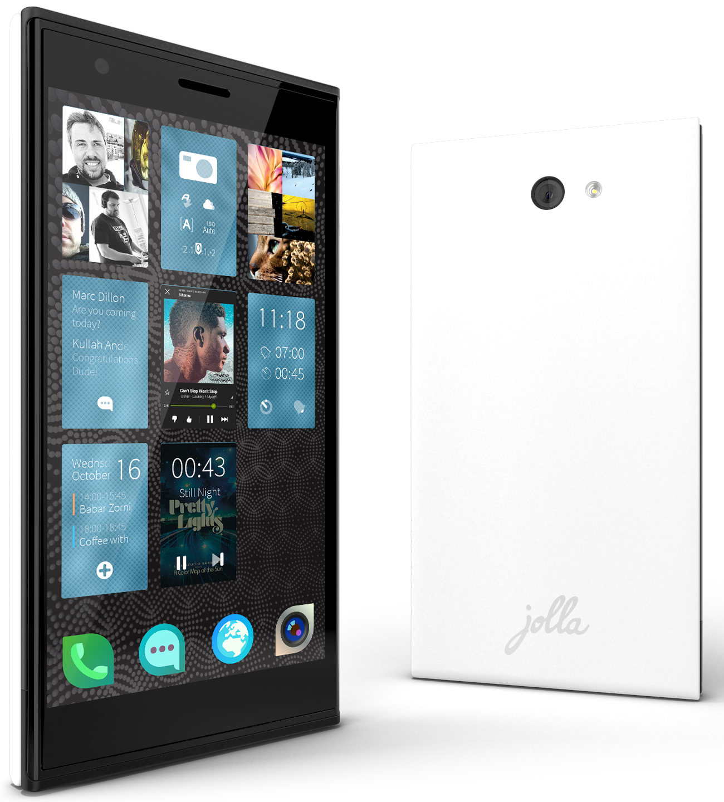
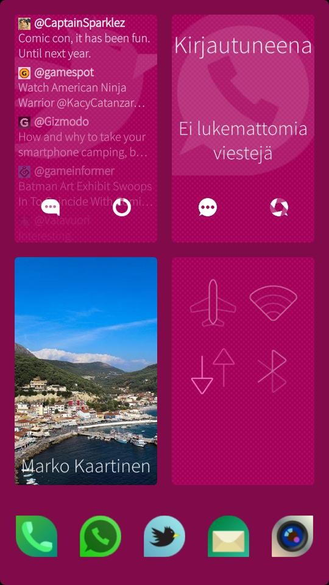
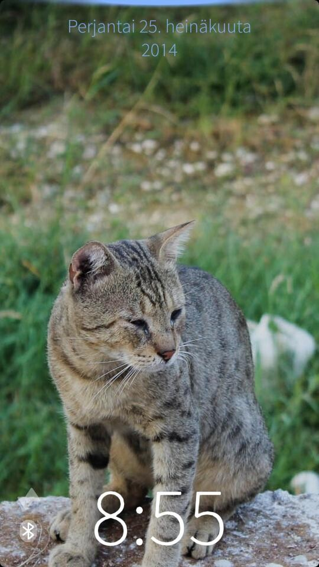
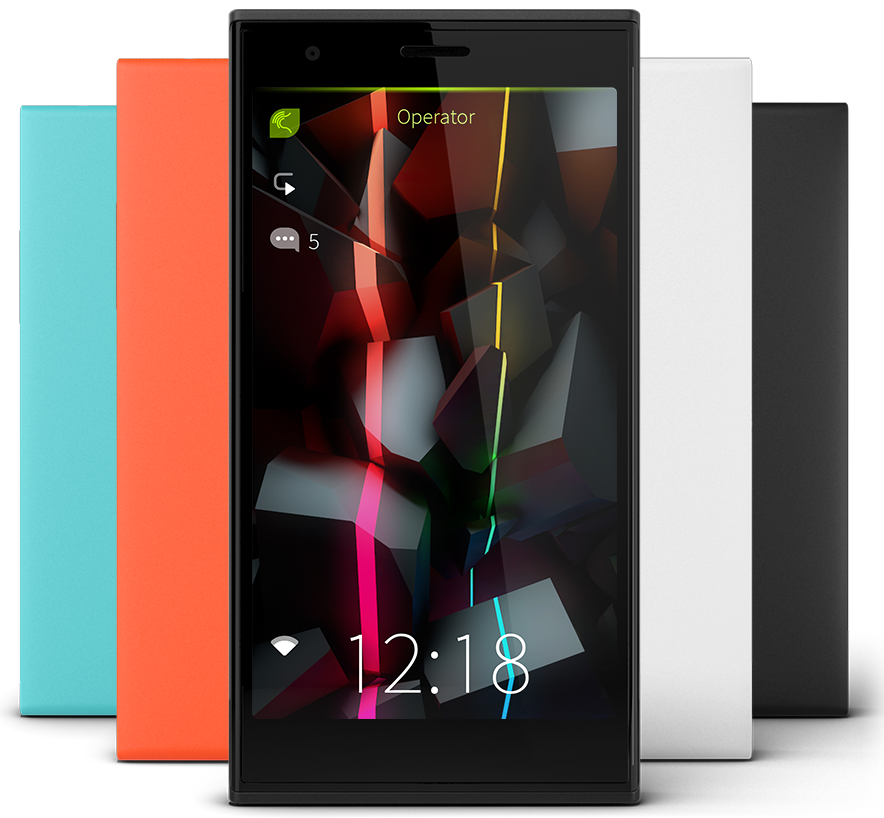
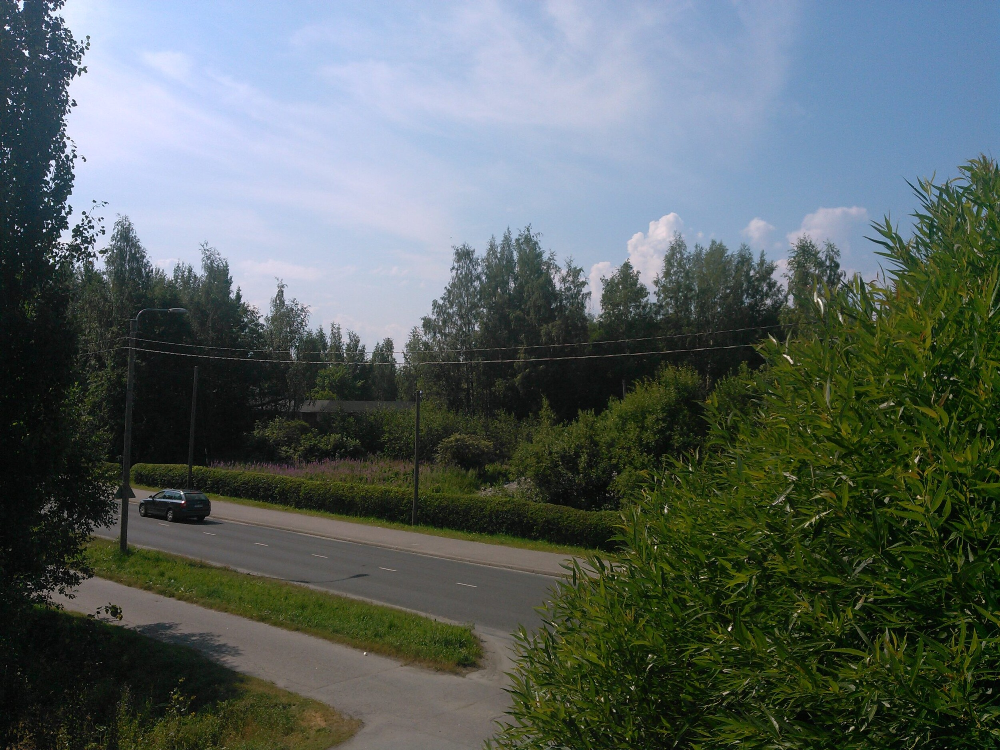
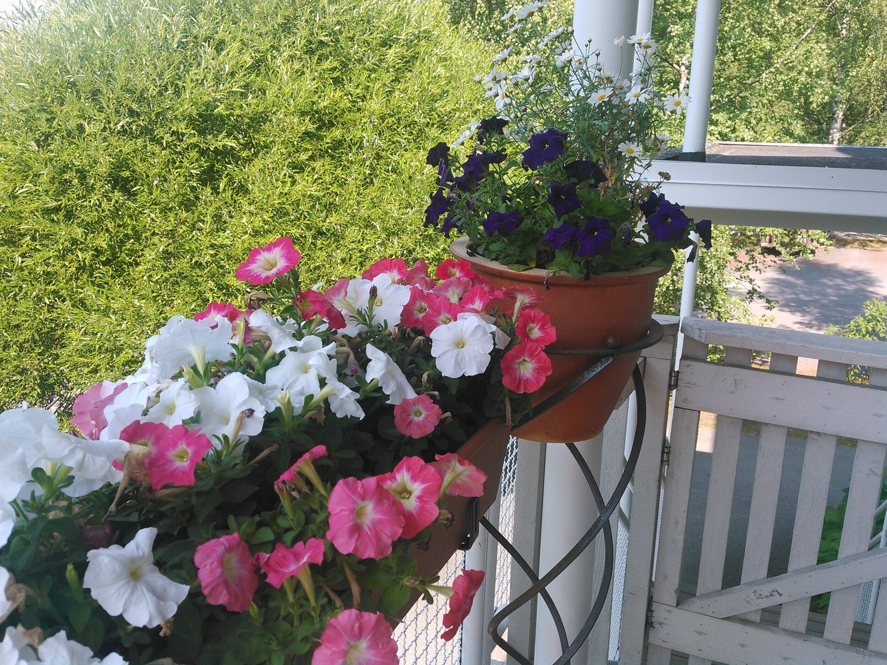
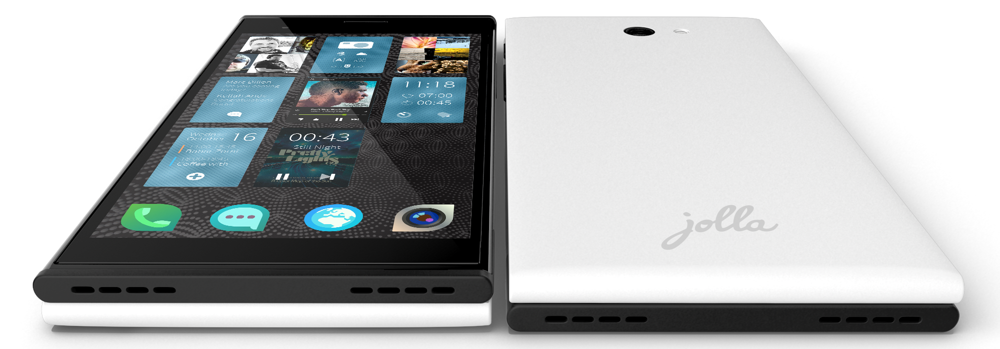

Olen jättänyt Jollan [aiemmin](/2013/jatin-jollan-viela-kaupan-hyllylle) kaupan hyllylle. Aiemmin tällä viikolla kuitenkin möin oman Samsung Galaxy S4 puhelimen pois ja hankin tilalle käytetyn Jolla puhelimen. Aloitetaan kuitenkin kertaamalla Jollan speksit (lähde: [Jolla.com](http://jolla.com/fi/)):

- Näyttö:  4.5″ IPS qHD kosketusnäyttö Gorilla 2™-lasilla
- Kamera: 8 megapikselin kamera automaattitarkennuksella, LED-salama ja 2 megapikselin etukamera
- Muisti: 16Gt tallennustilaa, 1Gt RAM-muistia ja MicroSD-muistikorttipaikka
- Prosessori: Qualcomm tuplaydinprosessori 1.4GHz
- Käyttöjärjestelmä: Sailfish OS
- Yhteydet: GSM/3G/4G LTE, WLAN802.11 b/g/n 2.4GHz, Bluetooth 4.0 EDR HS, AGPS & GLONASS
- Mitat: Korkeus: 131 mm / Leveys: 68 mm / Paksuus: 9.9 mm / Paino: 141 g
- Hinta: 349 euroa



## Käyttöliittymä

Käyttöliittymä on se mikä erottaa Jollan muista puhelimista. Jollassahan ei ole kuin kolme nappia: sammutus/herätys/sulku, äänenvoimakkuus ylös ja äänenvoimakkuus alas. Toiminnot tehdään pääasiallisesti erilaisilla eleillä. Esimerkiksi, jos haluat sulkea ohjelman niin vedät ylhäältä asti tai jos haluat ohjelman jäävän taustalle niin vedät jommalta kummalta sivulta.

Kotinäkymässä avoinna olevat ohjelmat näkyvät eräänlaisina tiilinä ja nämä tiilet näyttävätkin erilaista dataa sisällään – riippuen ohjelmasta. Oikealla onkin avoinna Tweetian (twitter), Mitäkuuluu (Whatsapp), Friends (Facebook) ja Asetukset -sovellukset – nämä näyttävätkin omaa tietoaan ja huomaatte varmaan kahdessa ylimmässä (Tweetian ja Mitäkuuluu) sovelluksissaa valkoiset ikonit alhaalla. Jos tuon tiilen kohdalta vedän oikealle tai vasemmalle niin pääsen tekemään suoraan toimintoa mitä tuo ikoni näyttää eli jos Tweetianin kohdalla vedän oikealta vasemmalle niin sovellus päivittää Twitter feedin.

Tunnelmat ovat tämän käyttöliittymän hauska ominaisuus. Ne nimittäin määräävät sen miltä puhelin näyttää.  Tuo ylempänä oleva pinkillä taustalla oleva tunnelma oli yksi monista testeistäni. Oikealla on taas Kreikassa kuvaamani kissa taustana ja siitä luotu tunnelma.

Tunnelmiin voit liittää taustan lisäksi soittoäänet, joten voit tehdä omia tunnelmia ja laittaa niihin erilaisia soittoääniä. Halutessasi voit siis tehdä tunnelman vaikka töihin ja kotiin tai vaihdella tunnelmaa vaikka joka päivä.

Puuhastelin myös itselleni muistiin pienen saitin, jonne tallentelin tunnelmia ja APK paketteja. Voitte vapaasti nappasta sieltä tunnelman käyttöön – osoite on [jolla.markokaartinen.net](http://jolla.markokaartinen.net/).

Vinkkinä tunnelmien luontiin: Luo 540×1600 pikselin kokoinen kuva ja pistä siihen ja laita siihen oma kuvasi. [Tältä](http://www.jollausers.com/2013/12/how-to-make-ambiance-wallpapers-for-sailfish-bonus/) sivulta löytyy passeli pohja ja hieman kuvausta siitä mihin mikäkin kohta tuossa korkeassa kuvassa menee – kannattaa käyttää tuota ohjenuorana.

Mainitsinkin APK-paketit, Jollassa toimii myös Android sovellukset ja itse olen jokusen asentanut APK pakettien kautta suoraan ja jokusen Aptoide nimisen sovelluksen kautta. Osa toimii vallan mainiosti ja osa taas ei – kokeilemalla se selviää.

## The Other half

The Other half on se toinen asia mikä erottaa tämän muista puhelimista. Tällä hetkellä Jollan omia Other halffeja on neljää eri väriä: valkoinen (tulee mukana), musta (Keira Black), oranssi (Poppy Red) ja vaaleansinen (Aloe) – tällä hetkellä näissä ei muita toimintoja ole, kuin se että niiden mukana tulee oma tunnelma ja soittoäänet. Yhteisö onkin se mikä uurastaa omia innovaatioitaan näiden kanssa. Jolla on julkaissut 3D-mallit näistä Other halfeista ja sinä voit itse tulostella oman Other halffisi. Olenkin nähnyt mielenkiintoisia Other halffeja aina langattomasta latauksesta QWERTY näppäimistöön. Odotankin innolla miten nämä kehittyy ja mitä kaikkea sitä tuleekaan – itseäni eniten kiinnostaa tuo langaton lataus.

Tulen jossain välissä hankkimaan jonkin Other halffin, lähinnä sen takia kun sillä saa helposti vaihdettua puhelimen ulkoasua ja väriä. Vaihdettava takakuori tuo myös puhelimelle kummasti lisää elämää sillä naarmuja voi taakse tulla ja vaihtamalla Other halffin pääset niistä eroon. Outoa on se, että tuota valkoista Other halffia ei ole myytävänä – ei ainakaan Jollan omassa kaupassa ollut.

## Yleistä

Katsotaanpa sitten yleisesti tätä puhelinta. Alla on pari kameralla näppästyä kuvaa ja kamerakännykän kuvaksi tämä kelpaa minulle mainiosti. Eipä tätä kameraa tule käytettyä muuhun kuin kuvien jakamiseen someen tai viestillä.





Akun kestosta en vielä oikein osaa sanoa mitään sillä olen vielä räplännyt tuota aika paljon normaaliin käyttöön verrattuna. Onhan se uutuuden viehätys vielä päällänsä. Katsellaan sitä ajan kuluessa lisää.

Isoin huoli itsellä oli, että puhelin on paksu tuon Other halffin ja itse puhelimen kanssa. Huoli oli sinänsä turha, koska ei tuo tunnu itselle yhtään liian paksulta ja omaan käteen tämä onkin varsin mukavankokoinen puhelin.

Näppäimistö on muuten suhteellisen pätevä, mutta kaipaisin hieman säätömahdollisuutta – asetuksien kautta nimenomaan. Pieni asia, mutta kaipaan pistettä, kun tuplaklikkaa välilyöntiä.

Tällä hetkellä ärsyttävin asia tässä puhelimessa on sen oma selain. Se nimittäin ei toimi oikein. Klikkaukset osuu minne sattuu ja tuntuu hieman tahmaiselta välistä. Tähän on toivottavasti tulossa korjausta jossain välissä.

Kaiken kaikkiaan olen ollut tyytyväinen matkaani Jollan kanssa – ainakin näin ensimmäisten päivien jälkeen. Tarkoitus on pitää tätä puhelinta jonkun aikaa ja katsella mitä sieltä Applen päästä tulee tässä syksyn mittaan.

Tuonne kommenttiboxiin voi muuten heitellä kysymyksiä! Vastaan parhaani mukaan niihin!
