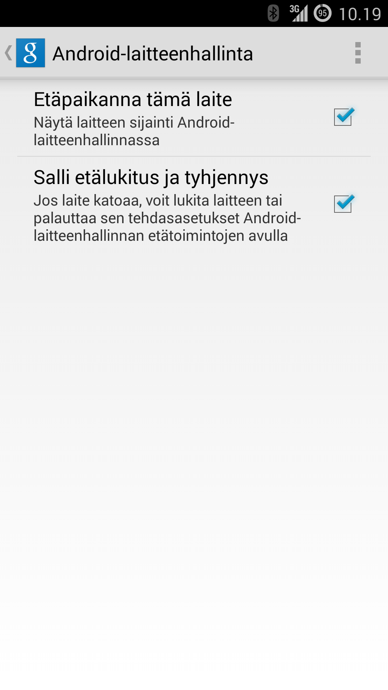

Joku aika sitten kuulin kun jollekkin tutulle oli myyty turha palvelu Android puhelimeen. Palvelua myytiin mm. argumentillä, että voit paikantaa puhelimen sitä kautta. Kadonneen Android puhelimen löytäminen onnistuukin ilmaiseksi Googlen omilla palveluilla.

[Android-laitteenhallinnan](https://www.google.com/android/devicemanager) kautta voit nimittäin paikantaa oman laitteesi kartalle sekä myös lukita ja tyhjentää sen. Ehkä usein käytetty ominaisuus on se, että voit soittaa laitteeseen tuota kautta. Tässä huushollissa on jonkun puhelin silloin tällöin kateissa.

Googlen sivuilla löytyykin [ohjeet](https://support.google.com/accounts/answer/3265955?p=android_device_manager&rd=1) siihen miten saat otettua tämän käyttöön. Alla vielä samat ohjeet:

1.  Avaa Google-asetukset laitteesi sovellusvalikosta.
2.  Valitse Android-laitteenhallinta.

Voit ottaa seuraavat valinnat käyttöön:

- Etäpaikanna tämä laite. Voit paikantaa laitteen ja nähdä sen likimääräisen sijainnin Google Mapsissa. Jos laitteen käyttöjärjestelmäversio on vähintään 4.1, myös sijainnin käyttöoikeuden on oltava käytössä. Voit ottaa sen käyttöön valitsemalla Google-asetukset \> Sijainti \> Sijainnin käyttöoikeus.
- Salli etälukitus ja tehdasasetusten palauttaminen. Voit lukita laitteen ja poistaa kaikki sen tiedot. Voit myös vaihtaa lukitusruudun tunnuskoodin. Kosketa tätä valintaa ja ota laitteen järjestelmänvalvoja käyttöön valitsemalla Ota käyttöön.

Jos tablet-laitteella on useita käyttäjiä, vain laitteen omistaja voi ottaa Android-laitteenhallinnan käyttöön.
