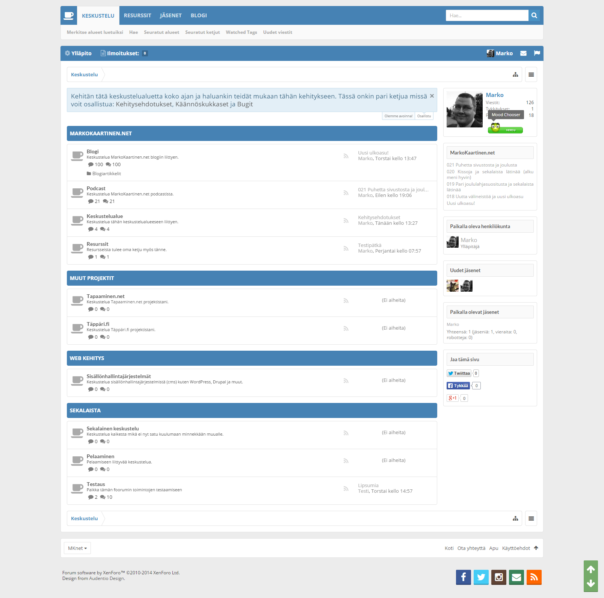

Aloitetaan [podcastissani](/2014/021-puhetta-sivustosta-ja-joulusta "021 Puhetta sivustosta ja joulusta") lupaamat uudistukset tällä keskustelualueen avaamisella. Oikealla on pieni kuva tästä alueesta ja kerronkin seuraavaksi hieman lisää tästä keskustelualueesta ja mitä kaikkea onkaan säädetty.

Ensinnäkin tuo on rakennettu maksullisen XenForon päälle. Minulla on pari lisenssiä tuohon ja laitoin toisen hyötykäyttöön tämän sivuston kautta. Tuossa lisenssissä on myös kiinni yksi resurssinhallinnan palikka ja tulenkin sinne laittamaan kivoja koodinpätkiä ja muuta mukavaa.

Perus XenForon lisäksi tuolla on kasa erilaisia lisäosia, joita olen halunnut koittaa tuolla ja tulen varmaan jokusta muutakin koittamaan. Lisäksi käännän hissukseen tuota sivustoa suomeksi sillä kunnollista käännöstä ei tunnu vielä tuolle olevan.

XenForossa on myös sisäänrakennettuna ominaisuus, että voi rss/xml syötteitä automaattisesti pistää menemään tuonne. Teinkin niin, että podcast -jaksot menee omalle alueelle ja muut blogiartikkelit menee omalle alueelleen. Samaten tein WordPressin puolelle skriptan, joka katsoo onko keskustelua blogiartikkelista ja laittaa sitten linkin näkyviin. XenForo katselee 30min välein syötettä ja heittää artikkelin sinne automaattisesti – helppoa ja vaivatonta.

Teemana on maksullinen teema, jota olen hieman puukotellut ja muokannut css muutenkin. XenForossa on muuten loistavat työkalut tuohonkin ja suht pienellä vaivalla saa puukoteltua tuota teemaa ja muutenkin noita palikoita haluamakseen. Jokusen tempun tulen vielä tekemään teemalle ja säätämään sitä lisää.

Ajatuksena on luoda tuonne omille projekteilleni omat alueet ja saada tuo jollain tavalla aktiiviseksi. Podcastiin liittyvä keskustelu tulee myös keskittymään sinne ja tulen siellä julkaisemaan mm. nauhoituspäiviä/-ajankohtia sekä ideoita sekä ynnä muuta vastaavaa roipetta podcastiin liittyen. Tietysti yhtenä ideana on käyttää tuota eräänlaisena testipenkkinä ja paikkana testata tuon XenForon toimivuutta. Yksi lisenssi nimittäin löytyy vielä

Kehitysehdotukset, käännöskukkaset ja bugit keskustelualueeseen liittyen voipi heitellä sinne liittyvälle [alueelle](/avainsana/keskustelu) tai sitten tämän postauksen kommenttiboxiin.

Niin ja keskustelualueelle pääsee joko [tästä](/avainsana/keskustelu) tai sitten valikosta ylhäältä!
