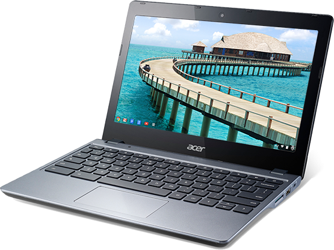
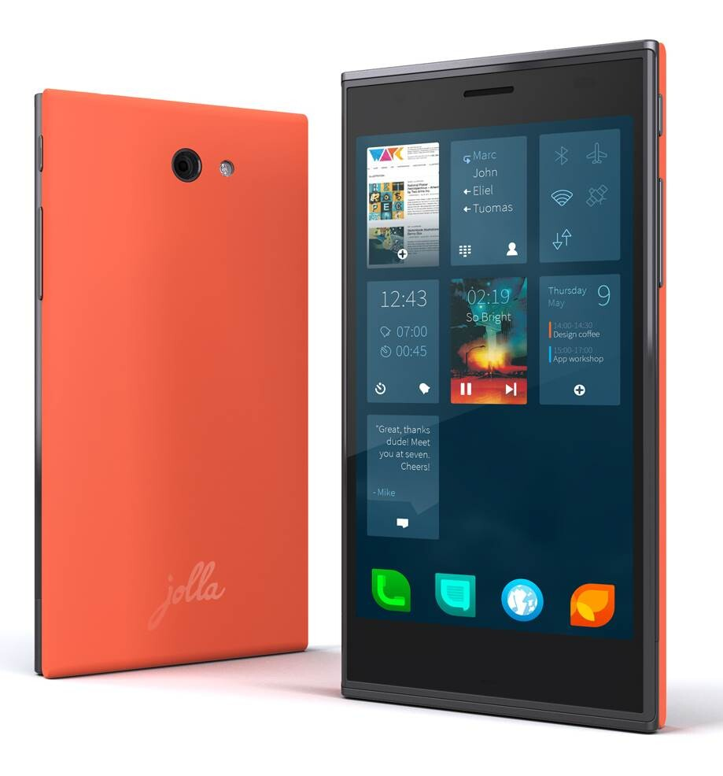
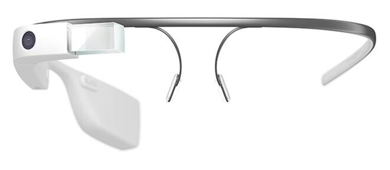
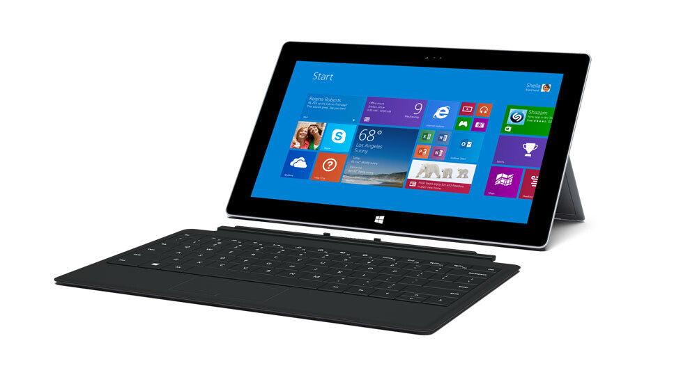

En nyt puhu pikatestistä, tahtoisin testata näitä kirjoituksessa mainittuja vempaimia esim. parin viikon ajanjakson verran. Tässä ajassa näkisin miten ne sopisivat omaan elämääni ja saisin kattavan kuvan tuotteesta. Olen ollut siitä onnekas, että olen saanut testata erinäköisiä vempeleita ja tästä olenkin äärimmäisen kiitollinen.

### Chromebook

Aloitetaan kannettavalla tietokoneella. Chromebookhan on Googlen tuotos jossa sisällä hyrrää ChromeOS. Sovellukset ovat pääosin Chromen sovelluksia, joten tämäkin toisi oman haasteensa.

Erityisesti tässä kannettavassa kiinnostaa tuo konsepti. Todella hyvän hintainen kannettava nettikäyttöön, mutta pystyisikö se muuhunkin? Saisinko koodattua sillä webbiä? Saisinko sillä tehtyä töitä?

Olen näitä käpistellyt liikkeissä, mutta en ole vielä kotiin tämmöistä kantanut. Testisessio voisikin paljastaa tästä koneesta sen, kävisikö se minulle? Kova vastus sillä ainakin olisi – nimittäin oma MacBook Pro. MBP:llä on tosin ikää jo jokunen vuosi ja se ei ole enää terävimmästä päästä (unelmissa olisikin uusi MBP tai ehkä MBA).

### Jolla

Harmittaa muuten edelleen aivan hillittömästi etten aikoinaan lähtenyt mukaan tämän ekaan tilauskamppikseen. Noh tehty mikä tehty ja ei Jollaa ole vieläkään taloudessa vaikka monesti olen sitä DNA:n liikkeessä käynytkin ihmettelemässä.

Hankin aikoinaan iPhone 3G:n kun se Suomeen tuli ja Jollassa on samaa uutuudenviehätystä, kuin iPhonessa aikoinaan. Tämä ja täysin erilainen puhelin olisikin se syy miksi tahtoisin ottaa Jollan edes pariksi viikoksi omaan päivittäiseen käyttöön.

Myös The Other Half vaikuttaa kiinnostavalta osalta puhelinta vaikka sen käyttötarkoitukset on vielä oikeastaan tulossa – yhteisö kehittää ja säätää (hienoa!). Itse Sailfish kiinnostaisi kuitenkin käyttiksen puolesta ja eihän tosta saa kunnon kuvaa pelkällä liikkeessä käpistelyllä.

Tuli Jolla omaan talouteen tai ei niin silti on mielenkiintoista seurata miten Jolla lähtee kehittymään ja millainen on esimerkiksi Jolla 2.

### Google Glass

Se jokapäiväinen stalkkaaja, Google Glass. Tästä ei taida vieläkään olla kuluttajaversiota ulkona ja Explorer versiota taidetaan survoa vain jenkkeihin 1500 dollarin hintaan – kallis betavempain.

Silti, tämä kiinnostaa – paljon. Kiinnostusta lisää se, että tämän vekottimen tulee jossain välissä saamaan kiinni vahvuuksilla oleviin laseihin tai no taitaa ne jo saadakin? Itsehän käytän laseja joten tämä olisi kanssa todella vänkä vempain testattavaksi.

Näissä kiehtoo erityisesti tuo tiedon tuominen naaman eteen ja se, että data on koko ajan näkösällä. Konsepti on kerrassaan jännittävä ja piru kun olisi siistiä saada nämä kokeiluun.

### Surface Pro 2

Tätä ette ehkä odottanutkaan. Microsoftin vastine tablet markkinoille – Surface. Itseä on kiinnostanut tämä Pro malli jo ekasta Surfacesta lähtien sillä se on suunniteltu tehokäyttöön.

Surface Pro 2 olisi siis tällä hetkellä todella mielenkiintoinen laite testattavaksi – ainut ongelma siinä on sen hillittömän korkea hinta. Olen Digiexpoilla ihmetellyt Windows pohjaisia tabletteja, mutta syvempi testaaminen on päässyt jäämään pois.

Tässä kiinnostaisi juurikin tämä Windows puoli ja tuo näppäimistö – tämä voisi hyvinkin korvata työkoneen viran. Riippuu hieman siitä miten saa webbiä koodailtua tuolla – en ole tutkinut tuota puolta ollenkaan (vielä).
