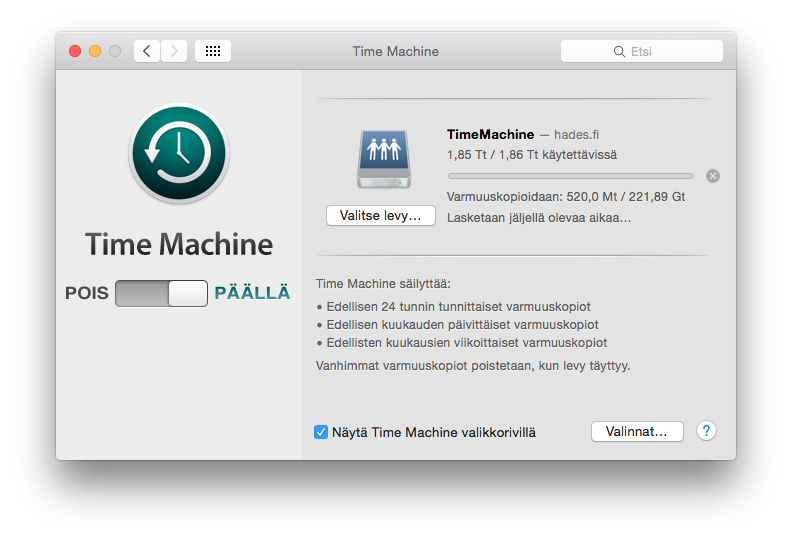

OS X tarjoaa erittäin toimivan varmuuskopioinnin jos suoraan. Itse olen käyttänyt tähän asti ulkoista kiintolevyä varmuuskopiointiin Time Machinella. Eilen tuli kuitenkin mieleen, että miksi en käyttäisi toimiston nurkassa olevaa Ubuntu pohjaista palvelinta hyödyksi ja laittaisi sinne varmuuskopiot menemään? Löysinkin nopeasti [ohjeen](https://www.64bit.co.uk/ubuntu-as-a-osx-time-machine/) minkä suomennankin teille tässä niiltä osin mitä itse tarvitsi tehdä.

Tätä operaatiota varten tarvitset Ubuntu palvelimen, jossa on kiintolevytilaa varmuuskopioita varten (itsellä vapaana 1.7 teratavua) sekä tietysti sen OS X tietokoneen eli mäkin.

1.  Asennetaan ensin tarvittavat paketit:

    ```sh
    sudo apt-get install netatalk avahi-daemon
    ```
2.  Tämän jälkeen luodaan asetustiedosto joka avautuu nano nimisessä ohjelmassa:

    ```sh
    sudo nano /etc/avahi/services/afpd.service
    ```
3.  Liität alla olevan rimpsun tiedostoon ja tallennat sen (*ctrl+o* tallentaa nanossa ja *ctrl+x* sulkee):

    ```xml
    <?xml version="1.0" standalone='no'?><!--*-nxml-*-->
    <!DOCTYPE service-group SYSTEM "avahi-service.dtd">
    <service-group>
    <name replace-wildcards="yes">%h</name>
    <service>
    <type>_afpovertcp._tcp</type>
    <port>548</port>
    </service>
    </service-group>
    ```
4.  Tämän jälkeen luodaan toinen tiedosto nanolla:

    ```sh
    sudo nano /etc/avahi/services/deviceinfo.service
    ```
5.  Tähän tiedostoon laitetaan alla oleva sisältö ja tallennetaan se:

    ```xml
    <?xml version="1.0" standalone='no'?><!--*-nxml-*-->
    <!DOCTYPE service-group SYSTEM "avahi-service.dtd">
    <service-group>
    <name replace-wildcards="yes">%h</name>
    <service>
    <type>_device-info._tcp</type>
    <port>548</port>
    <txt-record>model=Xserve</txt-record>
    </service>
    </service-group>
    ```
6.  Käynnistetään palvelut:

    ```sh
    sudo /etc/init.d/netatalk restart
    sudo /etc/init.d/avahi-daemon restart
    ```
7.  Luodaan kansio sekä käyttäjä Time Machinea varten

    ```sh
    sudo mkdir -p /data/osx/timemachine
    sudo useradd -c "Time Machine User" -d /data/osx/timemachine/ -s /bin/false -g 10 timemachine
    sudo passwd timemachine
    ```
8.  Kerrotaan kansiolle, että se tukee Time Machinea:

    ```sh
    sudo touch /data/osx/timemachine/.com.apple.timemachine.supported
    ```
9.  Oikeuksia kansiolle:

    ```sh
    sudo chown -R timemachine:users /data/osx/timemachine
    ```
10. Avataan tiedosto nanolla:

    ```sh
    sudo nano /etc/netatalk/AppleVolumes.default
    ```
11. Laitetaan tiedostoon seuraava rivi ennen *\# End of file* -tekstiä

    ```
    /data/osx/timemachine TimeMachine allow:timemachine options:tm
    ```
12. Oletus kotijaot pois:

    ```
    sed -i 's/^~/#~/' /etc/netatalk/AppleVolumes.default
    ```
13. Selvitä oman Ubuntu palvelimesi MAC osoite ja ota se talteen:

    ```sh
    ifconfig -a | grep HWaddr
    ```
14. Luodaan tiedosto nanolla:

    ```sh
    sudo nano /etc/avahi/services/adisk.service
    ```
15. Laita seuraava rimpsu tiedostoon (älä tallenna vielä):

    ```xml
    <?xml version="1.0" standalone='no'?>
    <!DOCTYPE service-group SYSTEM "avahi-service.dtd">
    <service-group>
    <name replace-wildcards="yes">%h</name>
    <service>
    <type>_adisk._tcp</type>
    <port>9</port>
    sys=waMA=nnnnnn,adVF=0x100
    <txt-record>dk0=adVF=0xa1,adVN=TimeMachine,adVU=xxxxxxxx</txt-record>
    <txt-record>dk1=adVN=media,adVU=yyyyyyyyyy</txt-record>
    <txt-record>dk2=adVN=software,adVU=zzzzzzzzz</txt-record>
    </service>
    </service-group>
    ```
16. Korvaa rimpsusta *nnnnnn* kohta omalla MAC osoitteellasi.
17. Korvaa rimpsusta kohdat *xxxxxxxx*, *yyyyyyyyyy* ja *zzzzzzzzz* uniikeilla UUID:llä. Voit luoda kolme kappaletta UUID:tä osoitteessa http://www.guidgen.com/
18. Tämän jälkeen tallenna tiedosto *ctrl+o* yhdistelmällä ja sulke *ctrl+x* yhdistelmällä.
19. Käynnistetään palvelut uudestaan:

    ```sh
    sudo /etc/init.d/netatalk restart
    sudo /etc/init.d/avahi-daemon restart
    ```
20. Lisää palvelin oman mäkkisi finderissa ja tallenna salasana\
    `Siirry -> Yhdistä palvelimelle`
21. Lisää palvelin Time Machinen asetuksissa

Näiden jälkeen itselläni oli homma valmis ja Time Machine alkoi tekemään varmuuskopiota tuonne palvelimelle.


