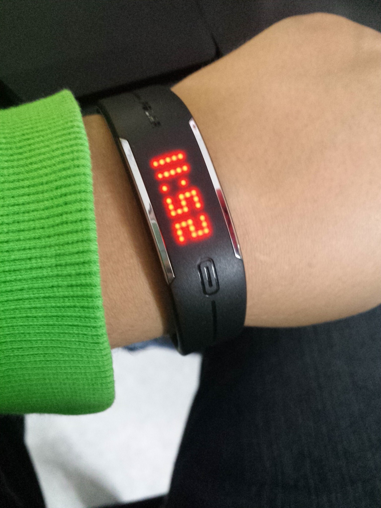

Sain tiistaina testattavaksi Polar Loop aktiivisuusrannekkeen. Tänne blogiin tulee tämmöinen ensikokemus kirjoitus tästä, mutta tulen kirjoittamaan kattavamman arvion [Pieni päätös päivässä](http://www.pienipaatospaivassa.fi/) -blogiin. Looppi on tosiaan ranneke joka tulee omaan ranteeseen kiinni ja se seuraa siinä sinun aktiivisuuttasi.

Onhan tässä tietysti kello ja tuo yksi hipaisunappikin, jota näppäsemällä saat tuon kellon näkyviin. Näet myös tuosta näytöltä aktiivisuuden, kulutetut kalorit ja kävellyt askeleet. Voit samaten asettaa laitteen lentokonetilaan, siinä oikeastaan kaikki mitä itse rannekkeella voit tehdä.

Rannekkeen asetusten säätäminen ja tulosten tarkempi seuraus tapahtuu sitten tietokoneella tai puhelimella. Tällä hetkellä Polar Flow sovellus on vain iPhonelle, joten Android omistajat joutuvat käyttämään mukana tulevaa kaapeli synkkaamiseen sekä lataamiseen.

Näin alle viikon kokemusten perusteella Polar Loop tekee sen mitä lupaa ja tekee sen ihan hyvin. Se seuraa askelia ja aktiivisuutta muutenkin. iPhoneen saisi muistutuksia omasta aktiivittomuudestaan ja näenkin ne aina kun synkkaan laitteen kaapista kaivetun iPhonen kautta. Käytän kuitnekin Android puhelinta ja Polarilla ei vielä appsia ole Loopin käyttöön sille. Täyttä hyötyä en siis saa Loopista irti sillä iPhone ei ole oma pääpuhelin.

Itse laitteesta näet kuitenkin edellä mainittujen asioiden lisäksi (aika, kalorit, askeleet, aktiivisuus) kivan palkin missä näkyy oma aktiivisuus ja tämän jälkeen näet mitenkä paljon pitäisi vielä liikkua jotta päästään päivittäiseen tavoitteeseen. Samaten jos sinulla on yhteensopiva sykevyö (H6 tai H7) niin saat oman sykkeesi näkyville ja tallentaapa se infot harjoituksestakin.

Untakin se seuraa ja näyttää sitten paljonko olet nukkunut ja miten paljon oli rauhallista unta ja miten paljon sitten levotonta. On nuo suhteellisen hyvin pitänyt kutinsa ainakin sen perusteella miltä itsestä on yö tuntunut. Tämänkin tiedon saat kun olet synkannut Loopin joko puhelimen tai tietokoneen kanssa.

Tarkat tiedot Polar Loopista voit käväistä lukemassa Polarin [tuotesivuilta](http://www.polarloop.com/fi/). Kysymyksiä/kommentteja voitte tuttuun tapaah heitellä tuonne alas kommenttiboksiin tai vaikka [Twitteriin](https://twitter.com/MarkoK).

*Kiitos vielä Polarille laitteen toimittamisesta testattavakseni!*
