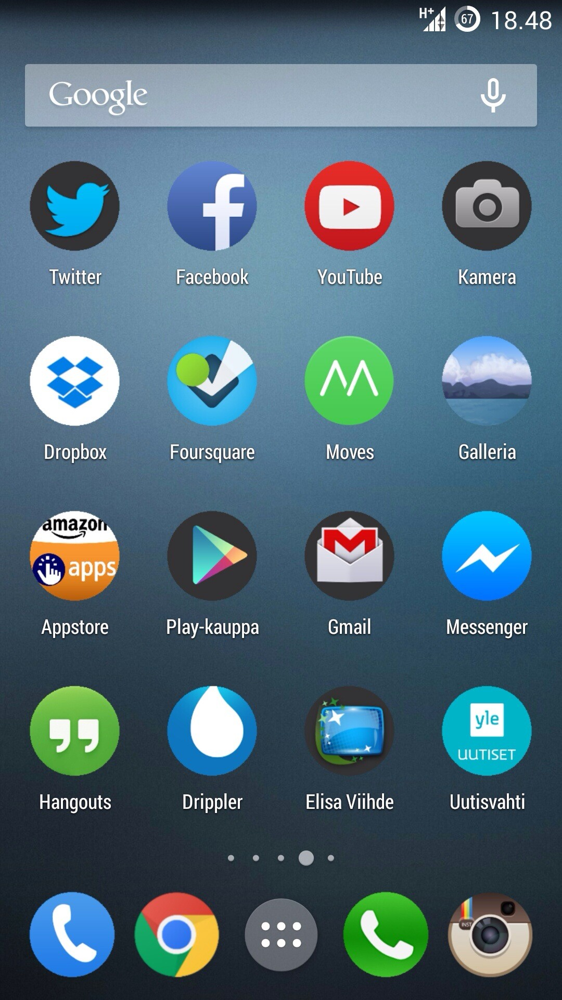

Jo ennen kuin laitoin [Cyanogenmodin](/2014/cyanogenmod-saapui-samsung-galaxy-s4-puhelimeeni) omaan puhelimeen olin pyöritellyt Nova Launcheria ja custom ikoneita puhelimessani. Nyt en enää löytänytkään mieleisiä ikoneita sillä Androidin oletukset ovat ihmeellinen ”sekametelisoppa”. Halusin yhtenäist ikonit ja vieläpä pyöreät. Näin syntyi ensimmäiset versiot Roundie ikoneista.

Aloin sitten googlaamaan miten tämä voisi onnistua ja päädyin aukaisemaan Androidin devaus työkalut (ADT) ja tekasin testiksi pari ikonia. Eilen ikoneita on tehtynä reilu 20 kappaletta. Tuossa kuvassa onkin näkyvillä kasa ikoneita ja niistä näkee mitä olen lähtenyt hakemaan. Ikonit ovat siis samanlaisia kuin alkuperäiset mutta pyöreitä.

Halusin tämän ohella testata Play Storen alphatestaus settiä ja laitoinkin tämän jo Play Storeen, vielä se ei vain näy siellä – enkä muuten tiedä tuleeko se näkyviin muille kuin testaajille.

Olen itse tuota testaillut vain Cyanohenmodin Trebuchet launcherilla joten en tiedä tarkalleen mitkä kaikki launcherit tuota pakettia tukevat. Tulen kuitenkin testaamaan tuota ainakin niillä launchereilla mitä omistan eli Nova Launcher ja Action Launcher Pro.

Tulen tämä kuitenkin julkaisemaan ilmaisena Play Storeen ja jos tämä jostain syystä menee muiden kuin minun kännykkään niin sitten ehkä Pro versiomainen julkaisu joka saisi ensin ikonit ja ilmaisversio saisi sitten hieman hitaammin niitä. Taikka sitten ihan joku lahjoitus hässäkkä – mene ja tiedä.

Loin Roundielle oman [Google Plus yhteisön](https://plus.google.com/communities/109778937336823875985), koska näin sain määritettyä kaikki yhteisön jäsenet Alpha/Beta testaajiksi. Eli tuon yhteisön jäsenet voivat automaattisesti alkaa testaamaan noita ikoneita vaikka itse sovellus ei muuten Play Storesta löydykään.

Tämäkin projekti on näitä kokeiluja ja tämän kautta opin taas Play Storesta hieman lisää ja varsinkin siitä kehittäjäpuolesta. Kommentit/ideat/ajatukset/kysymykset ovat tervetulleita!
