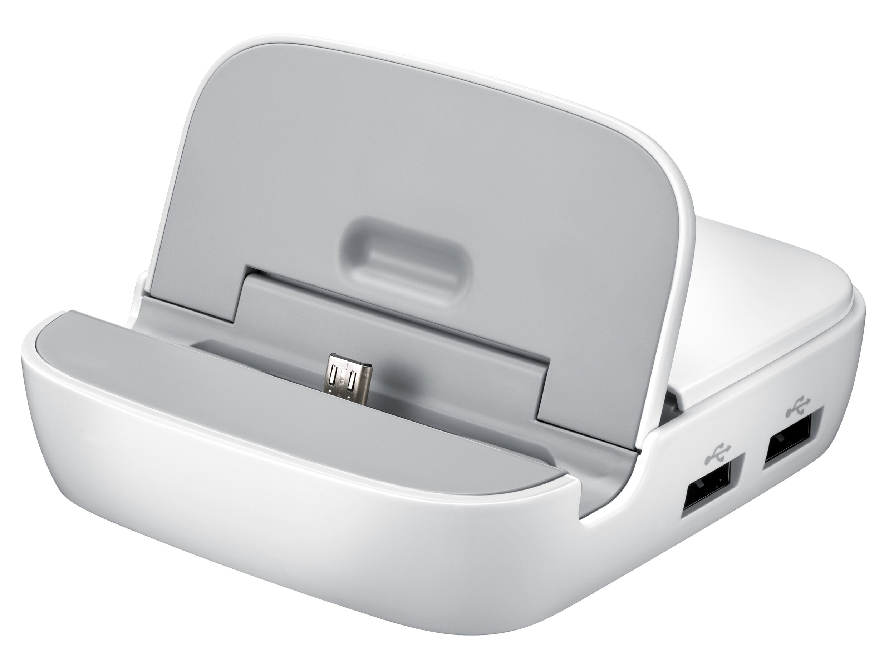
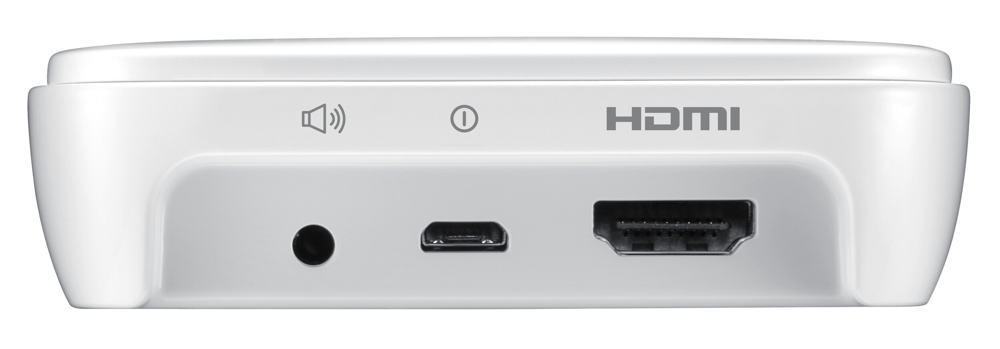
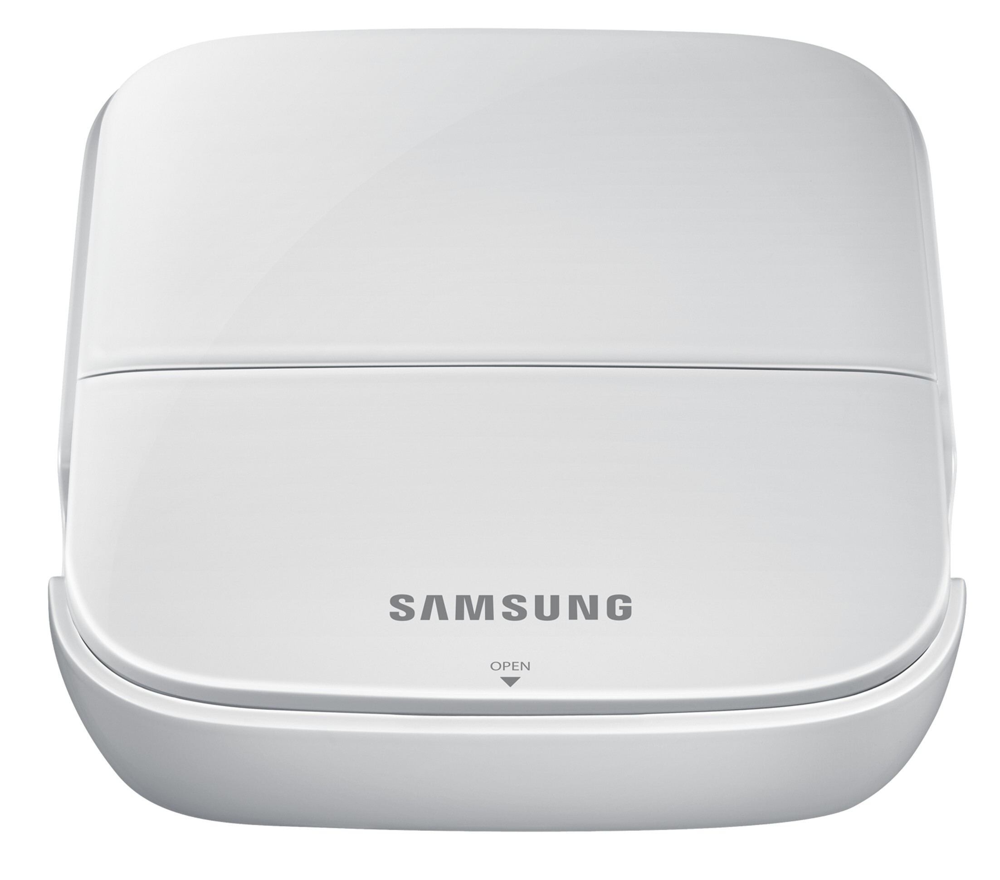

Sain [MobileFunilta](http://mobilefun.fi/36945-samsung-galaxy-s4-s3-note-2-3-smart-dock---edd-s20eweg.htm) testattavaksi Samsung Smart Dock -telakan. Telakka on oikeastaan ainut asia mikä (tällä hetkellä) uupuu puhelimen lisävarusteistani. Olin tykästynyt iPhone aikoinani puhelimen pitämiseen telakassa yöpöydällä ja nyt, kun tilaisuus tuli niin sain semmoisen testattavaksi.

Telakka on yhteensopiva Samsungin Galaxy S4/S3 ja Note 2/3 puhelinten kanssa. Kyseessä, kun on virallinen Samsungin telakka niin muiden puhelinten yhteensopivuudesta ei puhuta, mutta uskoisin muidenkin mallien käyvän tähän. Liitin onkin se jännin osa sillä siihen saat puhelimen joiden kuorienkin kanssa. Se nimittäin hieman ns. ”vääntyy” ja painautuu alaspäin, jolloin siihen saa paremmin puhelimen kuorien kanssa.

Telakassa on itse puhelimen Micro USB liittimen lisäksi kolme USB  porttia, joihin voit laittaa esimerkiksi näppäimistön tai USB tikun. Takaa löytyy myös 3.5mm liitin, jolla saat liitettyä telakan esimerkiksi kaiuttimiin. Takana on myös Micro USB portti johon tulee laturin piuha, sekä takaa löytyy HDMI liitin, jolla saat yhdistettyä puhelimen esimerkiksi näyttöön tai televisioon.

Telakan mukana tuli myös Samsungin alkuperäinen laturi ja Micro USB johto. Itse telakka on hyvin näppärän kokoinen ja sen saat simppelisti otettua mukaan, koska telakan kannen saa kiinni ja näin sen saa hieman kompaktimmin kantoon.

Kokeilin tuota telakan HDMI porttia ja telkkarin ruutuun pamahti oma Samsungin ruutu ilman mitään ylimääräistä säätöä. Ainut ongelma oli tietty se, että telakassa puhelin on pysty asennossa ja koitin esim. YouTubea katsoa niin TV:ssäkin oli näyttö pystyasennossa eli sivuilla mustat raidat. Tämän ratkaisin kuitenkin [Rotation Lock Adaptive](https://play.google.com/store/apps/details?id=ui.robot.rotate) sovelluksella, jolla pakotin näytön vaakatasoon. Tämän jälkeen YouTube videokin näkyi paremmin kun oli vaakakuvana – äänetkin kuuluivat oikein telkkarista.

Tämähän toimisi pienenä pelikoneena kun Androidille saa esim. emulaattoreita ja muitakin loistavia Android pelejä. Vielä kun olisi passeli ohjain tuohon tarkoitukseen niin voisi pelailla sillä noita emulaattoreita ja esim. jotain FPS pelejä joita ei oikein hyvä ole kosketusnäytöllä pelata (esim. [Shadowgun](https://play.google.com/store/apps/details?id=com.madfingergames.shadowgun) voisi olla tämmönen tai joku ajopelikin?).

Kannattaa katsastaa tuo alla oleva video tuosta telakasta, tässä katsellaan hieman telakkaa.



Kiitoksia vielä MobileFunille telakan lähettämisestä ja katso tarkempia tietoja telakasta vielä heidän [sivuiltaan](http://mobilefun.fi/36945-samsung-galaxy-s4-s3-note-2-3-smart-dock---edd-s20eweg.htm).
