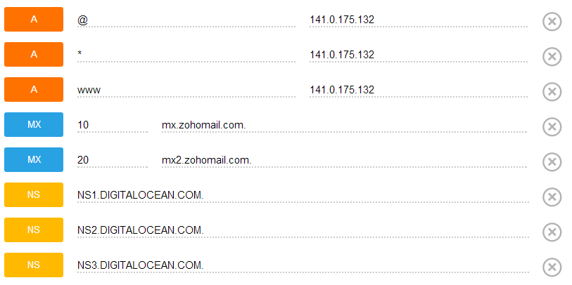

Kuten tiedätte niin tämä sivusto on virtuaalipalvelimen päällä. Palvelimen resurssien takia en itse halua hostata sähköpostipalvelinta samalla palvelimella. Ennen ohjailin Google Appsin puolelle, mutta ne kun muuttivat sen hyvän aikaa sitten pelkästään maksulliseksi niin kaikilla domaineilla ei ole ollut sähköpostia ollenkaan. Nyt halusin kuitenkin tehdä mie@markokaartinen.net sähköpostin ja näin piti sitten joku ratkaisu keksiä.

Päädyin siihen, että mie@markokaartinen.net sähköposti menee Zoho Mailiin ja sieltä se ohjautuu sitten minun Gmailiin joka on pääosoitteeni. Halutessani voin käyttää myös Zoho Mailia ja tuota mie@markokaartinen.net osoitetta.

[Zoho.com/mail](https://www.zoho.com/mail/) osoitteessa voit tehdä aluksi 30 päivän kokeilun ilmaiseksi ja tehdä säätöjä yhtä domainia varten. Itselläni oli ajatuksena tuonne pistää useita domaineja ja yhteen mailiboxiin tehdä aliaksia ja sitä kautta ohjata Gmailiini tavaraa. Näin saan osoite@domain.fi sähköposteja tehtyä yhteen mailiboxiin niin paljon kuin haluan ja tuo 2.5 dollaria per kuukausi hinta ei näin ole ollenkaan paha kun on vain yksi käyttäjä ja monta aliasta. Gmailin puolella sitten Gmailin omilla suodattimilla saan ne automaattisisti haluamiini kansioihin.

Kun tein tuon kokeilun ja loin tunnukset. Lisäsin sinne tämän markokaartinen.net domainin ja tämä oli oikeastaan sieltä päästä selvä. Loin sinne pääsähköpostiksi admin@markokaartinen.net osoitteen ja sille aliaksen mie@markokaartinen.net. Asetuksista laitoin vielä ohjauksen omaan Gmail osoitteeseeni.

Tämä oli se helpoin osuus. Nyt voi mennä joillekkin vaikeaksi, mutta käyttämässäni Digitaloceanissa on hyvä DNS:n hallinta joten homma on siellä helppo. Tarvitaan nimittäin muuttaa domainin MX-tietueet ohjaamaan Zoho Mailiin. Oikealla olevassa kuvassa onkin omat DNS asetukseni markokaartinen.net domainille. Lisäsin siis kaksi MX-tietuetta ja näiden avulla sähköpostiliikenne markokaartinen.net domainilla menee Zoho Mailiin ja muu liikenne tulee suoraan tuolle virtuaalipalvelimelle.

Tämä ei tietysti ole vain Digitaloceanin tai virtuaalipalvelimen käytössä, voit ohjata minkä tahansa domainin MX-tietueet Zoho Mailiin mikäli voit hallita MX-tietueita.

*Hanki Digitalocean VPS [tämän linkin](https://www.digitalocean.com/?refcode=34aebd17275a) kautta niin autat hieman minua.*
